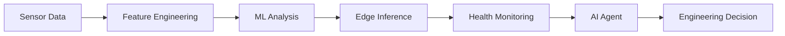
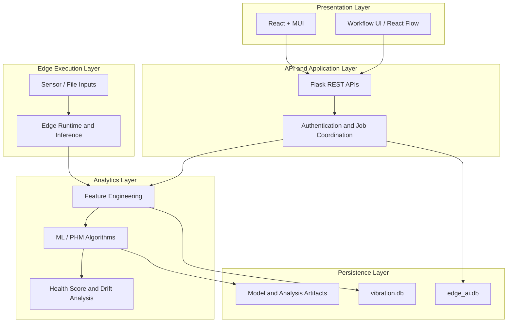
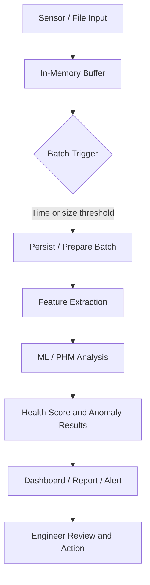
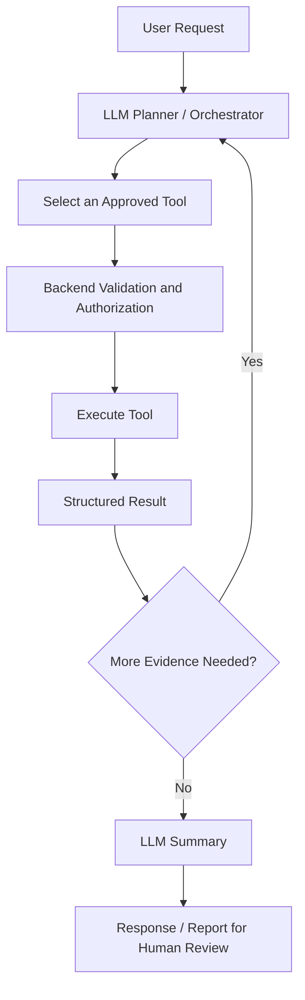
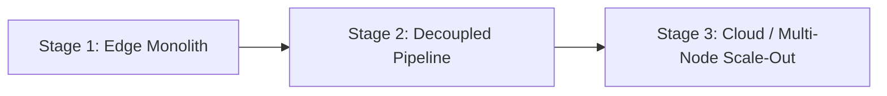

Building an Edge AI platform is not just about deploying a machine-learning model close to a machine. In a semiconductor manufacturing environment, the platform must connect sensor data, feature engineering, model inference, health monitoring, user workflows, and maintenance decisions into a system that can be operated and maintained reliably.

This article introduces an Edge AI / Prognostics and Health Management (PHM) platform from a system-design perspective. It covers the architecture, data flow, analytical methods, backend implementation, AI-agent integration, deployment, failure handling, and the trade-offs behind the design.

The emphasis is on how the components work together — not simply on listing technologies.

## 1. Project Overview

The platform is designed to turn equipment signals into information that engineers can use to investigate equipment health and plan maintenance. Its main workflow can be summarized as:

At a high level, the platform provides four capabilities:

| Capability | Purpose |
| --- | --- |
| Sensor-data processing | Collect, organize, and transform equipment signals into usable data |
| Feature engineering and ML | Extract signal characteristics, identify unusual patterns, and support health assessment |
| Health monitoring | Track health scores, historical changes, and potential abnormal conditions |
| AI-assisted workflows | Retrieve relevant data, summarize findings, and help engineers investigate the next step |

The AI agent is an assistance layer, not an autonomous replacement for engineering judgment. Decisions that can affect production equipment should remain subject to appropriate validation and human oversight.

## 2. Why Edge AI?

A model is only one part of a production system. The surrounding data path, deployment process, integration points, and operational controls often determine whether an AI solution is useful in practice.

### 2.1 Common engineering challenges

**Integration complexity.** Data acquisition, preprocessing, model execution, APIs, dashboards, and alerts may be implemented by different components. Without clear interfaces, even a small change can require updates across multiple modules.

**Data lineage.** Engineers need to understand where a feature or score came from, which source data was used, and which model or configuration produced the result. Without traceability, it is difficult to reproduce an analysis or compare results over time.

**Deployment latency.** A solution that works in a development environment can still be difficult to package, configure, install, and update consistently at an equipment site.

### 2.2 The intended improvement

The platform aims to standardize the path from data ingestion to operational use.

| Engineering area | Intended outcome |
| --- | --- |
| Deployment | Reduce the effort required to package and release a platform update |
| Integration | Reuse common interfaces instead of repeatedly writing project-specific integration code |
| Data lineage | Make analysis inputs, outputs, and model versions easier to trace |
| Maintenance workflow | Present data and analysis in a form that supports investigation and follow-up |

The project materials include illustrative figures such as a deployment cycle reduced from 28 days to 1 day, an 85% reduction in integration code, and 100% synchronization of data lineage within the measured scope. These numbers should be published as verified results only if their definitions, measurement periods, and comparison baselines can be documented. Otherwise, label them as internal estimates or targets.

## 3. System Architecture

The platform can be understood as five cooperating layers: presentation, API services, analytics, edge execution, and persistence.

### 3.1 Presentation layer

The web interface uses React and Material UI (MUI) to present equipment information, analysis results, and operational workflows. React Flow can be used to represent workflows or agent execution paths visually.

The frontend should focus on user interaction and presentation. It should not become the source of truth for model execution, access control, or data integrity.

### 3.2 API and application layer

The Flask backend exposes REST APIs and coordinates application-level operations, such as authentication, analysis requests, data retrieval, and report generation.

Keeping these responsibilities behind a stable API allows the frontend, analysis modules, and edge processes to evolve without requiring every component to know the implementation details of the others.

### 3.3 Analytics layer

This layer contains signal processing, feature extraction, anomaly detection, health scoring, and data-drift analysis. It should expose well-defined inputs and outputs so that algorithms can be tested independently from the web application.

### 3.4 Edge execution layer

The edge runtime handles local execution and interaction with the available sensor-data sources. Local processing can reduce dependence on continuous network connectivity and avoid sending every high-frequency raw sample to a central service.

The exact division between local and centralized processing depends on latency, compute resources, network reliability, data volume, and deployment constraints.

### 3.5 Persistence layer

The current design uses SQLite databases for application and vibration-related data, along with files for model or analysis artifacts. This is a pragmatic starting point for a local or single-node deployment, but it introduces concurrency and lifecycle considerations as workload grows.

## 4. End-to-End Data Flow

A typical processing path consists of ingestion, buffering, persistence, feature extraction, model analysis, health assessment, and follow-up action.

### 4.1 Buffering and batching

A bounded Python `deque`, for example `deque(maxlen=5000)`, can be used to hold recent samples before processing. A batch may be triggered by a time interval (for example, approximately five seconds) or a record-count threshold (for example, 500 records), depending on the implementation.

A bounded deque automatically discards the oldest entries when it reaches capacity. It is therefore a useful short-term buffer, but it is **not** a durable message queue. If samples must survive process crashes or temporary downstream failures, the system needs an explicit persistence and replay strategy.

### 4.2 Feature extraction and analysis

The batch is transformed into signal features and passed to the relevant analytical methods. The output may include feature values, anomaly indicators, a health score, and supporting metadata.

### 4.3 Results and action

The platform presents results through dashboards, reports, or alerts. The purpose is not merely to generate a score; it is to give engineers enough context to inspect the evidence, understand the potential issue, and decide what to do next.

## 5. Machine Learning and PHM Methods

PHM systems combine domain knowledge, signal processing, statistical analysis, and machine learning. No single algorithm can reliably answer every equipment-health question.

### 5.1 Signal features

Common time-domain features include:

- **RMS (root mean square):** summarizes signal magnitude and is often used to monitor vibration energy.
- **Peak:** captures the largest absolute amplitude in a window.
- **Kurtosis:** describes aspects of a distribution's tail behavior and can help identify impulsive signals. Its interpretation depends on the data distribution and implementation.
- **FFT (Fast Fourier Transform):** transforms a time-domain signal into frequency-domain components, helping reveal dominant frequencies and changes in spectral structure.

For a signal \(x = [x_1, x_2, \ldots, x_N]\), RMS is defined as:

$$
\mathrm{RMS} = \sqrt{\frac{1}{N}\sum_{i=1}^{N} x_i^2}
$$

Feature definitions, window sizes, sampling rates, units, and preprocessing should be consistent. Otherwise, apparent changes may come from the pipeline rather than the equipment.

### 5.2 One-Class SVM for anomaly detection

One-Class Support Vector Machine (One-Class SVM) can learn the boundary of data considered normal and flag observations that fall outside that boundary. It is useful when labeled fault examples are limited.

Important considerations include:

- Fit the model on a representative baseline of normal operation.
- Scale features consistently.
- Tune parameters such as `nu` and `gamma` using validation data and operational feedback.
- Monitor false positives and false negatives; an anomaly score is not automatically a diagnosis.
- Revisit the baseline when operating conditions or equipment configurations change.

### 5.3 Dynamic Time Warping (DTW)

Dynamic Time Warping measures similarity between sequences that may differ in timing or duration. It can be useful when comparing signal patterns whose important events do not occur at exactly the same time.

A DTW implementation uses a cumulative-cost matrix. A typical recurrence is:

$$
D(i,j) = d(x_i,y_j) + \min\left\{ D(i-1,j),\; D(i,j-1),\; D(i-1,j-1) \right\}
$$

where \(d(x_i,y_j)\) is the local distance between two points. Constraints such as a warping window can reduce computation and prevent implausible alignments. DTW is not a universal anomaly detector; its usefulness depends on the selected reference sequences, distance function, normalization, and domain.

### 5.4 PCA for data-drift monitoring

Principal Component Analysis (PCA) projects correlated features into a lower-dimensional space. Comparing current data with a reference baseline can help identify distribution changes.

A drift signal does not necessarily mean equipment failure. It may also reflect a changed recipe, sensor replacement, a different operating regime, or a preprocessing change. Drift should trigger investigation and contextual checks rather than an automatic conclusion.

### 5.5 Choosing the method

| Method | Primary purpose | Key limitation |
| --- | --- | --- |
| RMS / Peak / Kurtosis | Summarize time-domain signal characteristics | Can be sensitive to windowing, noise, and operating conditions |
| FFT | Identify spectral components and frequency changes | Requires appropriate sampling and interpretation |
| One-Class SVM | Detect deviations from a learned normal-data boundary | Depends on baseline quality and parameter selection |
| DTW | Compare sequences with temporal misalignment | Can be computationally expensive and reference-dependent |
| PCA | Monitor multivariate structure and potential drift | Drift is not equivalent to failure |

A robust PHM workflow combines these methods with engineering context, historical evidence, and validation.

## 6. Backend Design

### 6.1 Flask application structure

Flask Blueprints can separate API areas by responsibility — for example, authentication, equipment data, analysis, reports, and agent operations. This makes the application easier to test and maintain than a single large route module.

The backend should validate request parameters, enforce authorization, handle errors consistently, and return predictable response formats. Long-running analysis should be treated differently from short synchronous API requests.

### 6.2 Authentication and authorization

The platform uses LDAP / Active Directory integration for organizational identity and JWTs for authenticated requests, according to the implementation design.

These mechanisms serve different purposes: directory authentication verifies a user's identity, while a token can carry authenticated-session claims to subsequent API calls. Authorization still needs to be checked for each protected operation. Tokens should have appropriate expiry and signing configuration, and secrets must not be hard-coded into source code or container images.

### 6.3 SQLite and data separation

The design separates application data and vibration data into two SQLite databases, such as:

- `edge_ai.db` — application records, configuration, and workflow-related information.
- `vibration.db` — vibration-related data and analysis inputs.

SQLAlchemy can manage database interactions, and SQLite's `ATTACH DATABASE` feature can support selected cross-database queries. However, separate database files do not remove all consistency or concurrency concerns. Cross-database operations, transaction boundaries, backups, schema migrations, and recovery procedures need explicit testing.

SQLite is suitable for many local deployments. If concurrent writes or multi-node access become substantial, a client-server database such as PostgreSQL may be a more appropriate next step.

### 6.4 Scheduled tasks and model history

APScheduler can run periodic jobs such as drift checks, report generation, or maintenance summaries. The job should be designed to tolerate retries, failures, and partial completion.

One important deployment detail: starting the scheduler in multiple web-worker processes can cause the same job to run more than once unless scheduling is coordinated. For multi-process deployments, consider a dedicated scheduler process or another mechanism that ensures a single active job owner.

Model-build history should record enough metadata to reproduce an analysis, such as model version, training-data reference, configuration, creation time, and evaluation results. The exact fields depend on the platform's traceability requirements.

## 7. AI Agent: From Data Retrieval to Assisted Investigation

An AI agent can help users navigate the platform by translating a natural-language request into a controlled sequence of data retrieval and analysis operations. The LLM should not be the only component responsible for correctness or security.

### 7.1 Example tools

Depending on the actual deployment, the agent may expose tools such as:

| Tool | Responsibility |
| --- | --- |
| `get_health_score` | Retrieve a health score and its relevant context |
| `get_vibration_data` | Fetch authorized vibration data for a specified asset or time range |
| `run_sql_query_safe` | Execute a constrained, read-only query against approved data |
| `anomaly_detection` | Run a defined anomaly-analysis workflow |
| `read_file` | Read permitted files from an allowlisted location |
| `export_report` | Generate a report using validated inputs |

Tool names are illustrative; document only tools that are implemented and available in the deployed version.

### 7.2 Tool governance and safety

The model should propose an action, but the backend should enforce the rules. At minimum:

- Validate arguments against a schema.
- Authenticate the user and authorize access to the requested asset and data.
- Use allowlists for files, tools, and queryable resources.
- Restrict database operations; do not allow arbitrary destructive SQL.
- Apply timeouts, output-size limits, and audit logging.
- Return structured errors that the agent can handle without exposing secrets.
- Require explicit confirmation for consequential actions where appropriate.

A prompt instruction alone is not a security boundary. Enforcement belongs in the application and tool implementation.

### 7.3 Separate planning from execution

One possible design uses a larger model for high-level planning and a smaller model for tool-oriented execution. For example, a planner model can break a request into subtasks, while an executor selects from approved tools and handles structured results.

This split can help separate reasoning from action execution, but it also adds orchestration complexity, latency, and more failure points. It should be evaluated against a simpler single-model or deterministic workflow rather than assumed to be better by default.

### 7.4 Server-Sent Events (SSE)

Server-Sent Events can stream progress or partial results from the backend to the frontend over an HTTP connection. This is useful when an agent performs multiple steps and the user should see that work is progressing.

The implementation should define event types, error behavior, connection timeouts, and client reconnection semantics. Streaming text to the interface does not replace backend logging or durable job state.

## 8. Deployment and Observability

### 8.1 Docker Compose

Docker Compose can package the web application and its supporting services for repeatable deployment on a single host. It helps standardize runtime dependencies, ports, environment variables, volumes, and startup relationships.

A container being healthy does not guarantee that the whole application is functioning correctly. Readiness checks should verify the dependencies that matter, and persistent data should be stored in appropriate volumes rather than only in a container's writable layer.

### 8.2 Runtime frontend configuration

If the frontend needs to be deployed as a static bundle whose backend URL can change by environment, a runtime configuration file such as `env.js` can expose a value through `window.ENV`. This avoids rebuilding the frontend bundle for every deployment environment.

The runtime configuration must be loaded before application code reads it, validated at startup, and treated as public configuration. Do not put passwords, API secrets, or other credentials in browser-visible variables.

### 8.3 Monitoring

Useful operational signals include:

- API request rate, latency, and error rate.
- Data-ingestion delay, batch size, and dropped-sample counts.
- Model execution duration and analysis failures.
- Scheduler job start time, duration, and outcome.
- Agent tool-call success rate, timeouts, and token or inference cost where available.
- Disk usage, database growth, and artifact-storage health.

Observability should help answer three questions: what failed, where it failed, and whether the system can safely recover.

## 9. Failure Handling and Scaling

Failure handling should be designed into the data path, rather than added only after an incident.

| Failure scenario | Risk | Possible mitigation |
| --- | --- | --- |
| Buffer reaches capacity | Old samples may be discarded | Track overflow/drop counts; use durable buffering if loss is unacceptable |
| Sensor or source becomes unavailable | Incomplete or stale analysis | Track freshness, surface missing-data status, and avoid treating stale values as current |
| Model execution fails | Missing or invalid result | Record failure context, apply bounded retries, and preserve the previous valid result with a clear timestamp |
| SQLite write contention | Delayed or failed writes | Reduce competing writers, batch writes, tune transactions, or migrate to a server database |
| Scheduled task runs twice | Duplicate reports or work | Use a single scheduler owner, idempotent jobs, or a distributed coordination mechanism |
| LLM or tool call times out | Incomplete agent workflow | Apply timeouts, bounded retries, structured error handling, and a user-visible partial/failure state |
| Network connectivity is interrupted | Remote service unavailable | Keep appropriate local capabilities, queue recoverable work, and define synchronization behavior |

### 9.1 Evolve in stages

Scaling should respond to measured constraints, not to technology fashion.

**Stage 1 — Edge monolith.** A compact Flask application, local persistence, and local inference can be effective for a single-node deployment with modest workload.

**Stage 2 — Decoupled pipeline.** When ingestion and analysis interfere with API responsiveness, introduce durable queues and separate workers. This makes retries and backpressure easier to control.

**Stage 3 — Cloud or multi-node scale-out.** When workload, availability, or concurrent access demands it, consider a client-server database, shared job coordination, centralized observability, and horizontally scalable services. The edge component can remain responsible for latency-sensitive local functions.

Potential technologies such as MQTT, durable message brokers, Redis, PostgreSQL, and load balancers are options for future evolution — not proof that the current deployment already uses them.

## 10. Engineering Trade-offs

Every architecture reflects constraints. The objective is not to select the most sophisticated technology in every layer, but to make the current system reliable while preserving a practical path forward.

| Area | Current approach | Benefit | Trade-off / next consideration |
| --- | --- | --- | --- |
| Web backend | Flask | Lightweight and straightforward to organize | Long-running tasks may need separate workers |
| Persistence | SQLite | Simple local deployment and low operational overhead | Concurrent writes and multi-node access are limited |
| Scheduling | APScheduler | Convenient for periodic jobs | Multi-process execution needs coordination |
| Data buffering | Bounded `deque` | Fast and simple in-memory buffering | Not durable; old entries are discarded at capacity |
| Frontend updates | REST APIs and SSE | Familiar request-response model with optional streaming | Reconnection and job state must be designed |
| ML / PHM | Feature engineering plus multiple analytical methods | Combines interpretable signal features with statistical and ML methods | Requires baseline validation and domain-specific interpretation |
| Deployment | Docker Compose | Repeatable single-host deployment | Not a complete orchestration solution for large clusters |

A useful engineering principle is to separate **what exists today** from **what may be introduced later**. This distinction makes the design easier to review and prevents a roadmap from being mistaken for a production capability.

## 11. Conclusion

An Edge AI platform is an end-to-end engineering system. Its value comes from connecting sensor data, signal processing, model execution, backend services, deployment, monitoring, and human workflows into a coherent operational path.

The main lessons are:

1. **Design the complete data path.** A model is useful only when its inputs, outputs, errors, and operational context are handled reliably.
2. **Make data and results traceable.** Versioning and lineage are essential for debugging and comparing analyses.
3. **Treat AI agents as controlled application clients.** The backend — not the LLM prompt — must enforce permissions, validation, and tool safety.
4. **Make failure behavior explicit.** Buffers, schedulers, databases, network dependencies, and model calls all need defined failure semantics.
5. **Scale based on evidence.** Begin with a design that matches the deployment constraints, then decouple or replace components when measurements justify the change.

The most valuable work is often not a single algorithm or framework. It is the engineering judgment required to make the components work together safely, predictably, and maintainably.

---

> **Terms of use:** This article is written for technical exchange and system-design discussion. Identifying information about companies, customers and internal projects has been removed, and the data and scenarios have been de-identified or virtualized. The architectures described as future evolution are possible directions, not claims that all of them have been implemented or deployed. The use and redistribution of the text and diagrams follows the licensing terms published by the author.