
- Five layers: React/MUI, Flask APIs, analytics, edge execution, and SQLite persistence.
- A bounded deque batches recent samples (500 records or ~5s) but is not a durable queue.
- PHM uses RMS/FFT, One-Class SVM, DTW, and PCA drift monitoring; engineers interpret results.
- AI agents are controlled clients: the backend enforces allowlists, authorization, validation, and audit logging.
- Deployment starts as a Docker Compose edge monolith; decouple workers only when measurements justify it.

**Bottom line:** Reliability comes from traceable data, explicit failure behavior, and governed agents.


This article describes an Edge AI / Prognostics and Health Management (PHM) platform from a system-design perspective: architecture, data flow, analytical methods, backend, AI agents, deployment, failure handling, and trade-offs.

## 1. Project Overview

The platform turns equipment signals into information engineers can use to investigate health and plan maintenance. The main workflow:

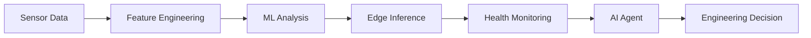

The platform provides four capabilities:

| Capability | Purpose |
| --- | --- |
| Sensor-data processing | Collect, organize, and transform equipment signals into usable data |
| Feature engineering and ML | Extract signal characteristics, identify unusual patterns, and support health assessment |
| Health monitoring | Track health scores, historical changes, and potential abnormal conditions |
| AI-assisted workflows | Retrieve relevant data, summarize findings, and help engineers investigate the next step |

The AI agent is an assistance layer, not an autonomous replacement for engineering judgment.

## 2. Why Edge AI?

A model is only one part of a production system; the data path and operational controls decide whether it is useful.

### 2.1 Common engineering challenges

**Integration complexity.** Data acquisition, preprocessing, model execution, APIs, dashboards, and alerts often live in different components; without clear interfaces, a small change can ripple across modules.

**Data lineage.** Engineers need to know which data, model, and configuration produced a feature or score; without traceability, analyses are hard to reproduce or compare.

**Deployment latency.** A solution that works in development can still be hard to package, configure, install, and update at a site.

### 2.2 The intended improvement

The platform standardizes the path from ingestion to operational use.

| Engineering area | Intended outcome |
| --- | --- |
| Deployment | Reduce the effort required to package and release a platform update |
| Integration | Reuse common interfaces instead of repeatedly writing project-specific integration code |
| Data lineage | Make analysis inputs, outputs, and model versions easier to trace |
| Maintenance workflow | Present data and analysis in a form that supports investigation and follow-up |

The source slides show three metrics — deployment cycle, integration code, and lineage synchronization — to be read with their definitions and baselines; they do not prove model accuracy or data quality.

## 3. System Architecture

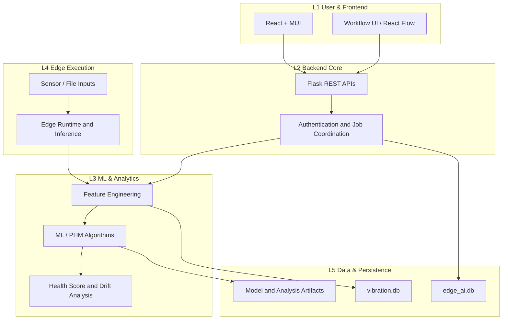

### 3.1 Five layers

| Layer | Responsibility |
| -- | -- |
| L1 Frontend | React UI, dashboard, and agent UI |
| L2 Backend | Flask APIs, authentication, and tool coordination |
| L3 Analytics | Feature engineering, model training, and anomaly detection |
| L4 Edge | Sensor access, edge runtime, and inference |
| L5 Data | SQLite, model files, and history |

Layering is a responsibility boundary, not independent microservices: the frontend does not access the database directly, and inference is separate from UI so it can be reused.

Edge execution runs locally to keep high-frequency samples off the central service; the split depends on latency, compute, network, data volume, and deployment.

### 3.2 Frontend and backend collaboration

The frontend uses React 18, Material UI, and React Flow; the backend uses Flask REST APIs with Blueprints for sensors, models, devices, users, and agents.

- **REST API:** query data, update settings, submit training jobs.
- **Polling:** fetch equipment status periodically.
- **SSE:** receive server events and agent streams.

### 3.3 Performance metrics

Latency metrics need consistent start and end points, must distinguish average, P95, P99, and cold start, and should not be summed across sources.

## 4. End-to-End Data Flow

The data flow defines how data enters, is processed, and stays stable under bursts.

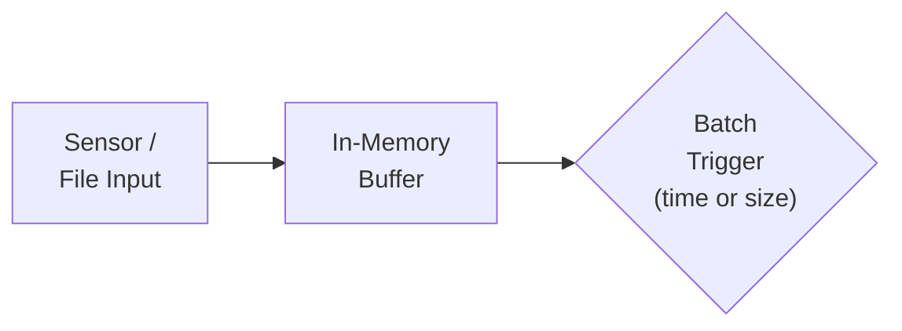

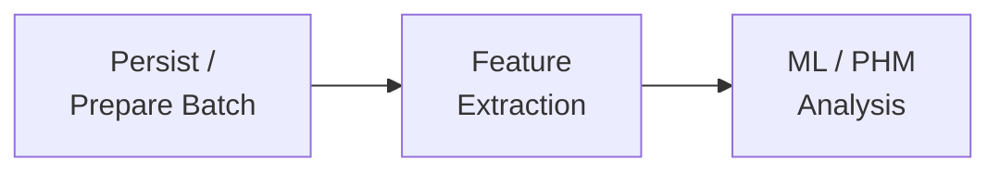

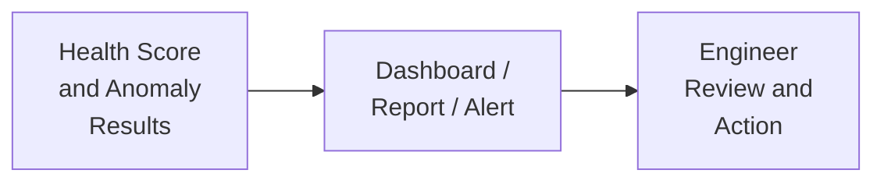

### 4.1 Buffering and batching

Sensors produce data continuously; a bounded `deque(maxlen=5000)` buffers samples and flushes up to 500 records to SQLite every ~5s or when the batch threshold is reached, keeping high-frequency I/O from competing with queries.

At capacity it discards the oldest samples: a useful memory bound, **not a durable queue**. If every sample must survive, add a persistent queue, overflow handling, backpressure, and loss monitoring.

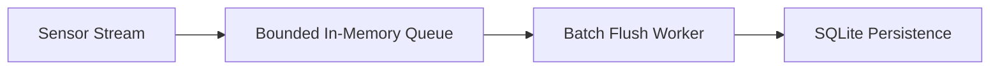

### 4.2 Feature extraction and analysis

The batch yields features, anomaly indicators, a health score, and metadata.

### 4.3 Results and action

The platform presents results through dashboards, reports, or alerts; **anomaly detection identifies deviation, while root-cause analysis explains it** and needs history, equipment knowledge, and engineer validation—not a score alone.

## 5. Machine Learning and PHM Methods

PHM systems combine domain knowledge, signal processing, statistical analysis, and machine learning. No single algorithm answers every equipment-health question.

### 5.1 Signal features

Common signal features include:

- **RMS (root mean square):** summarizes magnitude; often used for vibration energy.
- **Peak:** captures the largest absolute amplitude in a window.
- **Kurtosis:** measures tail behavior and can flag impulsive signals. Interpretation depends on the distribution and implementation.
- **FFT (Fast Fourier Transform):** converts a time-domain signal into frequency components, revealing dominant frequencies and spectral changes.

For a signal \(x = [x_1, x_2, \ldots, x_N]\), RMS is defined as:

$$
\mathrm{RMS} = \sqrt{\frac{1}{N}\sum_{i=1}^{N} x_i^2}
$$

Feature definitions, window sizes, sampling rates, units, and preprocessing should be consistent. Otherwise, apparent changes may come from the pipeline rather than the equipment.

### 5.2 One-Class SVM for anomaly detection

One-Class Support Vector Machine (One-Class SVM) learns the boundary of normal data and flags observations outside it. It suits cases with few labeled faults.

Important considerations include:

- Fit on a representative baseline of normal operation.
- Scale features consistently.
- Tune `nu` and `gamma` with validation data and feedback.
- Monitor false positives and negatives; an anomaly score is not a diagnosis.
- Revisit the baseline when conditions or equipment change.

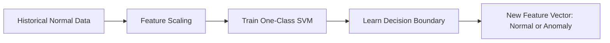

### 5.3 Dynamic Time Warping (DTW)

Dynamic Time Warping measures similarity between sequences that differ in timing or duration. It helps compare patterns whose events are shifted in time.

DTW uses a cumulative-cost matrix with recurrence:

$$
D(i,j) = d(x_i,y_j) + \min\left\{ D(i-1,j),\; D(i,j-1),\; D(i-1,j-1) \right\}
$$

where \(d(x_i,y_j)\) is the local distance. A warping window cuts computation and prevents implausible alignments. **DTW is not universal**; results depend on references, distance metric, normalization, and domain.

### 5.4 PCA for data-drift monitoring

Principal Component Analysis (PCA) projects correlated features into fewer dimensions. Comparing current data with a baseline reveals distribution changes.

Drift does not mean failure; a changed recipe, sensor replacement, operating regime, or preprocessing change can all produce it.

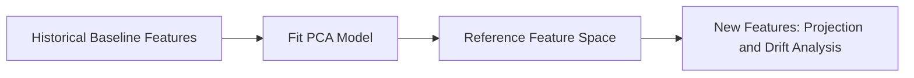

### 5.5 Choosing the method

| Method | Primary purpose | Key limitation |
| --- | --- | --- |
| RMS / Peak / Kurtosis | Summarize time-domain signal characteristics | Can be sensitive to windowing, noise, and operating conditions |
| FFT | Identify spectral components and frequency changes | Requires appropriate sampling and interpretation |
| One-Class SVM | Detect deviations from a learned normal-data boundary | Depends on baseline quality and parameter selection |
| DTW | Compare sequences with temporal misalignment | Can be computationally expensive and reference-dependent |
| PCA | Monitor multivariate structure and potential drift | Drift is not equivalent to failure |

The methods are complementary; validate combinations against the equipment and data.

## 6. Backend Design

### 6.1 Flask application structure

Flask Blueprints separate API areas by responsibility: sensor data, ML analysis, edge management, maintenance, agent, and user/admin. Blueprints organize routes; **they do not fix coupling**. When business logic concentrates in one module, extract a service layer and data-access layer.

### 6.2 Authentication and authorization

LDAP / AD verifies identity; JWTs authenticate later API calls. Authorization is checked per protected operation. Tokens need expiry and signing; secrets must never be hard-coded. **A valid token still requires role and resource checks**; hiding a button is not authorization.

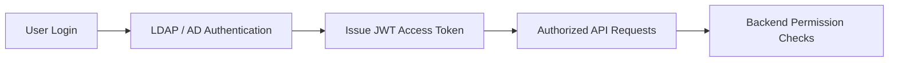

### 6.3 SQLite and data separation

- `edge_ai.db` — application records, configuration, model history.
- `vibration.db` — vibration data and alerts.

SQLAlchemy manages access; `ATTACH DATABASE` supports cross-database queries. **Separate files do not provide cross-database atomicity**; transactions, backups, migrations, and concurrent writes still need testing.

### 6.4 Scheduled tasks and model history

APScheduler runs periodic jobs such as drift checks, reports, or maintenance summaries. Jobs must tolerate retries, failures, and partial completion. Starting the scheduler in **multiple web workers can duplicate jobs**; use a dedicated scheduler or single-owner mechanism. Model-build history records model version, training-data reference, configuration, timestamp, and evaluation results. Builds need explicit states so a failed run differs from one that never started:

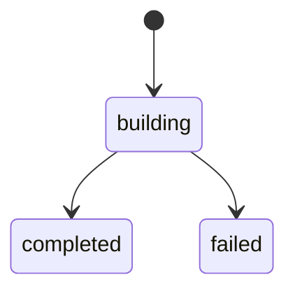

## 7. AI Agent: From Data Retrieval to Assisted Investigation

An AI agent translates a natural-language request into a controlled sequence of data retrieval and analysis. The constraints are permissions, traceability, and execution boundaries.

### 7.1 Example tools

The agent may expose:

| Tool | Responsibility |
| --- | --- |
| `get_health_score` | Health score and context |
| `get_vibration_data` | Authorized vibration data |
| `run_sql_query_safe` | Constrained read-only query |
| `anomaly_detection` | Defined anomaly workflow |
| `read_file` | Allowlisted files |
| `export_report` | Report from validated inputs |

Tool names are illustrative; only implemented tools are available.

### 7.2 Agent flow

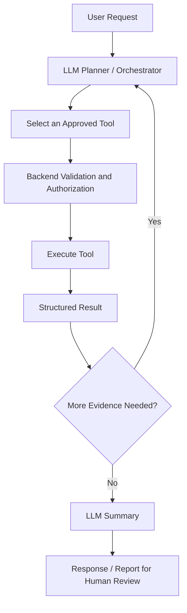

The LLM plans and selects tools; the backend executes SQL, file access, and computation. This reduces fabricated live values but **does not eliminate hallucination**; answers should cite query results, time ranges, and data sources.

### 7.3 Tool governance and safety

The model proposes actions; the backend enforces the rules:

- Validate arguments against a schema; require confirmation for consequential actions.
- Authenticate the user and authorize the requested asset and data.
- Use allowlists for files, tools, and queryable resources.
- Restrict database operations; no arbitrary destructive SQL.
- Apply timeouts, output-size limits, and audit logging; return structured errors without exposing secrets.

A prompt instruction is not a security boundary; enforcement belongs in the application and tools.

### 7.4 Planning vs execution

The LLM understands the request, plans, and summarizes; Python tools execute queries and computation; the backend enforces permissions, validation, and execution boundaries. This makes computation testable but **adds orchestration, latency, and failure points**; compare it with a single-model or deterministic workflow.

### 7.5 Server-Sent Events (SSE)

SSE streams progress and partial results over HTTP, so users see multi-step work as it happens. Define event types, error behavior, timeouts, and reconnection. Streaming **does not replace backend logging or durable job state**; evaluate WebSocket only if bidirectional interaction is needed.

## 8. Deployment and Observability

### 8.1 Docker Compose

Docker Compose manages frontend, backend, and persistent volumes, standardizing dependencies, ports, environment variables, and startup order. **A healthy container does not mean the application works**; readiness checks should verify critical dependencies, and data belongs in volumes.

### 8.2 Runtime frontend configuration

When the frontend is a static bundle and the backend URL varies by environment, a runtime `env.js` can expose the endpoint through `window.ENV`, avoiding a rebuild per environment. Load it before application code, validate it at startup, and treat it as public. **Never put secrets in browser-visible variables**.

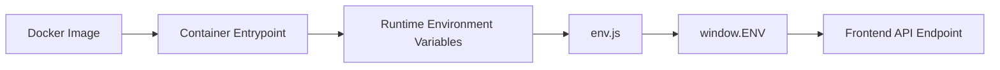

### 8.3 Monitoring

- API request rate, latency, and error rate.
- Ingestion delay, queue depth, batch size, and dropped samples.
- Model execution duration and analysis failures.
- Scheduler job start time, duration, and outcome.
- Agent tool-call success rate, timeouts, and cost.
- Disk usage, database growth, and artifact storage.

Observability should answer three questions: what failed, where, and whether the system can recover safely.

## 9. Failure Handling and Scaling

Failure handling must be designed into the data path, not added after an incident.

| Failure | Risk | Mitigation |
| --- | --- | --- |
| Buffer full | Old samples may be dropped | Track drops; use durable buffering if loss is unacceptable |
| Source unavailable | Stale or incomplete analysis | Track freshness; surface missing data; do not treat stale values as current |
| Model fails | Missing or invalid result | Record context, bounded retries, keep the last valid result with a timestamp |
| SQLite contention | Delayed or failed writes | Reduce competing writers, batch writes, tune transactions, or migrate |
| Duplicate scheduled task | Duplicate reports or work | Single scheduler owner, idempotent jobs, or coordination |
| LLM or tool timeout | Incomplete agent workflow | Timeouts, bounded retries, structured errors, visible partial state |
| Network interrupted | Remote service unavailable | Keep local capabilities, queue recoverable work, define synchronization |

### 9.1 Evolve in stages

Scaling should respond to measured constraints, not technology fashion.

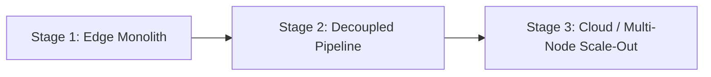

**Stage 1 — Edge monolith.** A compact Flask app, local persistence, and local inference suit a single node with modest load.

**Stage 2 — Decoupled pipeline.** When ingestion and analysis hurt API responsiveness, add durable queues and separate workers; retries and backpressure become easier.

**Stage 3 — Cloud or multi-node scale-out.** When workload, availability, or concurrency demands it, consider a server database, shared job coordination, centralized observability, and horizontal scaling; keep latency-sensitive work at the edge.

MQTT, durable brokers, Redis, PostgreSQL, and load balancers are future options, not current components.

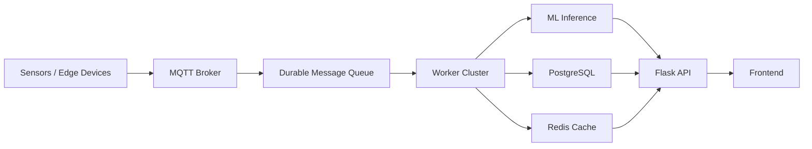

## 10. Engineering Trade-offs

The goal is not the most sophisticated technology in every layer, but a reliable current system with a practical path forward.

| Area | Current approach | Benefit | Trade-off / next consideration |
| --- | --- | --- | --- |
| Web backend | Flask | Lightweight and straightforward to organize | Long-running tasks may need separate workers |
| Persistence / scheduling / buffering | SQLite, APScheduler, bounded deque | Simple local operation | Concurrency, duplicate jobs, and non-durable buffering need explicit handling |
| Frontend updates | REST APIs and SSE | Familiar request-response model with optional streaming | Reconnection and job state must be designed |
| ML / PHM | Feature engineering plus multiple analytical methods | Combines interpretable signal features with statistical and ML methods | Requires baseline validation and domain-specific interpretation |
| Deployment | Docker Compose | Repeatable single-host deployment | Not a complete orchestration solution for large clusters |

Separate **what exists today** from **what may come later**; this keeps a roadmap from being mistaken for a production capability.

## 11. Conclusion

1. **Design the complete data path and make results traceable.** A model is only useful when its inputs, outputs, errors, and context are handled reliably, with versioning and lineage for comparison.
2. **Treat AI agents as controlled application clients.** The backend, not the prompt, enforces permissions, validation, and tool safety.
3. **Make failure behavior explicit.** Buffers, schedulers, databases, network dependencies, and model calls all need defined failure semantics.
4. **Scale based on evidence.** Start with deployment constraints, then decouple or replace components when measurements justify it.

The value is not the number of frameworks, but the engineering judgment to make them work together safely and predictably.

---

> **Terms of use:** For technical exchange only. Company, customer, and internal-project identifiers are removed; data and scenarios are de-identified or virtualized. Future architectures are possible directions, not deployment claims. Licensing follows the author's published terms.