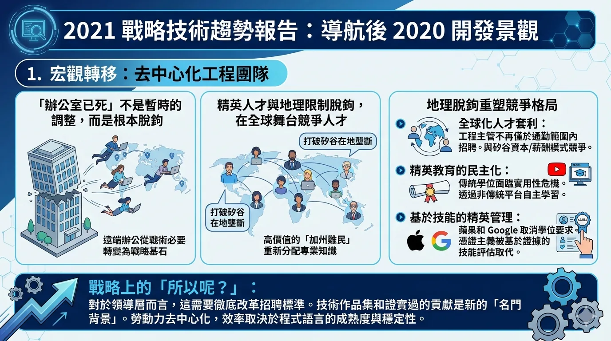



---
# 2021 戰略技術趨勢報告：導航後 2020 開發景觀

## 1. 宏觀轉移：去中心化工程團隊

2020 年的全球事件催化了工程組織的永久性結構轉型，將遠端辦公從一種戰術上的必要轉變為戰略基石。「辦公室已死」的現象並非暫時的後勤調整，而是精英人才與地理限制的根本脫鉤。組織首次被迫在全球舞台上競爭人才，打破了矽谷的在地壟斷，並允許高價值的「加州難民」在不犧牲薪資的情況下，將專業知識重新分配到更具成本效益的地區。

這種地理脫鉤從根本上重塑了競爭格局：

* **全球化人才套利：** 工程主管不再僅於通勤範圍內招聘。無論您的實體總部位於何處，您現在都在與矽谷的資本和薪酬模式競爭。
* **精英教育的民主化：** 傳統的四年制學位正面臨實用性危機。透過非傳統平台（包括 YouTube 等專業技術頻道）進行自主學習，現在提供的課程在速度和相關性上往往超過學術機構。
* **基於技能的精英管理：** 蘋果和 Google 等業界先驅取消學位要求，標誌著精英招聘的轉變。憑證主義正被基於證據的技能評估所取代。

**戰略上的「所以呢？」：** 對於領導層而言，這需要徹底改革招聘標準。技術作品集和證實過的貢獻是新的「名門背景」。隨著勞動力變得去中心化，其效率將日益取決於所使用的程式語言的成熟度與穩定性。

---

## 2. JavaScript 高原期與 TypeScript 授權

定義了過去十年的「框架戰爭」已達到終端成熟狀態。我們已跨越了不斷進行架構革命的時代，進入了精煉與標準化的時期。React 鞏固了其作為市場主導力量的地位，讓其他競爭對手佔據穩定但遙遙領先的次要地位。

### JavaScript 框架景觀 (2020-2021)

| 框架 | 2020-21 戰略地位 | 主要生態系影響 |
| --- | --- | --- |
| **React** | 市場主導 | 透過 "Hooks" 實現標準化，推動產業轉向函數式模式。 |
| **Angular** | 遺留/企業級 (遙遠的第二名) | 增量維護；專注於局部功能（如 UI 組件）而非架構轉移。 |
| **Vue** | 社群標準 (遙遠的第二名) | Vue 3 和 Composition API 的實施，很大程度上反映了 React 向 Hooks 的轉型。 |
| **Svelte/Ember** | 利基/創新層級 | 專業使用場景；在不破壞 React 現狀的情況下突破邊界。 |

語言趨於穩定的證據可以在 ECMAScript 的「木槌運算子」（邏輯賦值）中找到，這有效地「完成」了語言的核心實用性。基礎語言的這種高原現象為 **TypeScript 授權** 掃清了道路。TypeScript 不再是一個可選的超集；它是任何需要長期可維護性專案的戰略標準。2020 年發布的 Deno（一個將 TypeScript 視為一等公民的運行環境）強化了這一轉變，標誌著從過去碎片化的建置步驟思維，轉向整合且型別安全的執行環境。

![1. 框架戰爭的終局 (Framework Maturity)圖表中央展示了四大框架的戰略地位。這反映了開發景觀已從「混亂的革命期」進入「穩定的精煉期」：React (市場主導)： 確立了業界標準。透過 Hooks 實現了開發模式的統一，迫使整個生態系向函數式編程轉向。Angular (遺留/企業級)： 雖穩坐企業市場，但已轉為維護模式，重點在於組件優化而非架構變革。Vue (社群標準)： 透過 Vue 3 (Composition API) 的演進，顯示出向 React 模式靠攏的標準化趨勢。Svelte/Ember (創新層級)： 代表了技術邊界的探索，雖具創新性但尚未動搖主流市場。2. JavaScript 的「高原現象」 (The Plateau)圖表背景使用「高原」意象，象徵 ECMAScript 語言規範的趨於成熟。關鍵證據： 提到的「木槌運算子」（Logical Assignment Operators）等特性的加入，意味著語言核心功能的「完成」，開發者不再急於尋找底層補丁，而是轉向更高層次的開發效率。3. TypeScript 的戰略授權 (TypeScript Empowerment)圖表右上方的盾牌與 Deno 圖示象徵著 TypeScript 的不可或缺性：從超集到標準： 它不再是選項，而是確保長期專案可維護性的「戰略標準」。Deno 的催化： 作為原生支援 TypeScript 的執行環境，Deno 標誌著開發流程從「零碎的編譯步驟」進化到「原生型別安全」的時代。](images/Gemini_Generated_Image_ifmvbkifmvbkifmv.png)
---

## 3. 工具鏈現代化：Deno、Snowpack 與效率

在 2021 年，開發者體驗 (DX) 是組織速度的主要驅動力。Node/npm 生態系歷史上的摩擦——以深層的依賴地獄和不斷的建置步驟流失為特徵——已成為生產力上不可接受的稅賦。

### Deno：後 Node 時代的運行環境

Deno 透過提供更安全、更標準化的環境來解決 Node.js 的架構債。其 2020 年的發布提供了三個明確的戰略優勢：

1. **原生 TypeScript 執行：** 消除了外部轉譯層的脆弱性和複雜性。
2. **沙盒安全：** 「預設安全」模式，需要明確的權限才能訪問文件和網絡，減輕了供應鏈漏洞。
3. **標準化工具集：** 內建的測試、格式化和 Lint 工具消除了對龐大且雜亂的第三方套件生態系的依賴。

### Snowpack：利用 ESM 提升速度

Snowpack 透過利用 ES 模組 (ESM) 進行非打包開發，打破了傳統的打包思維。與需要在開發期間對應用程式進行完整重新打包的 Webpack 不同，Snowpack 服務於單個文件。這導致了幾乎瞬時的啟動時間，並顯著縮短了工程師的反饋週期，直接影響了交付速度。

![3. 工具鏈現代化：Deno、Snowpack 與效率:在頂部，一個流動的橫幅：“2021 年：開發者體驗 (DX) 是組織速度的主要驅動力”。下方是兩個對比的圖示：一個斷裂的 'Node/npm' 鏈標註了「生態系歷史摩擦」，並列出了：深層依賴地獄、建置步驟流失。一個 sign 指出「生產力稅賦」。另一邊是一個清爽流動的「現代工具鏈」。中間部分分為兩個主要的水平面板。Deno：後 Node 時代的運行環境: Deno 標誌位於中央，周圍是齒輪和電路。三個 distinct、bulleted 點（帶圖示）從中流出：原生 TypeScript 執行：TS 圖示帶 unchecked checkbox。消除轉譯層脆弱和複雜性。沙盒安全：一個帶 unchecked checkbox 的盾牌。沙盒安全：「預設安全」模式，需明確權限。減輕供應鏈漏洞。標準化工具集：一個工具箱帶 unchecked checkbox，內建測試、格式化、Lint 工具。消除雜亂第三方套件依賴。Snowpack：利用 ESM 提升速度: Snowpack 標誌（山脈和火箭）位於中央。一個對比圖：左側是 Cross-out 'Webpack (打包模式)'，顯示開發時需重新打包。右側是 'Snowpack (非打包模式)'，帶 uncheck checkbox 標註「利用 ESM」。顯示非打包開發：服務單個文件。瞬時啟動、緊湊反饋週期。直接影響交付速度。底部整合了圖示和陳述：一個帶 checkmark 的計時器指向「開發效率提升」。底部中央的陳述：“精煉與標準化時期 -> 高效、安全的現代工具鏈”。](images/Gemini_Generated_Image_drpb8fdrpb8fdrpb.png)
---

## 4. 打破原生障礙：WebAssembly 與 PWA 進化

「開放網頁」已成熟為一個可行的戰略競爭者，對抗封閉且尋租的行動應用程式商店生態系。長期以來，軟體供應商一直受制於「30% 的應用程式商店稅」、任意審查以及由平台守門人強制執行的受限分發模式。

WebAssembly (Wasm) 與漸進式網頁應用程式 (PWA) 之間的協同作用，允許開發者在保持原生級性能的同時繞過這些障礙：

1. **硬體層級整合：** 瀏覽器現在支持關鍵的原生功能：藍牙、推播通知、背景同步和離線模式。
2. **多語言性能：** WebAssembly 允許使用 C++、Rust 或 Go 編寫的高性能代碼在瀏覽器中以接近原生的速度運行。
3. **直接分發：** PWA 消除了「守門人風險」，允許建立直接面向消費者的關係，並奪回 30% 的利潤率。

**戰略上的「所以呢？」：** 2020 年 Epic Games 與蘋果之間的法律衝突說明了封閉市場的脆弱性。對於獨立軟體供應商而言，Wasm 和 PWA 代表了一條通往平台獨立的道路。技術不再是瓶頸；現在的挑戰正轉向引導消費者行為重返開放網頁——這一舉動將日益受到 AI 驅動的開發代理程式的推動。

---

## 5. 生產力悖論：AI 與低程式碼革命

GPT-3 的出現以及低程式碼/無程式碼工具（Webflow、Amazon Honeycode、Google App Sheet）的激增，不應被視為對工程人員數量的威脅，而應被視為抽象層級的巨大飛躍。

AI 生成的代碼代表了從編寫語法到定義意圖的轉變。當 AI 可以根據自然語言描述建構 React 組件時，它就起到了一個高階抽象層的作用。這允許資深工程師退出「樣板陷阱」，專注於專有的業務邏輯和系統架構。

### 對工程主管的價值主張

* **快速搭建 (Scaffolding)：** 使用低程式碼工具在幾分鐘內原型化 UI，降低驗證成本。
* **資本效率：** 將昂貴的工程人才從重複性的「腳手架」工作中轉移出來，投入到 AI 尚無法解決的高價值、專有功能中。
* **內部創業機會：** 目前任何透過重複手動編碼處理的內部任務，都是拖放式自動化新創公司的候選對象。

---

## 6. 基礎設施成熟度：「無伺服器優先」架構

「無伺服器優先」(Serverless First) 理念代表了基礎設施從管理任務向公用事業消費模式的最終過渡。2020 年的更新解決了對此架構的主要技術異議。

### 2020-21 無伺服器成熟度檢查表

* [x] **消除冷啟動：** AWS Lambda 的預配置並發 (Provisioned Concurrency) 為「熱」函數提供可預測且低延遲的執行。
* [x] **通用運行環境支持：** AWS Lambda 的容器支持引入以及 Google Cloud Run 的成熟，允許團隊透過 Docker 部署自定義運行環境，而無需管理伺服器。
* [x] **從無狀態到有狀態：** 無伺服器原生資料庫（如 Firestore 和 FaunaDB）的興起，意味著擴展狀態管理現在已是一個解決了的問題。

對於現代架構師而言，「擴展」不應再是手動關注的問題。基礎設施已成為一種公用事業——就像電力一樣——您只需嚴格按照消耗付費，而忽略底層的複雜性。

![6. 基礎設施成熟度：「無伺服器優先」架構:在頂部，一個對比圖：“管理任務”與“公用事業消費模式”進行對比，說明“基礎設施過渡的最後一步”和“解決主要技術異議”。2020-21 無伺服器成熟度檢查表: 三個 distinct，stylized 垂直面板，帶 checked checkboxes。說明：冷啟動消除、通用環境支持、解決狀態管理擴展。消除冷啟動: AWS Lambda 預配置並發 (Provisioned Concurrency)，「熱」函數提供低延遲，可預測執行。通用運行環境支持: AWS Lambda 容器支持引入以及 Google Cloud Run 的成熟，允許團隊透過 Docker 部署自定義運行環境，無需管理伺服器。從無狀態到有狀態: 無伺服器原生資料庫（如 Firestore 和 FaunaDB）的興起，解決擴展狀態管理問題。現代架構師視角: 底部整合了陳述和圖示：一個帶有 plant 圖示和數據線的中央面板，“基礎設施已成為一種公用事業 (Infrastructure as a Public Utility)”。按消耗付費: 嚴格按照消耗付費。忽略底層複雜性: 忽略底層複雜性。](images/Gemini_Generated_Image_vuy0upvuy0upvuy0.png)
---

## 7. 戰略風險評估：市場波動與「黑天鵝」

技術進步目前與經濟現實脫鉤。受刺激方案和科技業 IPO/SPAC 熱潮推動的 2020 年底市場，創造了一個高風險環境，其特點是不可持續的「燒錢率」和「瘋狂估值」。

**「黑天鵝」的潛力：** Snowflake 的案例——1000 億美元的市值，對應僅 4 億美元的收入和 **3.5 億美元的虧損**——是潛在泡沫的徵兆。缺乏資本效率且依賴高股價生存的公司是脆弱的。2021 年引發市場修正的任何催化劑都將導致就業市場快速收縮和創業資金崩潰。

### 戰略韌性計劃

1. **應對市場收縮的應急預案：** 審核工程優先級，確保所有團隊專注於高影響力、能產生收入的項目，而非投機性的研發。
2. **供應商穩定性評估：** 評估您關鍵 SaaS 和基礎設施夥伴的盈利能力和現金流。避免過度依賴那些可能在修正中消失的「零利潤」新創公司。
3. **效率高於員工人數：** 利用 Serverless 和低程式碼的抽象化，以精幹、高技能的團隊保持高產出，減少組織開銷。

![7. 戰略風險評估：市場波動與「黑天鵝」:在頂部，一個流動的橫幅：“技術進步與經濟現實脫鉤”與“2021 年市場修正催化劑”進行對比，說明“市場混沌”與“「黑天鵝」潛力”。市場混沌: 顯示了不可持續「燒錢率」、瘋狂估值。列出了：受刺激方案推動、科技業 IPO/SPAC 熱潮。一個 sign 指出「泡沫徵兆」。「黑天鵝」潛力: 展示了 Snowflake 的案例：1000 億美元市值，對應僅 4 億美元收入和 3.5 億美元虧損。說明了缺乏資本效率且依賴高股價。戰略韌性計劃: 三個 distinct，stylized 垂直面板，帶 checked checkboxes。說明：應對市場收縮、供應商穩定性、效率高於員工人數。應對市場收縮: 審核工程優先級。專注於產生收入項目。消除投機研發。供應商穩定性: 評估關鍵 SaaS/基礎設施夥伴。盈利能力評估。現金流評估。避免依賴消失「零利潤」新創。效率高於員工人數: 利用 Serverless & 低程式碼。精幹、高技能團隊保持高產出。減少組織開銷。底部整合了陳述和圖示：一個帶有 plant 圖示和數據線的中央面板，“結論：2021 年是成熟與戰略選擇的一年。 (Conclusion: 2021 is Year of Maturity and Strategic Selection.)”。基礎設施與工具退入幕後: 基礎設施與工具退入幕後。挑戰：選擇人力資本應用點: 挑戰：選擇人力資本應用點。](images/Gemini_Generated_Image_8jdq2d8jdq2d8jdq.png)

## 結論：2021 年是成熟與戰略選擇的一年。

隨著基礎設施和工具退入幕後，主要的挑戰不再是選擇框架，而是選擇將您的人力資本應用在哪裡。

---
