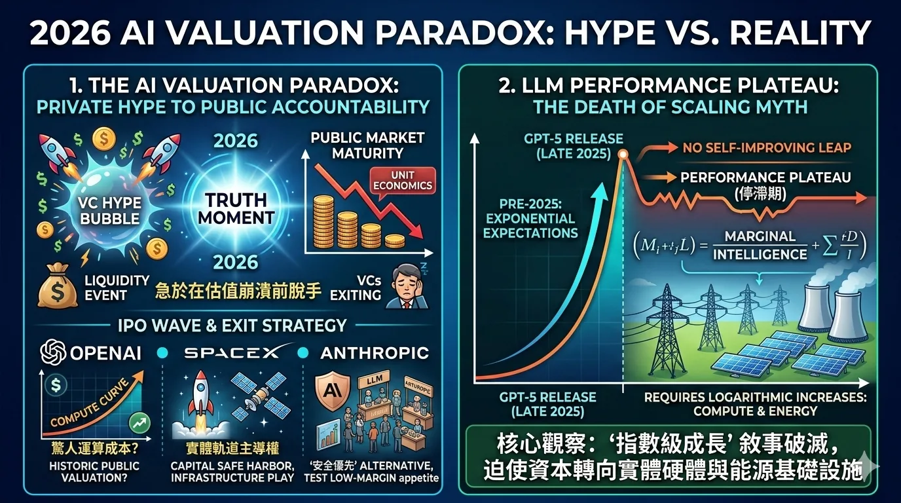
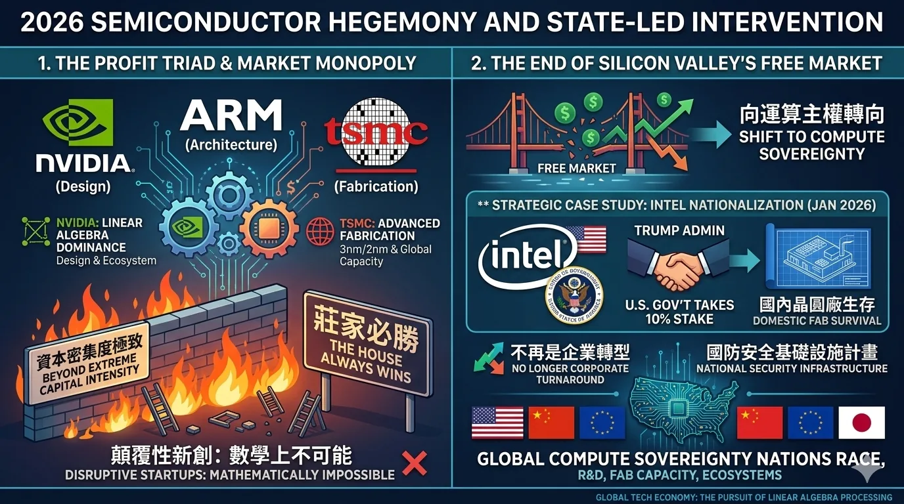
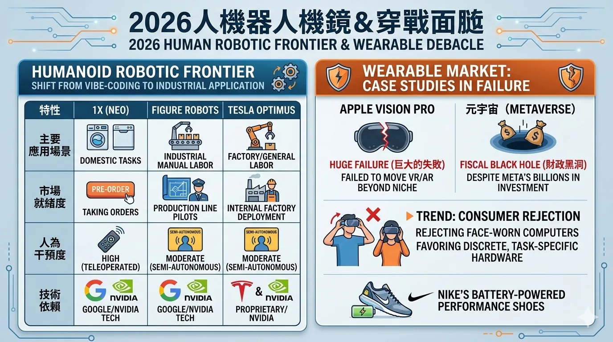
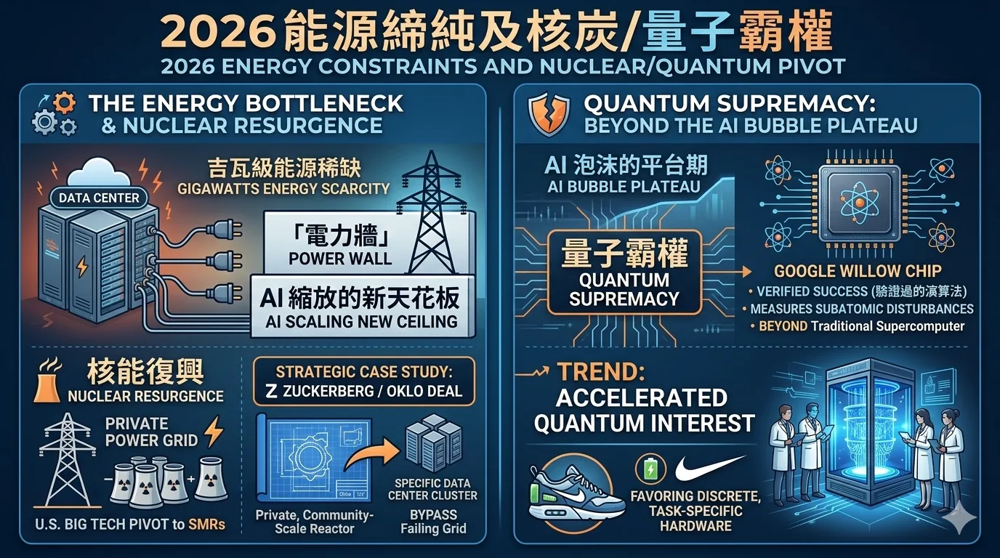
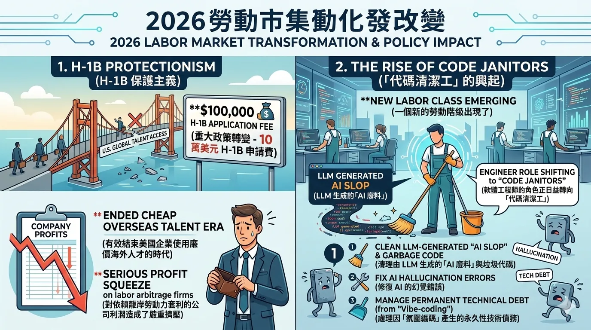
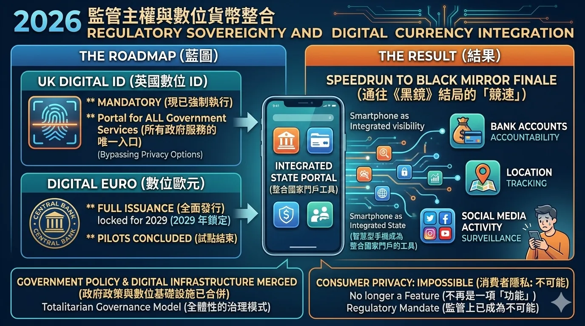
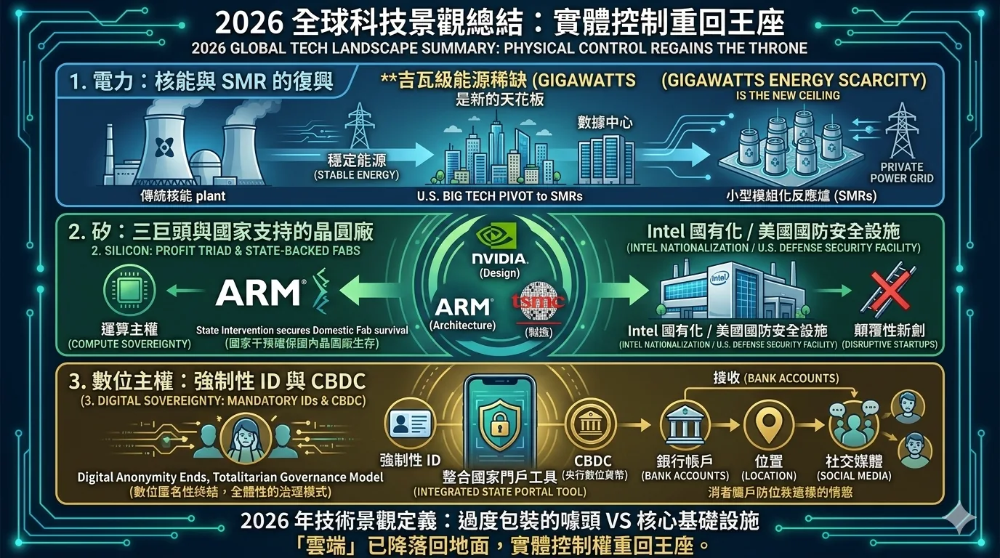


- 文章主張 AI 在 2026 年進入估值與效能平台期，公開市場開始檢驗私有市場的炒作。
- NVIDIA、ARM 與台積電形成運算寡占，國家干預則將晶圓廠視為國家基礎設施。
- 類人機器人進入工業試點，但仍高度依賴遠端操作；消費級穿戴裝置仍是墳場。
- 能源成為真正的擴張天花板，推動小型模組化反應爐與量子運算的關注。
- 10 萬美元 H-1B 費用與「代碼清潔工」的興起，重塑科技勞動市場。
- 數位身分與 CBDC 計畫擴張國家連結的身分與支付基礎設施，侵蝕消費者隱私。

**總結：** 權力正從軟體敘事轉向實體基礎設施——電力、矽晶片與數位主權。




---

# 2026 全球科技市場分析

## 航行於「過度擴張後的平台期」與「基礎設施轉向」

---

## 1. AI 估值的悖論：從私有市場的狂熱到公開市場的問責

進入 2026 年，人工智慧產業正面臨其決定性的「真相時刻」。由敘事驅動的私有市場估值時代，已與公開市場冷酷的單位經濟效益發生正面碰撞。

### IPO 浪潮與退出策略

2026 年的 IPO 時間表代表了當前 AI 假象的最後階段。風險投資（VC）正急於在估值底線崩潰前脫手：

* **OpenAI**：正尋求具歷史意義的公開上市估值，該公司必須說服市場，其驚人的運算成本不只是個無底洞。
* **SpaceX**：雖然本質上是基礎設施，但其 2026 年的上市被定位為資本的「避風港」，旨在尋求軌道上的實體主導權，而非投機性軟體。
* **Anthropic**：被行銷為「安全優先」的替代方案，其 IPO 將測試公開市場對於在擁擠且低利潤環境中的二線 LLM（大型語言模型）供應商是否仍有胃口。

### LLM 性能的平台期（停滯期）

2025 年底 **GPT-5** 的發布證實了最悲觀的預測：**「縮放神話的終結」**。

> **核心觀察：** 預期中通往自我進化超人工智慧的指數級飛躍並未實現。相反地，我們進入了一個性能平台期，在此階段，微小的「智能」增益需要運算量與能源的對數級增長。這種失望情緒戳破了「指數級成長」的敘事，迫使資本轉向實體硬體與能源基礎設施。

---

## 2. 半導體霸權與國家主導的干預

全球科技經濟已簡化為單一追求：獲取 **「線性代數」** 的處理能力。

### 利潤三巨頭與市場壟斷

**NVIDIA（設計）、ARM（架構）與台積電 TSMC（製造）** 目前以實質壟斷的形式運作。高階晶片的准入門檻在資本密集度上已達到極致，使任何「顛覆性」新創公司在短期內甚至無法進入對話。這是一場莊家必勝的遊戲。

### 矽谷自由市場的終結

過去一年最劇烈的轉變是徹底拋棄了自由市場機制，轉向 **「運算主權」**。

* **策略案例研究：Intel 國有化（2026 年 1 月）**
在經歷了瀕臨破產的 2025 年後，美國政府執行了「大到不能倒」的干預。透過持有 Intel 10% 的股權，川普政府有效地繞過自由市場，以確保國內晶圓廠的生存。這已不再是企業轉型，而被視為國防安全的國家級基礎設施計畫。

---

## 3. 類人機器人前線與穿戴式設備的潰敗

2026 年是實體 AI 從「氛圍編碼」（Vibe-coding，缺乏架構嚴謹性的開發風格）轉向實際工業應用的一年。

### 機器人競爭對手比較表

| 特性 | 1X (Neo) | Figure Robots | Tesla Optimus |
| --- | --- | --- | --- |
| **主要應用場景** | 居家任務（洗衣、洗碗） | 工業體力勞動 | 工廠/通用勞動 |
| **市場就緒度** | 目前接受預訂 | 生產線試點計畫 | 內部工廠部署 |
| **人為干預度** | 高（遠端操作） | 中（半自主） | 中（半自主） |
| **技術依賴** | Google/NVIDIA 技術 | Google/NVIDIA 技術 | 自有/NVIDIA |

### 穿戴式市場：失敗的研究

消費者穿戴設備領域仍是一片過度工程化的噱頭墳場：

* **Apple Vision Pro**：正式被歸類為巨大的失敗，未能將 VR/AR 帶離小眾市場。
* **元宇宙（Metaverse）**：儘管 Meta 投入了數十億美元，依然是一個財政黑洞。
* **趋势**：消費者正拒絕臉部穿戴電腦，轉而支持更隱蔽、任務導向的特定硬體（例如 Nike 加強體能的電池驅動鞋）。

---

## 4. 能源約束與核能/量子轉向

雲端供應商已達到策略瓶頸：**吉瓦（Gigawatts）級能源的稀缺**。 **「電力牆」** 是 AI 縮放的新天花板。

* **核能復興**：美國「大科技公司」已轉向**小型模組化反應爐（SMRs）**。Zuckerberg 與 Oklo 在俄亥俄州的交易成為藍圖：一種私有的、社區規模的反應爐，旨在繞過故障的傳統電網，直接為特定數據中心群提供動力。
* **量子霸權**：AI 泡沫的平台期加速了對量子計算的興趣。**Google Willow 晶片**已證明能測量亞原子尺度的擾動，其驗證過的演算法成功超越了傳統超級電腦的能力。

---

## 5. 勞動力市場轉型與政策影響

### H-1B 保護主義

一項重大的政策轉變——**10 萬美元的 H-1B 申請費**——有效地結束了美國企業使用廉價海外人才的時代。這對依賴離岸勞動力套利的公司的利潤造成了嚴重擠壓。

### 「代碼清潔工」的興起

一個新的勞動階級出現了。軟體工程師的角色正日益轉向 **「代碼清潔工」（Code Janitors）**，任務包括：

1. 清理由 LLM 生成的「AI 廢料（AI Slop）」與垃圾代碼。
2. 修復 AI 的幻覺錯誤。
3. 處理因「氛圍編碼」產生的永久性技術債務。

---

## 6. 監管主權與數位貨幣整合

我們正在目睹一場通往《黑鏡》結局的「競速」，政府政策與數位基礎設施已合併為一種全體性的治理模式。

### 數位身分與 CBDC（央行數位貨幣）藍圖

* **英國數位 ID**：現已強制執行，成為所有政府服務的唯一入口。
* **數位歐元**：試點結束後，已鎖定於 2029 年全面發行。

> **結果：** 智慧型手機已成為整合國家門戶的工具，追蹤銀行帳戶、位置及社交媒體活動。對企業而言，消費者隱私不再是一項「功能」，而在監管上已成為不可能。

---

## 總結：2026 年的景觀

2026 年的技術景觀定義為「過度包裝的噱頭」與「核心基礎設施」之間的掙扎。2026 年的權力核心在於對實體資源的控制：

1. **電力**（核能 / SMR）
2. **矽**（三巨頭與國家支持的晶圓廠）
3. **數位主權**（強制性 ID 與 CBDC）

**「雲端」已降落回地面，實體控制權重回王座。**

---
