
- Edge AI 平台是一套端到端工程系統：資料接入、特徵工程、推論、監控與人員工作流程，必須環環相扣。
- 設計採用五層架構：React／MUI 呈現、Flask API、分析、邊緣執行，以及 SQLite／檔案持久化。
- 有界 deque 會先批次緩衝近期樣本（例如 500 筆或約 5 秒）再進行特徵萃取；它是緩衝區，不是持久化佇列。
- PHM 結合訊號特徵（RMS、FFT）、One-Class SVM、DTW 與 PCA 漂移監控，判讀仍交由工程師負責。
- AI Agent 是受控的應用程式用戶端：工具白名單、授權、驗證與稽核紀錄由後端強制執行，而非依賴 LLM 提示詞。
- 部署從 Docker Compose 的邊緣單體開始，待量測結果證明有必要時，才擴展為解耦的 Worker。

**總結：** 可靠性來自可追溯的資料、明確的故障行為與受治理的 Agent，而非單一模型或框架。


## 前言

在半導體製造環境中，設備會持續產生振動、溫度與其他感測器資料。如何將這些資料轉化為可用的健康度指標、異常警報與維護建議，並進一步整合到實際的工程工作流程，是設備智慧化的重要課題。

這篇文章介紹我參與開發的 **Edge AI／PHM（Prognostics and Health Management，故障預測與健康管理）平台**。平台整合感測器資料處理、機器學習、設備端推論、健康度監控、後端服務與生成式 AI Agent，目標是將原本分散的資料分析與模型應用流程，整合成一套可操作、可追蹤且能持續演進的工程系統。

本文不會只列出使用了哪些技術，而是沿著實際的系統設計脈絡，回答幾個更重要的問題：

- 為什麼需要整合 Edge AI 平台？
- 如何設計從感測器到模型推論的端到端資料流？
- 如何在缺乏故障標籤的情境下進行異常偵測？
- 如何讓 LLM 使用真實的設備資料，而不是直接生成未經驗證的答案？
- 為什麼現階段選擇 Flask、SQLite 與 Docker Compose，而不是一開始就採用完整的分散式架構？
- 當資料量與併發需求增加時，系統應該如何演進？

文章也會討論目前架構的限制與可能的改善方向。對我而言，理解一套系統的瓶頸、設計選擇與演進路線，與完成當下的功能同樣重要。

> **專案說明：** 本文為個人技術展示與面試簡報的延伸版本。涉及公司、客戶及內部專案的識別資訊均已移除，相關資料與情境亦經去識別化或虛擬化處理。文中的架構描述不應被解讀為特定客戶或生產環境的完整規格。

---

## 1. 專案總覽：建立從感測器到工程決策的完整流程

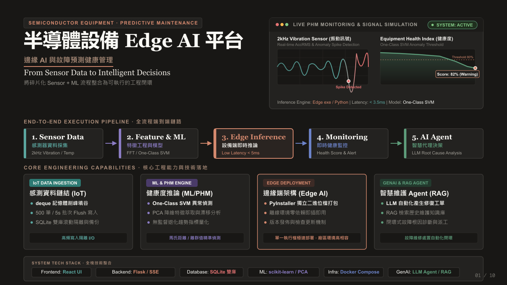

### 1.1 專案定位

這套平台的核心目標，是將感測器資料、機器學習模型、設備端推論、監控告警與 AI 輔助診斷整合成一條完整的工程工作流程。

整體流程可以分成五個階段：

**Sensor Data → Feature Engineering & ML → Edge Inference → Health Monitoring → AI Agent**

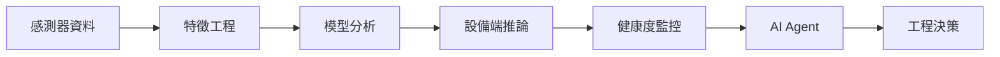

1. **Sensor Data：** 收集設備振動、溫度等感測器資料。
2. **Feature Engineering & ML：** 將原始訊號轉換為具有分析價值的時域與頻域特徵，並進行模型訓練與異常偵測。
3. **Edge Inference：** 在設備端執行資料處理與模型推論，降低對遠端服務的即時依賴。
4. **Health Monitoring：** 持續追蹤設備健康度、異常分數與告警狀態。
5. **AI Agent：** 整合設備狀態、歷史紀錄與分析工具，協助工程師理解異常並整理後續處置建議。

這五個階段並非彼此獨立的工具，而是透過資料格式、API、模型檔案與狀態管理串接起來的系統。

### 1.2 四大核心能力

| 模組                 | 核心職責             | 主要技術                     |
| ------------------ | ---------------- | ------------------------ |
| IoT Data Ingestion | 感測器資料接入、緩衝與持久化   | Python、deque、SQLite      |
| ML & PHM Engine    | 特徵工程、異常偵測、趨勢分析   | NumPy、SciPy、scikit-learn |
| Edge Deployment    | 設備端執行與版本發佈       | Python、PyInstaller       |
| GenAI & RAG Agent  | 資料查詢、診斷輔助、維護知識檢索 | LLM、Tool Calling、RAG     |

平台使用 React 建立操作介面，Flask 提供後端 API，SQLite 負責資料持久化，Docker Compose 管理容器化服務，並透過 AI Agent 將傳統資料分析能力延伸至自然語言互動。

### 1.3 設計原則

整體設計遵循一個原則：

**先滿足當前部署限制，再為未來擴充保留清楚的演進路徑。**

Edge AI 系統不一定需要一開始就採用微服務、訊息佇列叢集與大型資料庫。真正重要的是理解設備端的運算資源、網路條件、資料流量、維運能力與可靠性要求，再選擇合適的架構。

---

## 2. 為什麼需要 Edge AI 平台？

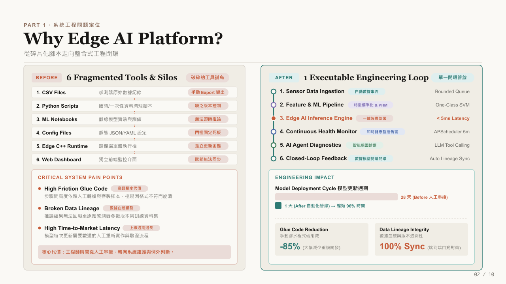

### 2.1 Before：功能存在，流程卻彼此分離

在整合之前，感測器資料處理、模型實驗、設備端執行與監控介面可能分散在不同工具中。

例如：

- CSV 檔案負責記錄或交換感測器資料。
- Python Scripts 負責一次性的資料清理與轉換。
- Jupyter Notebooks 負責離線模型實驗。
- JSON／YAML 設定檔負責保存模型參數與判斷門檻。
- 設備端執行檔負責實際推論。
- Web Dashboard 負責呈現監控結果。

這些工具各自都能完成任務，但工具之間仍然需要人工操作、格式轉換與額外的整合程式。

問題不只是操作步驟多，而是整條資料處理鏈缺乏一致的管理方式。

### 2.2 三個關鍵工程問題

**問題一：整合成本高（Integration Complexity）**

不同工具可能使用不同的資料格式、參數命名與執行方式。每次調整模型或更新設備端程式，都可能需要重新修改串接流程。

**問題二：資料血緣不完整（Data Lineage）**

當模型輸出異常分數時，工程師需要知道這個結果使用了哪些原始資料、特徵設定、模型版本與判斷門檻。

如果這些資訊無法對應，問題就很難重現，模型結果也不容易追蹤。

**問題三：模型部署週期過長（Deployment Latency）**

模型在 Notebook 中成功執行，不代表它已經具備設備端部署所需的設定管理、版本控制、錯誤處理與監控能力。

如果每次更新都需要人工重新串接，模型從實驗到實際應用的週期就會受到限制。

### 2.3 After：整合成可執行的工程閉環

平台將原本分散的流程整合成：

**資料接入 → 特徵處理 → 模型推論 → 健康度監控 → 異常診斷 → 維護回饋**

其中，模型輸出不再只是一次性分析結果，而是可以進一步連結到監控、歷史紀錄與維護工作流程的系統資料。

這種整合的價值，在於減少重複串接工作，並提高資料、模型與執行狀態之間的一致性。

### 2.4 工程效益如何衡量？

原始簡報整理了模型部署週期、重複串接程式碼與資料血緣同步率三項專案展示指標，具體數值可見對應圖表。

這些數字應搭配各自的計算方式、比較範圍與驗證條件解讀。部署週期的改善不能直接等同於模型準確率提升，而資料血緣同步也不代表所有資料品質問題都已消失。

真正值得追求的，是建立可以持續量測、重現與改善的工程流程。

---

## 3. 系統架構：五層整合設計

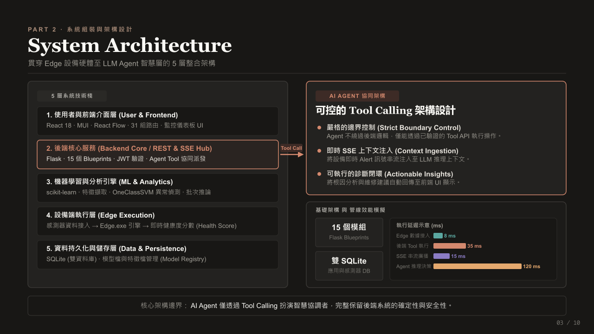

平台採用分層設計，將使用者操作、後端服務、機器學習、設備端執行與資料持久化分開管理。

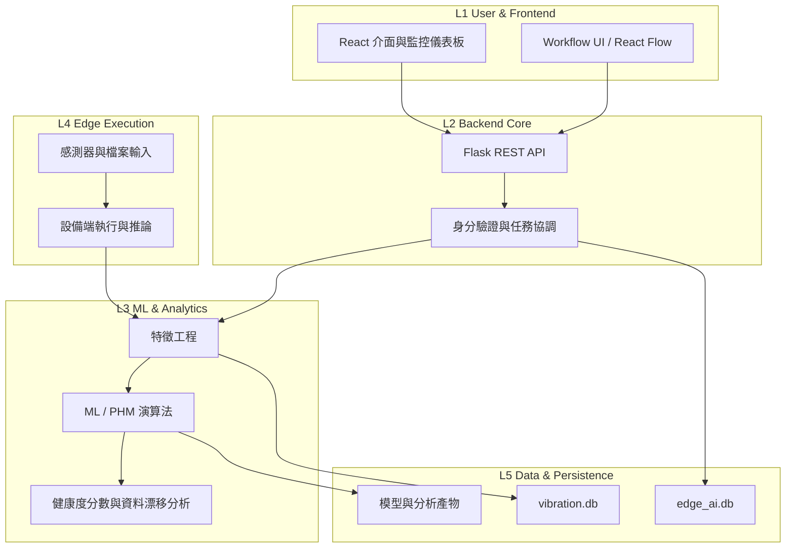

### 3.1 五層架構

| 層級 | 架構模組               | 主要職責                          |
| -- | ------------------ | ----------------------------- |
| L1 | User & Frontend    | React 介面、監控儀表板、資料操作與 Agent UI |
| L2 | Backend Core       | Flask REST API、身分驗證、業務邏輯與工具協調 |
| L3 | ML & Analytics     | 特徵工程、模型訓練、異常偵測與資料分析           |
| L4 | Edge Execution     | 感測器接入、設備端程式執行與即時推論            |
| L5 | Data & Persistence | SQLite 資料庫、模型檔案、特徵設定與歷程紀錄     |

這種分層方式不代表每一層都是獨立部署的微服務，而是以職責劃分降低模組間的耦合。

例如，前端不應直接存取資料庫；AI Agent 不應繞過後端權限檢查；模型推論也應與 UI 呈現分開，讓演算法能在不同工作流程中重複使用。

### 3.2 前端與後端如何協作？

前端使用 React 18、Material UI 與 React Flow 建立操作介面及工作流程視覺化。

後端使用 Flask 提供 REST API，並透過不同 Blueprint 分離感測器、模型、設備、使用者及 Agent 等業務領域。

兩者的主要互動方式包括：

- **REST API：** 查詢資料、更新設定、提交模型訓練任務。
- **Polling：** 定期取得最新設備狀態。
- **Server-Sent Events（SSE）：** 接收伺服器主動推送的事件與 Agent 串流回應。

這些機制各有用途。一般 CRUD 操作適合 REST API；對於定期更新的狀態，可以使用 Polling；需要持續接收伺服器事件時，SSE 則提供較直接的單向串流方式。

### 3.3 為什麼 AI Agent 不能直接操作資料庫？

AI Agent 的優勢是理解自然語言、拆解任務與選擇工具，但 LLM 的輸出本質上仍具有不確定性。

因此，平台將 AI 推理與實際執行分開：

1. LLM 理解使用者問題。
2. Agent 選擇符合任務需求的工具。
3. 後端檢查權限、參數與允許的操作範圍。
4. Python 工具執行資料查詢或分析。
5. 執行結果再交由 LLM 整理成可讀的回答。

這個架構讓 LLM 負責理解與協調，讓程式負責可驗證的資料操作。

**核心原則：讓 AI 決定要查什麼，但由受控的程式決定如何執行。**

### 3.4 如何看待系統效能資料？

原始簡報列出資料接入、Tool 執行、SSE 廣播與 Agent 推理等延遲指標。這些數字有助於建立效能觀測的方向，但不同階段的延遲必須使用一致的量測起訖點，並區分平均值、P95、P99 與冷啟動情境。

此外，若資料來自不同測試環境或不同量測方法，就不應直接相加，當成端到端延遲。

對工程系統而言，效能指標必須能夠重現，才具有實際的診斷與比較價值。

---

## 4. 端到端資料流：從高頻訊號到健康度監控

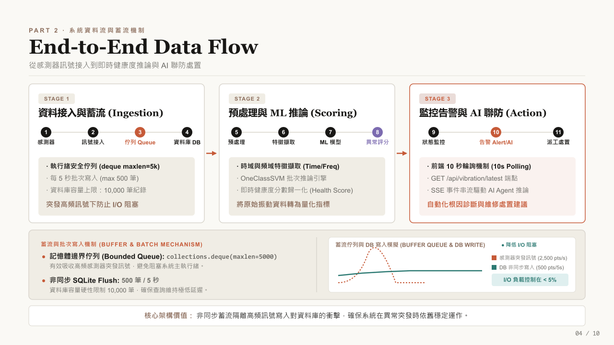

在系統設計中，資料流不只是把資料從 A 傳到 B，更需要定義資料如何進入系統、如何被處理，以及系統在流量突然增加時如何維持穩定。

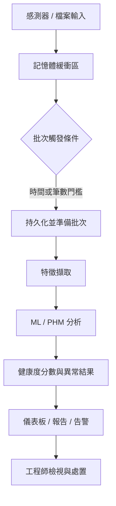

### 4.1 Stage 1：資料接入與緩衝（Ingestion）

感測器持續產生資料。如果每筆訊號都立即寫入資料庫，高頻 I/O 操作可能與查詢請求互相競爭。

平台採用有界記憶體緩衝區與批次寫入策略：

- 使用 `collections.deque(maxlen=5000)` 緩衝資料。
- 每隔約 5 秒，或達到批次條件時，將最多 500 筆資料寫入資料庫。
- 將資料庫保留量限制在設定的範圍內。
- 透過背景處理降低資料接收與磁碟 I/O 之間的耦合。

概念上的資料流如下：

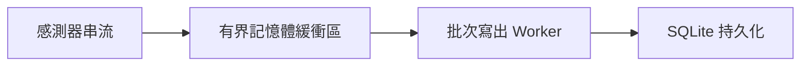

這個設計能吸收一定程度的短暫流量波動，避免每筆資料都觸發獨立的寫入操作。

不過，有界佇列也有重要限制：當緩衝區滿載時，`deque(maxlen=5000)` 會自動移除較舊的元素。因此，**它適合需要限制記憶體使用量的緩衝情境，但不能直接視為不丟資料的可靠訊息佇列。**

如果所有感測器樣本都必須完整保存，就需要額外設計持久化佇列、溢位處理、背壓機制與資料遺失監控。

### 4.2 Stage 2：特徵擷取與模型推論（Scoring）

原始振動訊號通常不適合直接用單一數值描述設備狀態，因此需要先經過訊號處理與特徵工程。

典型流程如下：

1. 將連續訊號切分成固定長度的時間視窗。
2. 從每個視窗擷取時域與頻域特徵。
3. 將特徵整理成模型可接受的矩陣。
4. 執行異常偵測模型。
5. 將模型輸出轉換成供監控介面使用的狀態或健康度指標。

例如，振動訊號可以轉換成 RMS、峰值、峭度與主要頻率等特徵。這些特徵有助於描述訊號強度、尖峰程度與頻率結構，但其意義仍需搭配設備特性與正常運轉基準判讀。

### 4.3 Stage 3：監控、告警與 Agent 分析（Action）

完成推論後，平台會更新設備狀態，並讓前端與 Agent 使用相關資料。

- 前端透過 API 取得最新健康度資訊。
- 週期性監控流程檢查設備狀態。
- 異常事件可以觸發告警與 SSE 通知。
- AI Agent 根據事件內容及可用的歷史資料，協助整理異常原因與維護建議。

此處需要區分兩件事：**異常偵測負責辨識偏離，根因分析則負責提出可能的解釋。** 前者可以由模型分數與規則驅動；後者通常需要結合歷史資料、設備知識與工程師驗證，不能只憑一個異常分數就斷言故障原因。

---

## 5. ML & PHM Pipeline：如何從感測器資料辨識異常？

設備健康管理的難點之一，是實際故障案例通常有限，而且不同設備、負載與運轉條件可能產生不同的訊號分布。

因此，平台使用多種分析方法處理不同問題，而不是期待單一模型解決所有情況。

### 5.1 訊號預處理與特徵工程

假設輸入為一段振動加速度訊號：

$$
x = [x_1, x_2, \ldots, x_N]
$$

首先將連續訊號切分成固定長度的視窗。若視窗之間存在重疊，就能提高時間解析度，但同時也會增加運算量與樣本間的相關性。

接著擷取特徵。

**RMS（Root Mean Square）**

$$
\mathrm{RMS} = \sqrt{\frac{1}{N}\sum_{i=1}^{N} x_i^2}
$$

RMS 可用來描述訊號的整體能量程度，適合追蹤振動強度的變化。

**峰值（Peak）**

$$
\mathrm{Peak} = \max_i |x_i|
$$

峰值有助於觀察瞬間衝擊或尖峰，但也容易受到單一極端樣本影響。

**峭度（Kurtosis）**

峭度可描述訊號分布尾部與極端值的特性，在某些衝擊型異常分析中具有參考價值。不過，解讀時需要注意定義、偏差修正方式與訊號分布假設。

除了時域特徵，平台也可利用 FFT（Fast Fourier Transform）將訊號轉換至頻域，觀察主要頻率成分及其變化。

這些特徵的選擇應根據設備的物理特性、取樣率、運轉條件與實際診斷需求決定。

### 5.2 One-Class SVM：缺乏故障標籤時的異常偵測

在故障樣本有限的情況下，One-Class SVM（OCSVM）是一種可考慮的無監督或單類別異常偵測方法。

其基本想法是利用正常資料學習一個決策邊界，之後判斷新的資料是否偏離正常資料所形成的區域。

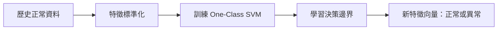

OCSVM 的優點是可以在缺少完整故障標籤的情境下建立異常偵測基準。

但它也有需要注意的地方：

- 對特徵尺度與資料前處理相當敏感。
- `nu`、`gamma` 等參數會影響決策邊界。
- 設備正常運轉條件若有多種模式，單一邊界可能難以涵蓋。
- 異常偵測結果不等同於故障分類，更不直接代表故障原因。

因此，實務上仍需利用正常資料的涵蓋範圍、誤報率、漏報率與工程師回饋評估模型是否合適。

### 5.3 DTW：處理時間序列的非線性對齊

DTW（Dynamic Time Warping）用於比較兩段時間序列，即使它們在時間軸上存在局部伸縮，也能尋找較合理的對齊路徑。

例如，同一設備在不同轉速下執行相似動作時，特徵峰值可能出現在不同時間點。直接逐點比較可能產生較大的差異，而 DTW 能在允許的條件下對齊兩段序列。

其概念是尋找一條累積距離較小的對齊路徑：

$$
D(i,j) = d(x_i,y_j) + \min\left\{ D(i-1,j),\; D(i,j-1),\; D(i-1,j-1) \right\}
$$

其中 \(d(x_i,y_j)\) 是兩個樣本點之間的局部距離。

DTW 適合用於時間序列相似度分析，但並不是所有轉速變化問題都應使用 DTW。必要時仍須考慮訊號重採樣、階次分析或其他與設備物理機制更直接相關的方法。

### 5.4 PCA：特徵空間與長期漂移分析

PCA（Principal Component Analysis）透過線性投影，將多個可能相關的特徵轉換成較少的主成分。

在 PHM 情境中，可以先利用歷史基準資料建立特徵空間，再觀察新資料相對於基準的變化。

例如：

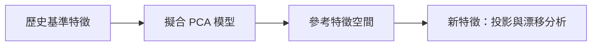

若新資料的分布持續偏離歷史基準，可能表示設備狀態、操作條件或資料來源出現變化。

但必須注意，**資料漂移不一定等於設備退化。** 負載改變、感測器更換、取樣條件改變或資料前處理版本不同，都可能造成分布差異。

因此，漂移監控應同時保留基準版本、特徵設定與運轉條件，並由領域知識協助判讀。

### 5.5 演算法應依問題選擇

| 問題        | 可考慮的方法            | 主要目的       |
| --------- | ----------------- | ---------- |
| 缺乏故障標籤    | One-Class SVM     | 建立正常行為邊界   |
| 序列時間軸不一致  | DTW               | 比較序列形狀與相似度 |
| 高維特徵與分布變化 | PCA               | 降維及特徵空間分析  |
| 突發振動變化    | RMS、Peak、Kurtosis | 量化時域訊號特性   |
| 頻率成分變化    | FFT               | 觀察頻域結構     |

這些方法可以互補，但實際組合仍須依設備與資料特性驗證。

---

## 6. Backend Engineering：讓資料、模型與服務可維護

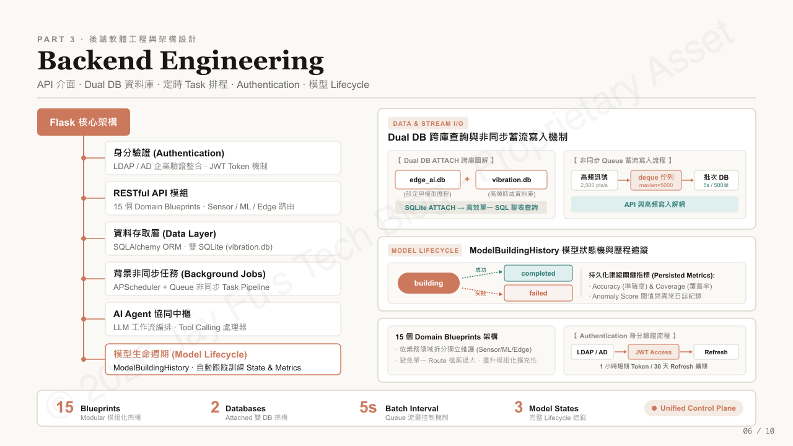

模型與感測器資料只是整個平台的一部分。要讓系統能持續運作，還需要身分驗證、資料存取、背景工作、狀態管理與錯誤處理。

### 6.1 Flask 與 Blueprint 模組化

後端使用 Flask 建立 REST API，並依業務領域拆分 Blueprint，例如：

- Sensor Data：感測器資料接入與查詢。
- ML & Analytics：特徵工程、模型訓練與分析。
- Edge Management：設備端程式與部署相關管理。
- Maintenance：維護回饋與相關工作流程。
- Agent：LLM 對話、工具呼叫與串流回應。
- User & Admin：使用者、權限與管理功能。

Blueprint 的價值在於讓不同領域的路由與邏輯有相對清楚的歸屬。

不過，將程式拆成多個 Blueprint 並不會自動解決所有耦合問題。如果大量業務邏輯仍集中在單一大型檔案，後續仍需要進一步抽離 Service Layer、資料存取層與共用領域邏輯。

### 6.2 身分驗證與權限控制

平台整合企業 LDAP／Active Directory 身分驗證，並使用 JWT 處理後續 API 的存取驗證。

典型流程為：

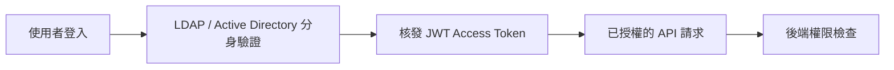

這裡需要區分身分驗證與授權：

- **Authentication：** 確認使用者是誰。
- **Authorization：** 確認使用者可以執行哪些操作。

即使請求帶有有效 JWT，後端仍應依使用者角色、專案權限與資源範圍進行檢查。敏感操作不能只依賴前端是否顯示按鈕。

### 6.3 SQLite 雙資料庫設計

平台將一般設定與模型歷程資料，和高頻振動資料分開保存。

| 資料庫            | 主要用途                |
| -------------- | ------------------- |
| `edge_ai.db`   | 使用者、專案、特徵設定、模型訓練歷程等 |
| `vibration.db` | 振動資料與相關告警紀錄         |

這種方式讓不同性質的資料可以分開管理，也能降低高頻資料持續成長對主要業務資料庫的影響。

後端透過 SQLAlchemy 管理資料存取，並使用 SQLite 的 `ATTACH DATABASE` 機制，在連線建立時附加另一個資料庫，讓部分跨資料庫查詢能透過單一 SQL 執行。

但雙資料庫不代表所有操作都具有單一交易的完整原子性。跨資料庫交易、備份一致性與併發寫入仍須依 SQLite 的實際限制進行設計與驗證。

### 6.4 背景任務與模型生命週期

平台使用 APScheduler 執行週期性工作，例如監控檢查、資料整理與資料庫備份；部分資料處理則透過佇列與背景工作降低對請求處理流程的影響。

模型生命週期也需要明確的狀態紀錄。例如，`ModelBuildingHistory` 可追蹤模型建置任務的狀態：

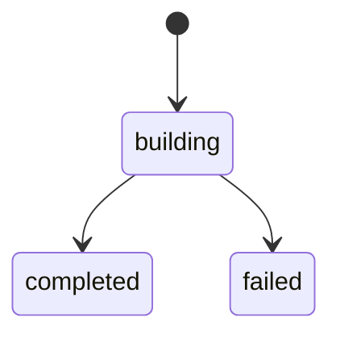

除了狀態，還應保存模型設定、執行時間、資料範圍及相關評估指標。這些紀錄能幫助工程師釐清模型是否成功建置、使用了哪些設定，以及異常發生在哪個階段。

### 6.5 備份與資料保護

平台設有定期資料庫備份，並透過 SQLite 的線上備份 API 產生備份檔案。

不過，備份排程存在並不等於災難復原能力已經完整。可靠的資料保護還需要考慮：

- 備份檔案是否能成功還原。
- 多個資料庫及模型檔案之間是否具有一致的版本。
- 備份是否與正式資料存放在不同的故障範圍。
- 是否定期驗證還原流程與資料完整性。

這些項目應列入後續的維運驗證與可靠性改善工作。

---

## 7. AI Agent：從自然語言查詢到可控的工程工具

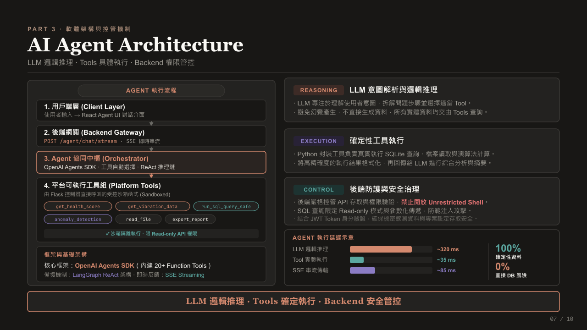

將 LLM 加入設備監控平台，真正的挑戰不只是讓模型能夠回答問題，而是讓它能在具備權限控制、資料可追溯與執行邊界的環境中使用系統能力。

### 7.1 為什麼需要 Tool Calling？

假設工程師詢問：

「最近設備的健康度為什麼下降？有沒有值得注意的振動異常？」

單純依靠 LLM 的內部知識，無法得知目前設備的真實狀態。

因此，Agent 需要先查詢實際資料，再根據結果進行分析。

平台提供的工具可以包含：

| 工具                   | 用途          |
| -------------------- | ----------- |
| `get_health_score`   | 取得設備健康度     |
| `get_vibration_data` | 查詢振動資料      |
| `run_sql_query_safe` | 執行受控的唯讀資料查詢 |
| `anomaly_detection`  | 執行異常分析      |
| `read_file`          | 讀取允許存取的檔案   |
| `export_report`      | 產生分析報告      |

實際可用工具應依部署版本、使用者權限與後端設定為準。

### 7.2 Agent 的執行流程

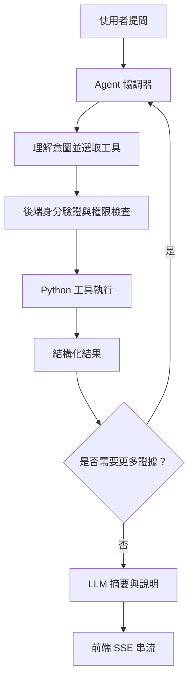

這個流程將語言理解與資料執行分開。

LLM 可以決定要查詢哪些資料、如何組織分析步驟，但真正的 SQL 查詢、檔案存取與演算法計算仍由後端工具執行。

這樣能降低模型憑空編造即時數值的風險，但不能完全消除幻覺。LLM 仍可能誤解工具結果、過度推論或產生缺乏證據的解釋，因此回答應盡可能引用查詢結果、時間範圍與資料來源。

### 7.3 為什麼不讓 Agent 直接操作資料庫？

直接將任意 SQL 或 Shell 權限交給 LLM，會使錯誤操作、權限越界與資料安全風險更難控制。

因此，平台採取以下原則：

1. 工具由後端明確定義，不提供任意 Shell 執行能力。
2. 資料查詢限制在允許的範圍內。
3. SQL 使用參數化方式，並限制唯讀查詢的能力。
4. 每次工具執行仍須遵守使用者的身分與資源權限。
5. 對重要操作記錄請求、工具執行結果與錯誤資訊。

需要特別注意的是，將 SQL 設為唯讀並不會自動讓它安全。查詢仍應限制可存取的資料表、欄位、執行時間與回傳資料量，並避免洩漏敏感資訊。

### 7.4 LLM 推理與確定性執行的分工

這套架構的核心是將不同類型的工作交給適合的元件：

- **LLM：** 理解問題、規劃步驟、選擇工具與整理結果。
- **Python Tools：** 執行資料查詢、數值運算與演算法。
- **Backend：** 管理身分、權限、參數驗證與執行邊界。
- **Frontend：** 顯示推理過程、查詢結果與維護建議。

這不代表整體系統的結果是百分之百確定的，而是盡量讓需要精確的資料取得與運算交由可測試、可驗證的程式處理。

### 7.5 SSE 在 Agent 互動中的角色

Agent 執行可能包含多次工具呼叫與較長的推理過程。如果前端只能等待最終回應，使用者很難了解目前的執行狀態。

SSE 允許伺服器透過單向 HTTP 連線持續傳送事件，適合用來顯示串流文字、狀態更新與工具執行結果。

若未來需要瀏覽器與伺服器進行頻繁的雙向即時互動，再評估 WebSocket 是否更合適。

---

## 8. 部署與監控：讓平台能在目標環境中運作

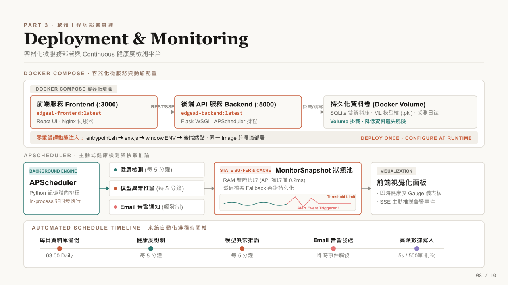

一個可以在開發環境成功執行的系統，不一定能直接部署到另一台設備或伺服器。

部署設計需要處理依賴、環境設定、持久化資料、背景工作與更新流程。

### 8.1 Docker Compose 容器化部署

平台使用 Docker Compose 管理前端與後端服務。

| 服務                 | 主要職責                |
| ------------------ | ------------------- |
| Frontend           | React UI 與靜態資源服務    |
| Backend            | Flask API、資料處理與背景工作 |
| Persistent Volumes | 保存資料庫、模型檔與需要持久化的資料  |

容器化的主要價值，是讓服務的執行環境更容易重現，並簡化部署與更新流程。

但容器本身不會自動提供高可用性。若前後端都部署在單一主機，主機故障仍可能影響整套系統。

### 8.2 執行時注入環境設定

前端與後端的連線位址不應被永久寫死在建置產物中。

平台透過執行時設定注入機制，讓容器啟動時產生或載入 `env.js`，再由前端讀取 `window.ENV` 取得後端端點。

概念如下：

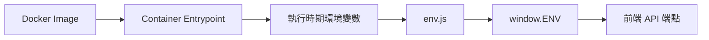

這種設計讓同一份前端建置產物可以在不同環境使用不同的後端位址，減少因環境切換而重新編譯的需求。

### 8.3 APScheduler 與背景監控

平台利用 APScheduler 執行週期性任務，例如健康度檢查、模型異常推論與每日資料庫備份；符合條件的告警則可透過事件觸發通知。

排程工作有幾個值得注意的工程問題：

- 單次任務執行時間是否超過排程間隔。
- 任務失敗後是否會重試。
- 同一任務是否可能重複執行。
- 服務重新啟動後，任務狀態是否仍然一致。
- 多個後端程序是否可能重複執行相同排程。

特別是在多副本部署時，不應直接假設每個 Flask 程序都能安全地啟動同一組排程器。此時可以考慮將排程工作移至獨立服務，並搭配分散式鎖或任務佇列。

### 8.4 監控不只是顯示儀表板

平台透過健康度儀表板、告警事件與快取狀態，協助使用者了解設備與系統的運作情況。

進一步的監控設計則應涵蓋：

- 感測器資料是否持續進入。
- 佇列長度與資料丟失情形。
- 批次寫入延遲與資料庫錯誤率。
- 模型推論延遲與異常比例。
- API 回應時間與錯誤率。
- 背景任務是否持續成功執行。
- Agent 工具呼叫失敗率與整體回應時間。

這些指標能幫助工程師區分設備異常、資料管線故障與應用服務故障，避免把所有問題都當成模型問題處理。

---

## 9. Failure Handling & Scalability：從單機限制到橫向擴充

單機架構的優點是部署簡單、依賴少、維運成本較低。但隨著資料量與併發請求增加，原本的簡化設計也會逐漸出現限制。

### 9.1 有界佇列的容量與資料完整性

目前資料流透過記憶體佇列吸收短暫突發流量，再批次寫入 SQLite。

這種方式能減少頻繁 I/O，但也有明確的容量限制。

如果輸入速率長時間高於消化速率，佇列仍會持續接近滿載。對使用 `deque(maxlen=5000)` 的實作而言，舊資料可能被新資料覆蓋，因此不能只觀察程式是否仍在執行，還需要監控資料遺失與佇列滿載情形。

此外，當資料庫寫入失敗、程序重新啟動或設備斷電時，尚未寫入磁碟的資料也可能遺失。

因此，可靠性設計應根據資料的重要性，決定是否需要磁碟緩衝、重試機制、持久化訊息佇列或資料補傳能力。

### 9.2 SQLite 的寫入併發限制

SQLite 適合許多單機與低維運負擔的應用，但它的寫入併發能力有限。

當多個工作同時寫入資料，或高頻感測器資料與 API 請求競爭資料庫資源時，可能出現鎖定等待、寫入延遲或失敗。

這不代表 SQLite 不適合 Edge AI，而是需要確認資料量、寫入模式、鎖定時間與查詢需求是否符合其使用範圍。

對單機設備而言，簡單的資料庫加上適當批次寫入，可能比引入完整分散式資料平台更合理。

### 9.3 未來架構：將接收、計算與儲存解耦

當系統需要處理更多設備、更高吞吐量或更嚴格的可靠性要求時，可以逐步演進至下列架構：

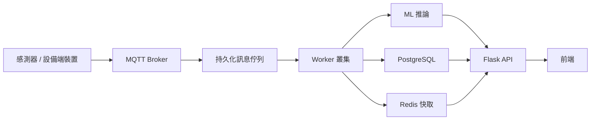

這是未來演進方向，而不是目前單機架構已經具備的所有能力。

各元件的目的如下：

| 元件               | 預期用途              |
| ---------------- | ----------------- |
| MQTT Broker      | 接收設備訊息與管理發佈／訂閱    |
| Kafka／RabbitMQ 等 | 緩衝資料流、解耦生產者與消費者   |
| Worker Cluster   | 平行處理特徵工程、推論與資料整理  |
| PostgreSQL       | 支援較複雜的資料管理與併發需求   |
| Redis            | 快取即時狀態與減少重複查詢     |
| Load Balancer    | 將 API 請求分配至多個服務副本 |

需要注意，訊息佇列能提供的持久性、重試與交付語意，取決於實際設定；即使採用可靠佇列，仍應設計冪等處理、重複訊息防護與失敗訊息處置。

### 9.4 不必為了擴充而一次重寫整套系統

比較務實的做法，是先量測瓶頸，再逐步解耦。

例如：

1. 先確認資料庫寫入是否真的成為瓶頸。
2. 將耗時工作移出 API 請求流程。
3. 為資料接收與背景工作建立明確介面。
4. 將需要可靠交付的資料流改用持久化佇列。
5. 在必要時將資料庫與快取替換成更符合負載需求的服務。
6. 最後再評估多副本部署、負載平衡與容器編排。

如此一來，架構演進是由實際需求驅動，而不是因為某種技術流行就提前引入。

---

## 10. Engineering Trade-offs：技術選擇與架構演進

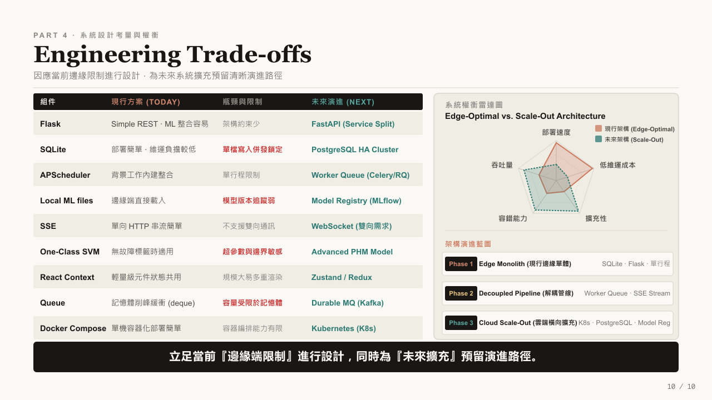

系統設計不只是選擇技術，也是在不同的限制之間取得平衡。

對 Edge AI 平台而言，部署便利性、離線運作、資料完整性、效能與維運成本都可能互相影響。

### 10.1 現行方案與未來演進

| 項目              | 現行方案                | 主要限制              | 可能的演進方向                        |
| --------------- | ------------------- | ----------------- | ------------------------------ |
| Backend         | Flask               | 需要更清楚的服務邊界與背景工作隔離 | 重構 Service Layer，必要時評估 FastAPI |
| Database        | SQLite 雙資料庫         | 寫入併發與單機故障範圍       | PostgreSQL、備援與讀寫最佳化            |
| Background Jobs | APScheduler + Queue | 多程序下的任務協調與可靠性     | 獨立 Worker、Celery 或 RQ          |
| Model Files     | 本機模型檔               | 版本、相依設定與追蹤能力有限    | Model Registry，例如 MLflow       |
| Event Streaming | SSE                 | 主要支援伺服器至用戶端的單向串流  | 依雙向需求評估 WebSocket              |
| ML              | One-Class SVM 等     | 參數敏感、資料分布改變       | 更完整的模型驗證與 PHM 方法               |
| Frontend State  | React Context       | 大型共享狀態可能增加維護成本    | Zustand 或 Redux 等方案            |
| In-Memory Queue | deque               | 無法保證持久化交付         | Durable Message Queue          |
| Deployment      | Docker Compose      | 跨主機編排與自動復原能力有限    | 視規模評估 Kubernetes               |

這張表不是說未來方案一定比較好，而是列出目前選擇的適用範圍，以及在什麼條件下可能需要改變。

例如，Flask 本身並不等於缺乏擴充性；真正需要關注的是程式結構、部署方式、請求處理模型與背景工作如何分離。同樣地，React Context 也不一定需要被 Redux 取代，是否更換應由狀態複雜度與實際維護成本決定。

### 10.2 三階段架構演進

可以將未來的架構演進整理成三個階段：

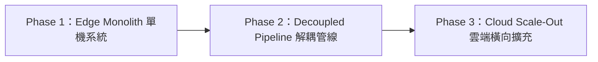

**Phase 1 — Edge Monolith**

使用 Flask、SQLite、設備端程式與 Docker Compose 建立可部署的單機系統。重點是讓核心資料流與模型工作流程穩定運作。

**Phase 2 — Decoupled Pipeline**

將資料接收、背景計算與 API 請求進一步解耦。針對可靠性需求引入持久化佇列、獨立 Worker 與更明確的錯誤處理流程。

**Phase 3 — Cloud Scale-Out**

當設備數量、資料吞吐量或可用性需求達到單機架構的限制時，再評估 PostgreSQL、Redis、多副本 API 與 Kubernetes 等技術。

這三個階段不一定是所有系統都必須經過的固定路線。部分設備可能長期使用單機架構就足夠；另一些系統則可能因為資料完整性或高可用性要求，必須提早採用更可靠的儲存與訊息傳遞機制。

### 10.3 我認為最重要的設計原則

**Design for today's constraints, keep a path to tomorrow's scale.**

好的架構不代表使用最多的元件，而是能清楚說明：

- 為什麼現在選擇這個方案。
- 它解決了哪些實際問題。
- 它有哪些限制與失敗模式。
- 當需求改變時，哪些模組可以被替換或擴充。

對 Edge AI 而言，離線能力、部署簡單性與資料可靠性可能比一開始就追求大規模水平擴充更重要。

---

## 結語：真正的價值在於把模型整合成工程系統

回顧這個專案，我認為最大的挑戰並不是單獨實作某個演算法，而是如何讓感測器資料、模型推論、後端 API、設備部署、監控與 AI Agent 在同一套系統中協同運作。

從整體工程角度來看，這個平台帶給我的重要經驗包括以下幾點：

1. **模型需要完整的資料與部署流程。** 模型在實驗環境中表現良好，只是整個生命週期的一部分。要讓模型真正進入設備應用，還需要特徵設定、版本管理、推論介面、監控與錯誤處理。
2. **AI Agent 的可靠性取決於工具與系統邊界。** LLM 可以協助工程師理解問題，但不應取代需要精確執行的資料查詢與數值計算。透過受控工具、後端驗證與可追溯的執行結果，才能讓 Agent 更有機會成為可靠的工程助手。
3. **系統效能必須搭配可觀測性。** 緩衝區、批次寫入、快取與背景排程都能改善部分工作負載，但每種設計也會引入新的限制。只有持續量測延遲、錯誤率、資料完整性與資源使用情況，才能判斷這些選擇是否真的有效。
4. **架構演進應由瓶頸與需求驅動。** SQLite、Flask 與 Docker Compose 可以是合理的起點，前提是理解它們的適用範圍，並在需求超出限制時有計畫地演進。

對我而言，這個專案的核心不是使用了多少種框架，而是建立了一套從感測器資料到工程決策的完整技術脈絡，並在實際限制下思考資料處理、模型應用、系統可靠性與未來擴充。

這也是我希望持續深化的方向：不只完成單一功能，而是能夠理解並設計一套可維護、可觀測、可驗證，而且能隨需求成長的 AI 工程系統。

---

> **版權與使用條款：** 本文所有圖表版權歸作者所有，轉載請註明出處與原作者。內容已全面進行去識別化與虛擬化處理，僅供技術交流與架構展示使用，不構成任何營業秘密洩露。文中所列未來架構屬於可能的演進方向，不代表已全部實作或部署。