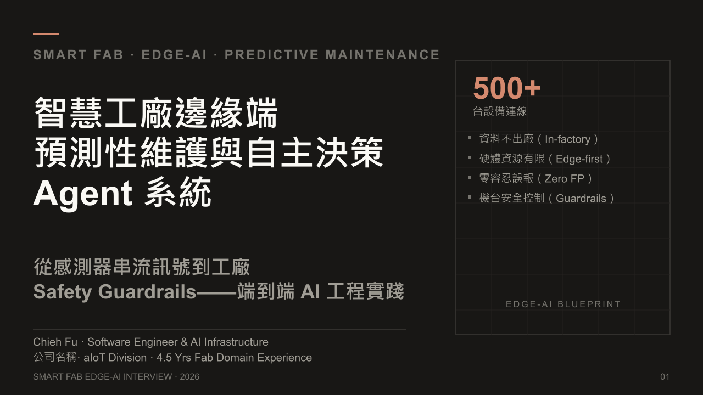
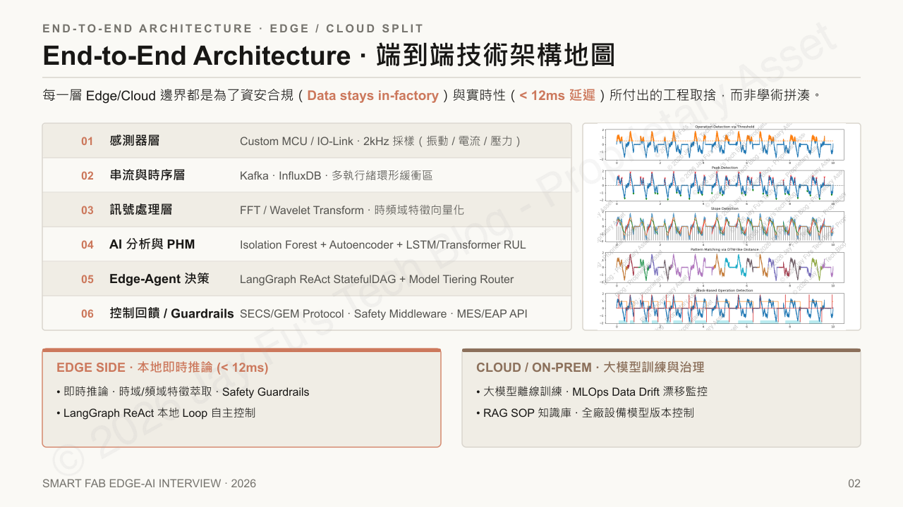
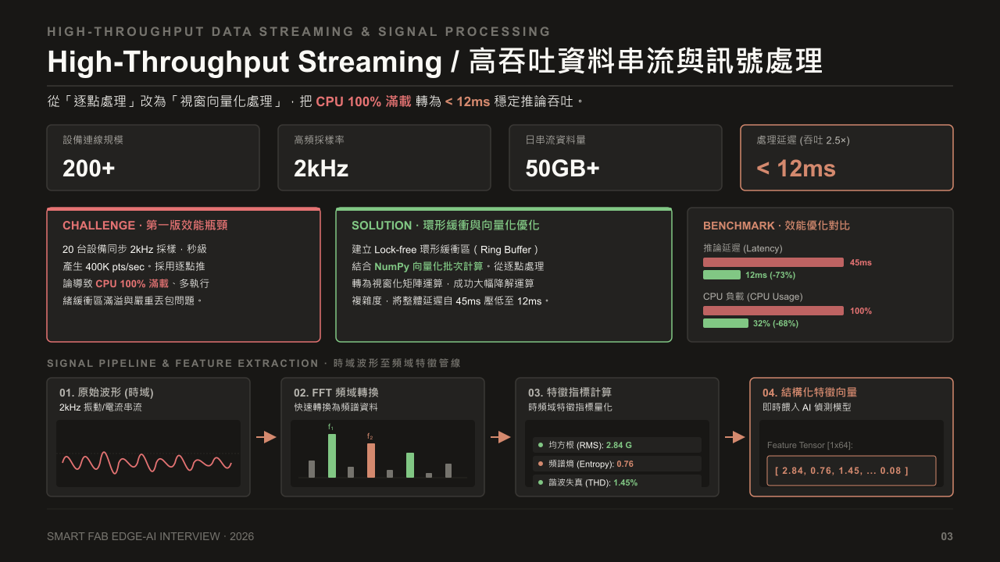
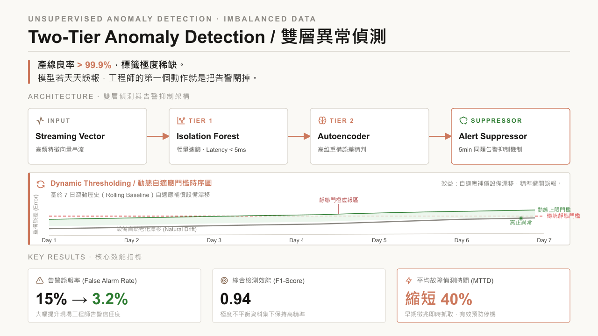
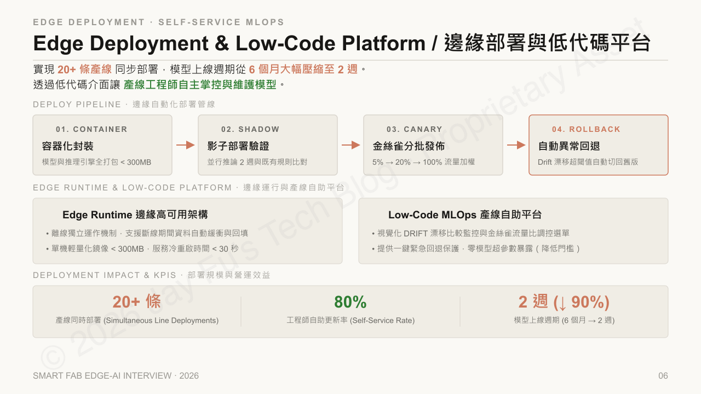
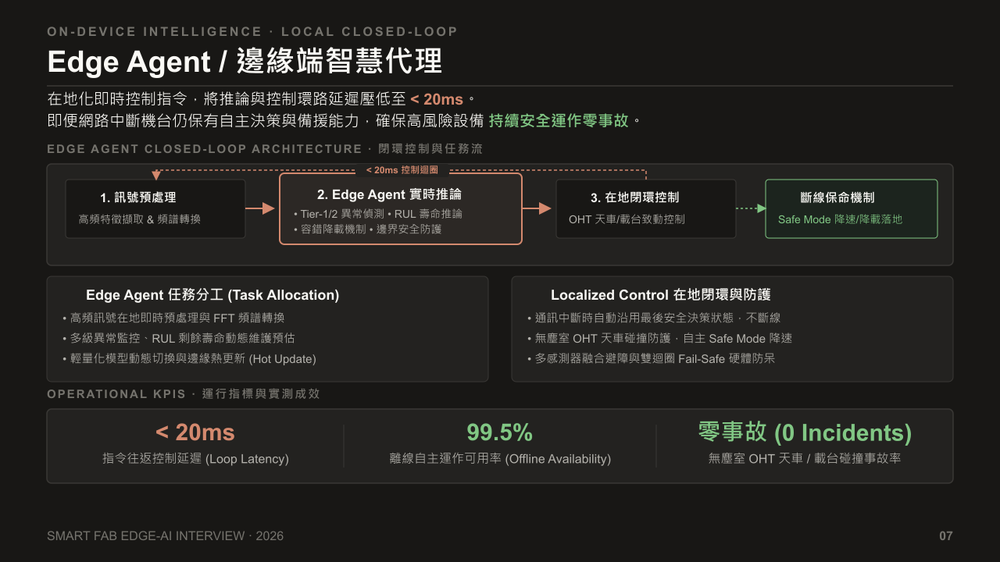
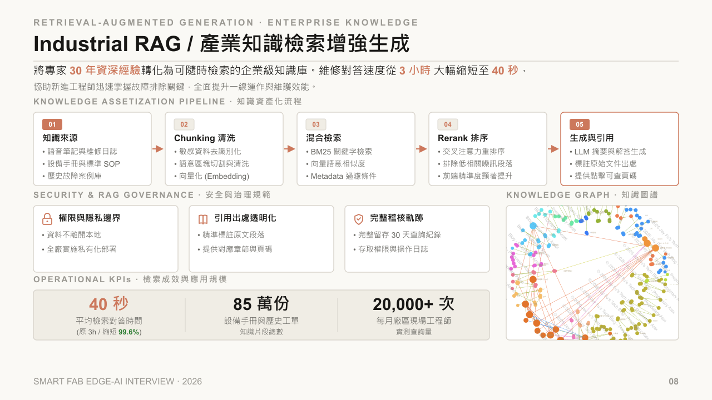
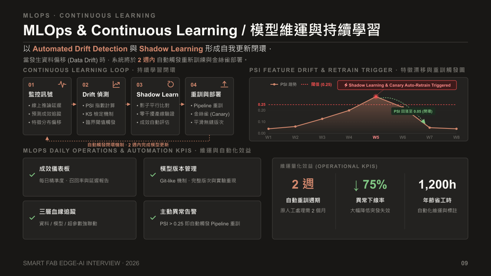
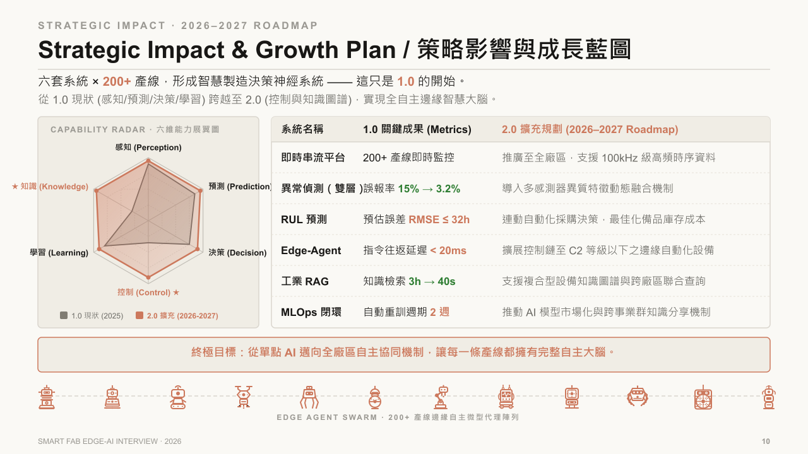

## 前言

這篇文章將我面試用的 11 張簡報圖表整理成文字版。內容按照系統設計的邏輯推演：從最底層的感測器串流開始，一路延伸至頂層的自主決策 Agent。中間每一層架構的切割考量，以及工程上的權衡（Trade-offs），都詳細紀錄在對應的段落中。

本文歡迎轉載，但請務必註明出處與原作者。文中簡報的所有公司名稱皆已替換為占位符，相關數據亦經過調整，閱讀時建議聚焦於系統架構與設計思維即可。

> ⚠️ **智慧財產權與免責聲明**
本文圖表版權歸作者所有，僅供個人技術能力展示與面試參考。內容已全面進行去識別化與虛擬化處理，未包含任何未公開之營業秘密、真實客戶名稱、具體半導體製程節點或內部專案代號。未經授權，請勿將圖表進行商業下載、二次改作或未註明來源之轉載。

---

## 01. 封面：智慧工廠邊緣端預測性維護與自主決策 Agent 系統

本系統定位為「智慧工廠邊緣端預測性維護與自主決策 Agent 系統」，核心願景是從感測器串流訊號到工廠 Safety Guardrails 的端到端 AI 工程實踐。設計受四大約束條件指導：

- **資料不出廠（In-factory）**：所有推論與訊號處理在廠區內完成，避免資料跨境。
- **硬體資源有限（Edge-first）**：模型與推理引擎必須適配邊緣設備的運算與記憶體限制。
- **零容忍誤報（Zero FP）**：誤報會導致工程師關閉告警，必須嚴格控制誤報率。
- **機台安全控制（Guardrails）**：高風險設備必須保有自主決策與備援能力，確保零事故。

---

## 02. 端到端技術架構地圖

架構採 Edge/Cloud 分層設計，每一層 Edge/Cloud 邊界都是為了資安合規與實時性（< 12ms 延遲）所付出的工程取捨，而非學術拼湊。六層堆疊如下：

| 層級 | 名稱 | 核心技術 |
|---|---|---|
| 01 | 感測器層 | Custom MCU / IO-Link · 2kHz 採樣（振動 / 電流 / 壓力） |
| 02 | 串流與時序層 | Kafka · InfluxDB · 多執行緒環形緩衝區 |
| 03 | 訊號處理層 | FFT / Wavelet Transform · 時頻域特徵向量化 |
| 04 | AI 分析與 PHM | Isolation Forest + Autoencoder + LSTM/Transformer RUL |
| 05 | Edge-Agent 決策 | LangGraph ReAct StatefulDAG + Model Tiering Router |
| 06 | 控制回饋 / Guardrails | SECS/GEM Protocol · Safety Middleware · MES/EAP API |

邊緣端負責即時推論（< 12ms），雲端/本地端負責大模型訓練與治理。

---

## 03. 高吞吐資料串流與訊號處理

從「逐點處理」改為「視窗向量化處理」，把 CPU 100% 滿載轉為 < 12ms 穩定推論吞吐。

關鍵指標：
- 設備連線規模：500+
- 高頻採樣率：2kHz
- 日串流資料量：50GB+
- 處理延遲：45ms → < 12ms（-73%，吞吐提升 2.5×）
- CPU 負載：100% → 32%（-68%）

訊號管線分為四個階段：原始波形（時域）→ FFT 頻域轉換 → 特徵指標計算（RMS、頻譜熵、諧波失真）→ 結構化特徵向量，即時餵入 AI 偵測模型，特徵張量範例 Feature Tensor [1×64] = [2.84, 0.76, 1.45, …, 0.08]（RMS 2.84 G、頻譜熵 0.76、諧波失真 1.45%）。

---

## 04. 雙層異常偵測

針對產線良率 > 99.9%、標籤極度稀缺，資料極度不平衡的問題，採用「雙層偵測 + 告警抑制」架構：

1. **Tier 1 - Isolation Forest**：輕量速篩，延遲 < 5ms。
2. **Tier 2 - Autoencoder**：高維重構誤差精判。
3. **Alert Suppressor**：5min 同類告警抑制機制，避免誤報干擾工程師。

搭配動態自適應門檻，基於 7 日滾動歷史（Rolling Baseline）自適應補償設備漂移，精準避開誤報。核心效益：告警誤報率從 15% 降至 3.2%，F1-Score 達 0.94（極度不平衡資料集下仍保持高精準），平均故障偵測時間（MTTD）縮短 40%。

---

## 05. PHM 與剩餘壽命預測 (RUL)

融合頻譜熵等領域知識與 Weibull 存活分布（生存機率與衰退分配建模），將 RUL 預估誤差控制在 ≤ 32 小時內，實現設備維護從「被動搶修」轉為「主動預防排程」。

物理知識融合管線：Sensor Features → Transformer-LSTM → Weibull Survival → RUL + 95% CI。

三階段維護行動分級：
- Tier 1（> 30 天）：常規監控
- Tier 2（7–30 天）：預警備料
- Tier 3（< 7 天）：緊急派工

實測效益：非預期停機時間 ↓ 42%，整體設備維護成本 ↓ 28%，RUL 預估誤差 ≤ 32 小時。

---

## 06. 邊緣部署與低代碼平台

實現 20+ 條產線同步部署，模型上線週期從 6 個月大幅壓縮至 2 週。透過低代碼介面讓產線工程師自主掌控與維護模型。

部署管線四階段：容器化封裝（< 300MB）→ 影子部署驗證（並行推論 2 週與既有規則比對）→ 金絲雀分批發佈（5% → 20% → 100% 流量加權）→ 自動異常回退（Drift 漂移超閾值自動切回舊版）。

邊緣高可用架構支援離線獨立運作、斷線期間資料自動緩衝與回填，單機輕量化鏡像 < 300MB，服務冷重啟時間 < 30 秒。產線自助平台提供一鍵緊急回退保護，且零模型超參數暴露（降低操作門檻）。工程師自助更新率達 80%。

---

## 07. 邊緣端智慧代理 (Edge Agent)

在地即時下發控制指令，將推論與控制環路延遲壓低至 < 20ms。即便網路中斷，機台仍保有自主決策與備援能力，確保高風險設備持續安全運作、零事故。

閉環控制架構包含：訊號預處理 → Edge Agent 實時推論 → 在地閉環控制 → 斷線保護機制（Safe Mode 降速／降載落地）。

Edge Agent 任務分工：高頻訊號在地即時預處理與 FFT 頻譜轉換、多級異常監控與 RUL 動態壽命預估、輕量化模型動態切換與邊緣熱更新（Hot Update）。

在地閉環與防護：通訊中斷時自動沿用最後安全決策狀態、多感測器融合避障、雙迴圈 Fail-Safe 硬體防呆。

實測指標：指令往返控制延遲 < 20ms，離線自主運作可用率 99.5%，無塵室 OHT 天車/載台碰撞事故率為零。

---

## 08. 產業知識檢索增強生成 (Industrial RAG)

將專家 30 年資深經驗轉化為可隨時檢索的企業級知識庫。維修對答速度從 3 小時大幅縮短至 40 秒，協助新進工程師迅速掌握故障排除關鍵，全面提升一線運作與維護效能。

知識資產化流程：知識來源（語音筆記、維修日誌、設備手冊、歷史故障案例）→ Chunking 清洗（敏感資料去識別化、語意區塊切割與向量化 Embedding）→ 混合檢索（BM25 關鍵字 + 向量語意 + Metadata 過濾）→ Rerank 排序（交叉注意力重排序、排除低相關噪訊）→ 生成與引用（標註原始文件出處、提供點擊可查頁碼）。

安全與治理：權限與隱私邊界（資料不離開本地、全廠實施私有化部署）、引用出處透明化（精準標註原文段落與頁碼）、完整稽核軌跡（留存 30 天查詢紀錄與存取操作日誌）。

實測：平均檢索對答時間 40 秒（原 3h，縮短 99.6%），知識片段總數 85 萬份（涵蓋設備手冊與歷史工單），每月廠區現場工程師實際查詢量 20,000+ 次。

---

## 09. MLOps 與持續學習

以 Automated Drift Detection 與 Shadow Learning 形成自我更新閉環，當發生資料漂移（Data Drift）時，系統於 2 週內自動觸發重新訓練與金絲雀部署。

持續學習閉環：監控訊號（線上推論延遲、預測成效、特徵分布）→ Drift 偵測（PSI 指數、KS 檢定、臨界閾值觸發）→ Shadow Learn（影子平行比對、零干擾產線驗證、成效自動評估）→ 重訓與部署（Pipeline 重訓、金絲雀、平滑無縫版次）。

PSI 特徵漂移與重訓觸發圖顯示：當 PSI 超過閾值 0.25 時，自動觸發 Shadow Learning 與 Canary Auto-Retrain，PSI 隨後回落至 0.05。

維運與自動化效益：成效儀表板（每日精準度、召回率與延遲報告）、模型版本管理（Git-like 機制、完整版次與實驗重現）、三層血緣追蹤（資料／模型／超參數強聯動）、主動異常告警（PSI > 0.25 即自動觸發 Pipeline 重訓）。量化成果：自動重訓週期 2 週（原人工處理需 2 個月）、異常停機率 ↓ 75%、每年節省工時 1,200h。

---

## 10. 策略影響與成長藍圖 (2026–2027)

六套系統 × 20+ 產線，形成智慧製造決策神經系統 —— 這只是 1.0 的開始。從 1.0 現狀（2025 年已完成感知 / 預測 / 決策 / 學習四維）跨越至 2.0（新增控制與知識兩維），實現全自主邊緣智慧大腦。

六維能力雷達圖：感知（Perception）、預測（Prediction）、決策（Decision）、學習（Learning）為 1.0 已具備維度；控制（Control）與知識（Knowledge）為 2.0 新增維度。

六大系統 1.0 關鍵成果與 2.0 擴充規劃：

| 系統名稱 | 1.0 關鍵成果 | 2.0 擴充規劃 |
|---|---|---|
| 即時串流平台 | 20+ 產線即時監控 | 推廣至全廠區，支援 100kHz 級高頻時序資料 |
| 異常偵測（雙層） | 誤報率 15% → 3.2% | 導入多感測器異質特徵動態融合機制 |
| RUL 預測 | 預估誤差 RMSE ≤ 32h | 連動自動化採購決策，最佳化備品庫存成本 |
| Edge-Agent | 指令往返延遲 < 20ms | 擴展控制鏈至 C2 管制層級（含 C2）以下的邊緣自動化設備 |
| 工業 RAG | 知識檢索 3h → 40s | 支援複合型設備知識圖譜與跨廠區聯合查詢 |
| MLOps 閉環 | 自動重訓週期 2 週 | 推動 AI 模型商品化與跨事業群知識分享機制 |

最終形態為 Edge Agent Swarm —— 20+ 產線邊緣自主微型代理陣列。終極目標：從單點 AI 邁向全廠區自主協同機制，讓每一條產線都擁有完整自主大腦。

---

## 11. 結語與交流

以上就是這套邊緣 AI 系統的全貌。從底層的感測器串流、中段的模型閉環，到頂層的自主決策 Agent，每一步的架構取捨，都是為了在「即時性」、「穩定性」與「維運成本」之間找到最佳平衡。

如果您的團隊也正在解這類工業現場的落地難題，或對這套設計思維有興趣，非常歡迎隨時交流討論。

---

> **版權與使用條款**：本文所有圖表版權歸作者所有，轉載請註明出處。內容已全面去識別化與虛擬化處理，僅供技術交流與架構展示使用，不構成任何營業秘密洩露。
