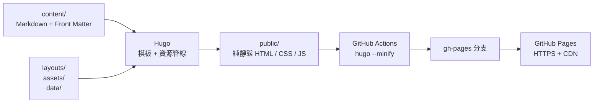
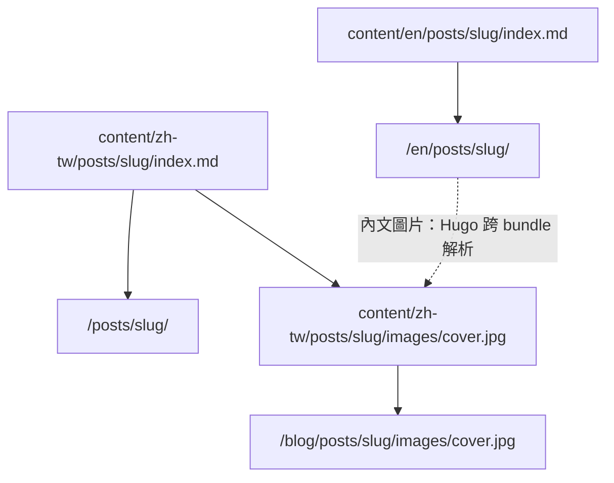
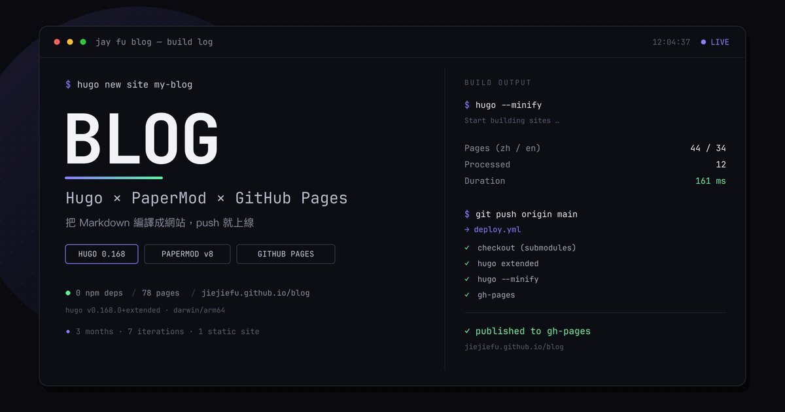
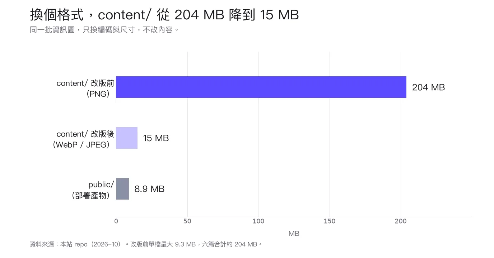


**這個部落格不是用 WordPress 或 Medium 蓋的**，而是 Hugo（Go 寫的靜態網站生成器）＋ PaperMod 主題＋ GitHub Pages。整個流程只有三步：寫 Markdown、`git push`、GitHub Actions 幫你編譯並部署。

**它不是一次完工，而是三個月內分了七次改版才長成現在的樣子。** 這篇不是「Hugo 入門 30 分鐘」，而是一份真實的建站日誌：為什麼選這套、每一個決定換來什麼、以及那些文件不會告訴你、只有真的 build 下去才會炸出來的坑。

如果你也想蓋一個不用租伺服器、沒有資料庫、沒有 Node.js 的部落格，這篇可以當成地圖；如果你只是想知道這個站的首頁為什麼長這樣，<a href="#7-day-5把首頁從-papermod-預設改成實驗室">第 7 節開始是拆解</a>。


## 1. 為什麼自己蓋一個部落格

2026 年可以寫東西的地方多得是：Medium、Substack、方格子（vocus）、Notion，甚至直接在 GitHub 開一個 repo 寫 Markdown 都行。

先把 WordPress、痞客邦這類傳統自架或老牌平台放在一邊。若只看 2026 年台灣繁體中文圈「公開發表與流量擴散」的寫作平台，大致可以分成三個梯隊：方格子與 Medium 這類自帶流量、讀者慣性強的平台約佔一半；Substack 代表的私域電子報約四分之一；Notion 與 GitHub / Markdown 這類知識庫型寫作則約兩成。下面的圓餅圖把各區間的中點歸一化成 100%，用來看相對量級；它不是平台官方統計，也不代表唯一的寫作方式。


{
  "data": [
    {
      "type": "pie",
      "labels": ["方格子", "Medium", "Substack", "Notion/GitHub"],
      "values": [29, 24, 26, 21],
      "sort": false,
      "direction": "clockwise",
      "texttemplate": "%{label}<br>%{percent}",
      "textposition": "inside",
      "insidetextorientation": "horizontal",
      "textfont": { "size": 16 },
      "hovertext": [
        "第一梯隊：大眾創作與內容發現",
        "第一梯隊：大眾創作與內容發現",
        "第二梯隊：私域流量與電子報訂閱",
        "第三梯隊：極客手札與生產力延伸"
      ],
      "hovertemplate": "%{label}<br>%{percent}<br>%{hovertext}<extra></extra>",
      "marker": {
        "colors": ["#6366F1", "#818CF8", "#C7D2FE", "#94A3B8"],
        "line": { "color": "rgba(255,255,255,0.55)", "width": 1 }
      }
    }
  ],
  "layout": {
    "margin": { "t": 16, "b": 92, "l": 16, "r": 16 },
    "font": {
      "family": "-apple-system, BlinkMacSystemFont, 'PingFang TC', 'Noto Sans TC', 'Microsoft JhengHei', sans-serif",
      "size": 13
    },
    "legend": {
      "orientation": "h",
      "x": 0.5,
      "xanchor": "center",
      "y": -0.12,
      "yanchor": "top",
      "font": { "size": 12 }
    }
  }
}


而且這幾塊通常不是互斥的：常見的組合是先用 Medium 接外部 SEO，把讀者引流到 Substack 或方格子沉澱，再用 Notion / GitHub 管理長期的知識與作品集。平台負責被看見，自己的站負責把內容留下來。

自己蓋一個站，說到底只換來三件事：

1. **內容所有權**：文章是 repo 裡的 `.md` 檔，搬到任何地方都只需要複製資料夾，不用匯出 XML 再祈禱格式不會跑掉。
2. **版本控制**：每一次改版都有 commit。首頁改壞了、CSS 順序放錯了，`git diff` 看得到，`git revert` 退得回去。
3. **可以改到爽**：首頁的終端機、文章底部的分享框、程式碼配色的檔名排序，這些平台不會給你，但你可以自己寫。

代價也很具體：沒有留言系統、沒有後台編輯器、圖片要自己壓、SEO 要自己顧，而且**你會花很多時間在處理「看起來只是設定」的東西**。

這篇的重點不是說服你自架。它是一份紀錄：把這個站從第一個 commit 到現在的決策與失敗留下來，讓下一個人在同一個地方少卡半天。

## 2. Hugo 到底幫你做了什麼

先把名詞拆開。**靜態網站生成器（Static Site Generator, SSG）不是 CMS**，它不連資料庫、不執行後端程式，而是在 build time 把「Markdown + 模板 + 資源」編譯成一堆純 HTML、CSS、JS 檔案。部署的時候，你只是把這堆檔案放到一個會回傳檔案的伺服器上。

Hugo 的特別之處是它是一個**編譯成單一執行檔的 Go 程式**：

- 不需要 Node.js、不需要 `npm install`、不需要 webpack。
- 官網下載一個 binary 就能跑，換電腦不用重建環境。
- 幾十篇文章的站，build 時間是百毫秒等級，不是幾十秒。

它的心智模型可以畫成這樣：



一句話：**Hugo 只負責「把檔案變成檔案」**。網址、HTTPS、CDN、部署，是 GitHub Pages 的事。這個分工很清楚，也是它不容易壞的原因。

### 為什麼不是 Next.js、Astro 或 WordPress

不是那些工具不好，而是這個站不需要它們的能力：

| 方案 | 它擅長的事 | 這個站不需要的原因 |
|---|---|---|
| Next.js / Astro | SSR、API route、互動元件、hydration | 文章是靜態內容，讀者不需要登入、留言或即時資料 |
| WordPress | 後台、外掛、留言、CMS 生態 | 需要 PHP + 資料庫 + 主機，備份與安全更新都是額外工作 |
| Hugo | 大量 Markdown、極快 build、單一 binary | 正好是這個站的全部需求 |

如果你需要會員、金流、即時儀表板，Hugo 不是答案。但如果你只是想寫文章，它會讓你忘記「網站」這件事，專心在內容上。

## 3. Day 1：安裝、第一個 site，以及 Extended 的真相

macOS 用 Homebrew 安裝：

```sh
brew install hugo
hugo version
# hugo v0.168.0+extended+withdeploy darwin/arm64
```

建立一個新站：

```sh
hugo new site my-blog
cd my-blog
hugo server
# Web Server is available at http://localhost:1313/
```

初始化後的目錄不用全部記，但這幾個一定要知道：

| 目錄 / 檔案 | 作用 | 這個站怎麼用 |
|---|---|---|
| `content/` | Markdown 內容 | `content/zh-tw/`、`content/en/` 兩套 |
| `layouts/` | 覆寫主題模板 | 首頁、分享框、shortcodes |
| `assets/` | 需要 Hugo Pipes 處理的資源 | Console / Mermaid / Plotly 的 JS、自訂 CSS |
| `static/` | 原樣複製到 `public/` 的檔案 | 幾乎沒用，本站的 JS 都走 assets pipeline |
| `data/` | 結構化資料 | 首頁文案 `home.yaml` |
| `i18n/` | 介面翻譯 | 「閱讀全文」、分享框文案 |
| `themes/` | 主題 | PaperMod，以 git submodule 管理 |
| `config.yaml` | 全站設定 | `baseURL`、語言、taxonomy、highlight |

### Extended 不是 PaperMod 的必要條件

網路上很多文章會說「現代 Hugo 主題都用 Sass，所以一定要裝 Extended」。這句話對 Stack、Blowfish 之類的主題大致成立，但**對 PaperMod 不成立**：PaperMod 的樣式是純 CSS，透過 Hugo Pipes 串接、壓縮、fingerprint，沒有 SCSS 編譯。

那為什麼這個站還是用 Extended？兩個原因：

1. **WebP 編碼**：Extended 版本包含 WebP 支援。如果你讓 Hugo 直接處理圖片、輸出 WebP，Standard 版會做不到。
2. **主題生態**：哪天想換主題，Extended 幾乎不會是問題；反過來則要重裝。

本站的內文圖片其實是用 `cwebp` 預先轉好的，不依賴 Hugo 的圖片處理，所以 Standard 也能 build。但既然 CI 一行 `extended: true` 就解決，沒必要為了「證明不需要」而冒險。

### 第一個坑：`hugo server` 會改寫 `public/`

`hugo server` 不是唯讀的開發伺服器。它會把非 minify、含 draft 的版本寫進 `public/`。所以如果你剛跑完 dev server，接著去檢查 `public/`，你看到的是**開發產物**，不是正式產物。

正確順序永遠是：

```sh
rm -rf public && hugo --minify
```

這也是後來我在 `AGENTS.md` 裡寫給自己的第一條規則：**要對 `public/` 做任何檢查，先重建。**

## 4. Day 2：選 PaperMod，以及為什麼不是 Stack / Blowfish

選主題的標準不是「哪個最漂亮」，而是「哪個最不需要我維護」。

| 主題 | 優點 | 這個站不選的原因 |
|---|---|---|
| **PaperMod** | 純 CSS、無 Node、內建搜尋／多語／TOC／cover／code copy | 預設外觀偏樸素，首頁最後還是自己寫 |
| Stack | 卡片式版面、側欄、搜尋、視覺完成度高 | 設定與模板比這個文字為主的站需要的多 |
| Blowfish | Tailwind、版型與配色選擇多 | 需要 Tailwind 工具鏈，維護成本較高 |

PaperMod 最大的價值是**它幾乎沒有魔法**。它用 Hugo 原生的 asset pipeline、原生的 taxonomy、原生的 multilingual，沒有額外的 bundler。你看到的 CSS 就是它載入的 CSS，你要覆寫就是放一個同名檔案到 `layouts/`。對一個想長期自己維護的站來說，這比「功能很多」重要。

### 用 git submodule 安裝

```sh
git submodule add https://github.com/adityatelange/hugo-PaperMod.git themes/PaperMod
git submodule update --init --recursive
```

submodule 的好處是**版本可重現**：`themes/PaperMod` 指到一個固定的 commit，不會因為主題作者更新而讓你的站突然變形。代價是升級要刻意做：

```sh
cd themes/PaperMod
git fetch && git checkout <new-tag>
cd ../..
git add themes/PaperMod
git commit -m "chore: bump PaperMod"
```

而且如果你的專案裡有覆寫主題模板（這個站有，`layouts/_default/single.html` 就是為了把分享框插進文章底部），升級時要 `diff` 一次，不要直接覆蓋。

CI 那邊也必須記得拉 submodule，否則 build 出來會是沒有主題的空殼：

```yaml
- uses: actions/checkout@v4
  with:
    submodules: true
```

### `config.yaml` 的最小片段

```yaml
baseURL: "https://jiejiefu.github.io/blog/"
title: "Jay Fu Blog"
theme: "PaperMod"

pagination:
  pagerSize: 10

outputs:
  home:
    - HTML
    - RSS
    - JSON   # PaperMod 的搜尋頁需要
```

`baseURL` 是第一個真正會讓人卡住的地方。這個站是 **project page**，網址是 `https://jiejiefu.github.io/blog/`，不是 `https://jiejiefu.github.io/`。如果 `baseURL` 少了 `/blog/`，build 不會報錯，但線上會出現：

- CSS / JS 404，頁面變成純文字
- 文章內的絕對連結指到錯的地方
- `og:image` 指向不存在的路徑

判斷規則很簡單：

| 你的 repo | `baseURL` |
|---|---|
| `username.github.io` | `https://username.github.io/` |
| `blog`（一般 repo） | `https://username.github.io/blog/` |

結尾的 `/` 不要省略。Hugo 不會幫你補。

## 5. Day 3：中英雙語，以及圖片為什麼只放一份

這個站有 `content/zh-tw/` 與 `content/en/` 兩套內容，預設語言是 zh-tw。設定大概長這樣：

```yaml
defaultContentLanguage: zh-tw
hasCJKLanguage: true

languages:
  zh-tw:
    label: "繁體中文"
    contentDir: content/zh-tw
    weight: 1
  en:
    label: "English"
    contentDir: content/en
    weight: 2
```

兩邊用**相同的 slug**，PaperMod 的語言切換就會自動把同一篇文章串起來：

```
content/zh-tw/posts/hugo_papermod_devlog/index.md
content/en/posts/hugo_papermod_devlog/index.md
```

介面文字則由 `i18n/` 覆寫。例如想把 `read_more` 固定成「閱讀全文」，就在 `i18n/zh-tw.yaml` 補：

```yaml
- id: read_more
  translation: "閱讀全文"
```

### 坑 1：`data/home.zh-tw.yaml` 在 Hugo 0.168 是無效的

我一開始很自然地想把首頁文案拆成 `data/home.zh-tw.yaml` 和 `data/home.en.yaml`，結果 `site.Data.home` 取到的是空值。Hugo 會把檔名註冊成 key `"home.zh-tw"`，不是「home 的 zh-tw 版本」。

正確做法是**單一檔案、頂層用語言代碼分組**：

```yaml
# data/home.yaml
zh-tw:
  hero:
    title: "把演算法帶進真實世界"
en:
  hero:
    title: "Turning Algorithms Into Reality"
```

模板端用 `index` 取值，不要用點號：

```go-html-template
{{ $home := index hugo.Data "home" site.Language.Lang }}
```

不要寫 `hugo.Data.home.zh-tw.title`。語言代碼含連字號，用點號取值在 Go template 裡不可靠；`index` 是唯一安全的寫法。

### 坑 2：`cover.relative` 只適用於 zh-tw

PaperMod 的封面可以用 page bundle 裡的相對路徑：

```yaml
cover:
  image: "images/cover.jpg"
  relative: true
```

這在 zh-tw 很好用，因為圖片真的放在 `content/zh-tw/posts/<slug>/images/`。但**英文版不要照抄**。英文版沒有 `images/` 資料夾，而 PaperMod 的 `cover.image | absURL` 不會跨 bundle 解析，會產生：

```
/blog/en/posts/<slug>/images/cover.jpg   # 不存在
```

結果就是 `og:image` 對外 404，Facebook / LinkedIn 分享預覽直接失效。英文版要寫絕對網址：

```yaml
cover:
  image: "https://jiejiefu.github.io/blog/posts/<slug>/images/cover.jpg"
  # 不要加 relative
```

內文的 `` 則是另一回事：那是 Hugo 的跨 bundle 資源解析，英文頁會自動指到 zh-tw 的圖片 URL。**這是預期行為，不是壞連結**。



所以圖片**只需要放一份**，放 zh-tw。英文版不用複製，重製圖片時也只覆蓋 zh-tw 的 `images/`，英文版會自動跟著更新。

## 6. Day 4：GitHub Pages + GitHub Actions

這是整個站最容易「看起來設定好了，其實沒有」的一段。

先分清楚兩種 Pages：

| 類型 | repo 名稱 | 網址 |
|---|---|---|
| User / Organization site | `<username>.github.io` | `https://<username>.github.io/` |
| Project site | 任何其他名稱（這個站是 `blog`） | `https://<username>.github.io/blog/` |

這個站是 project site，所以 `baseURL` 一定要有 `/blog/`。

### 這個站實際在跑的 workflow

```yaml
name: Deploy Hugo site

on:
  push:
    branches:
      - main

permissions:
  contents: write

concurrency:
  group: pages-deploy
  cancel-in-progress: false

jobs:
  deploy:
    runs-on: ubuntu-latest

    steps:
      - uses: actions/checkout@v4
        with:
          submodules: true
          fetch-depth: 0

      - name: Setup Hugo
        uses: peaceiris/actions-hugo@v3
        with:
          hugo-version: 'latest'
          extended: true

      - name: Build
        run: hugo --minify

      - name: Deploy
        uses: peaceiris/actions-gh-pages@v4
        with:
          github_token: ${{ secrets.GITHUB_TOKEN }}
          publish_dir: ./public
```

逐段解釋：

- **`on.push.branches: [main]`**：只有 main 會觸發。開 PR 不會部署，這是對的。
- **`permissions.contents: write`**：`peaceiris/actions-gh-pages` 需要把 build 產物推到 `gh-pages` 分支，所以需要寫入權限。少這行會出現 `remote: Permission to ... denied`。
- **`concurrency`**：避免兩次 push 同時部署、互相覆蓋。`cancel-in-progress: false` 是刻意的：寧可排隊，也不要讓部署中途被取消。
- **`submodules: true`**：沒有這行，CI 裡的 `themes/PaperMod` 會是空資料夾。
- **`fetch-depth: 0`**：抓完整 Git 歷史。若之後啟用 `enableGitInfo`，Hugo 才能用 commit 時間算 `.Lastmod`；淺層 clone 會讓時間失真。這個站目前沒開，但這是好習慣。
- **`hugo --minify`**：正式 build。不需要 `--gc` 才能上線，`--gc` 是清快取，對這種規模的站差異不大。
- **`publish_dir: ./public`**：把 Hugo 的輸出推上去。

部署完成後，GitHub repo 的 **Settings → Pages → Build and deployment** 要設成：

```
Source: Deploy from a branch
Branch: gh-pages / (root)
```

而不是「GitHub Actions」。這一點很容易搞混，因為 GitHub 現在把兩種模式都放在同一個下拉選單裡。

### 另一種做法：官方 `actions/deploy-pages` + OIDC

如果你不想用 `gh-pages` 分支，也可以用 GitHub 官方的 Pages 流程：

```yaml
permissions:
  contents: read
  pages: write
  id-token: write
```

搭配 `actions/configure-pages`、`actions/upload-pages-artifact`、`actions/deploy-pages`。這種模式的好處是：

- 不需要把 build 產物推到另一個分支
- 用 OIDC 的短期權杖，不需要長期 token
- Pages 的來源直接設成「GitHub Actions」

兩種都可行。這個站選擇分支模式，是因為它在 2026 年初就設定好了，而且 `peaceiris` 的 action 很穩定；如果你現在從零開始，官方模式也值得考慮。**重點是不要把兩種模式的設定混在一起**：用 `peaceiris` 就設 `contents: write` + `gh-pages` 分支；用官方 action 就設 `pages: write` + `id-token: write` + GitHub Actions 來源。

### 一個我還沒改掉的風險

workflow 裡的 `hugo-version: 'latest'` 很方便，但也很危險：某天 Hugo 升版、行為改變，你的 build 可能突然壞掉，而且是在 push 之後才發現。

如果重來，我會釘版本：

```yaml
- uses: peaceiris/actions-hugo@v3
  with:
    hugo-version: '0.168.0'
    extended: true
```

代價是每次升級要自己改一行；好處是「今天能 build，下個月也能 build」。

### 本機驗證正式產物

```sh
rm -rf public && hugo --minify

# 以已發布的文章為例
ls public/posts/rea_reverse_engineer_anything/index.html

# og:image 指向的檔案真的存在
rg -o 'og:image" content="[^"]+' public/posts/rea_reverse_engineer_anything/index.html
```

## 7. Day 5：把首頁從 PaperMod 預設改成「實驗室」

PaperMod 的首頁有三種模式：Regular、Home-Info、Profile。這個站一開始用 Home-Info，後來整頁重寫。原因不是 Home-Info 不好，而是它能做的事情就到那裡。

### 最重要的觀念：`layouts/index.html` 會讓 `homeInfoParams` 完全失效

Hugo 的 home page lookup 順序是：

```
layouts/index.html  >  layouts/_default/list.html
```

只要你的專案裡有 `layouts/index.html`，PaperMod 的 `_default/list.html` 在首頁就**永遠不會被呼叫**。而 `homeInfoParams` 是 `home_info.html` 在讀的，`home_info.html` 只會被 `_default/list.html` 呼叫。

所以會出現一個很詭異的狀態：

- `config.yaml` 裡的 `homeInfoParams` 改了，首頁完全沒變
- 把 `homeInfoParams` 整段刪掉，首頁也完全沒變
- 你以為是快取，其實是那段設定根本沒有被讀

這不是 bug，是 lookup order。要改首頁，就只能改 `layouts/index.html`。

### 首頁的資料放在 `data/home.yaml`

首頁的文案、技術領域卡、Console 的標籤全部集中在 `data/home.yaml`，用語言分組：

```yaml
zh-tw:
  hero:
    eyebrow: "JAY FU · ENGINEERING LAB"
    title: "把演算法帶進真實世界"
  topics:
    - tag: "Edge AI"
      icon: "cpu"
      blurb: "從感測器串流到邊緣推論，再到完整的平台化部署與故障處理。"
en:
  hero:
    eyebrow: "JAY FU · ENGINEERING LAB"
    title: "Turning Algorithms Into Reality"
```

模板端一樣用 `index`：

```go-html-template
{{ $home := index hugo.Data "home" site.Language.Lang }}
```

### Console：真資料與假資料要分清楚

首頁那塊終端機有兩種資料：

| 區塊 | 性質 | 來源 |
|---|---|---|
| 文章數 / 標籤數 / 累積字數 / 最後建置 | **真的** | Hugo build 時算出來 |
| 吞吐量 / 延遲 / 異常分數 / 日誌 / 進度條 | **假的** | `data/home.yaml` 的 `shared.console`，genact 式噪音 |

真資料那段有一個很容易踩的細節：**必須先過濾草稿**。

```go-html-template
{{ $published := where $allPosts "Draft" false }}
```

Hugo 的 `site.RegularPages` 與 `site.Taxonomies` 都會把草稿算進去。這個站大部分文章是 `draft: true`，如果直接算，首頁的「文章數」會把草稿一起算進去，比線上實際的多。`hugo --buildDrafts` 也不會把 `.Draft` 改成 false，它只是把草稿納入建置，所以過濾邏輯要自己寫。

還有一個小地方：標籤數不要用 `len site.Taxonomies.tags`，因為那是全站詞彙表，含草稿、而且跨語言合併的行為不一定是你想要的。從已發布文章的 `.Params.tags` 收集後去重，語意最清楚。

### 漸進增強：沒有 JS 也要看得到

Console 的日誌是每 0.15 秒跳一次的裝飾，但**伺服器端已經先渲染開機訊息、靜態指標與四格統計**。沒有 JS 時，版面完整，只是不會動。

JS 在三種情況會停掉計時器：

- 使用者開啟 `prefers-reduced-motion`
- 分頁被隱藏（`visibilitychange`）
- Console 捲出視窗（`IntersectionObserver`）

這樣它不會在背景空轉，也不會讓一個裝飾區塊吃掉手機的電。

### 坑 3：逐頁條件不能放 `extend_footer.html`

這是這個站最隱蔽的坑之一。

PaperMod 的 `baseof.html` 裡，footer 是這樣呼叫的：

```go-html-template
{{ partialCached "footer.html" . .Layout .Kind (.Param "hideFooter") (.Param "ShowCodeCopyButtons") }}
```

`partialCached` 的快取鍵是 `.Layout`、`.Kind` 與後面兩個參數，**不是頁面本身**。所以任何「這個頁面要不要做 X」的判斷放進 `extend_footer.html`，實際會變成：

> 第一個被算到的頁面決定全站。

而且不會報錯、不會有 warning。Mermaid 一開始就是踩在這裡：判斷條件寫對了，但全站頁面裡只有 1 個拿到 `<script type="importmap">`。

規則很簡單：**逐頁條件一律放 `extend_head.html`**。`head.html` 是用 `{{ partial }}` 逐頁求值的，沒有快取問題。

### 坑 4：script 要走 assets pipeline

一開始我把 Console 的 JS 放在 `static/js/`，用 `absURL` 指向它。這樣可以跑，但沒有 fingerprint：

- 讀者會拿到瀏覽器快取的舊版 JS
- 你改了程式，讀者要硬重新整理才看得到

正確做法是走 Hugo 的 assets pipeline：

```go-html-template
{{- with resources.Get "js/lab-console.js" }}
{{- $js := . | minify | fingerprint }}
<script src="{{ $js.RelPermalink }}" defer></script>
{{- end }}
```

不要直接把 `{{ . | minify | fingerprint }}` 印在 `src` 裡。那樣會呼叫 Resource 的 `String()`，輸出的是來源路徑（`/js/lab-console.js`），不是加工後的檔案，結果就是 404。要取 `$js.RelPermalink`。

## 8. Day 6：內容與圖片管線

### Page bundle：一篇文就是一個資料夾

這個站的文章用 leaf bundle：

```
content/zh-tw/posts/hugo_papermod_devlog/
├── index.md
└── images/
    └── cover.jpg
```

好處是圖片跟文章一起版本控制、一起搬移。內文用相對路徑：

```markdown

```

Hugo 會把它解析成這篇文章的資源。

### 圖片格式：不要等到 200 MB 才後悔

這個站曾經把資訊圖全部存成 PNG，單檔最大 9.3 MB，六篇合計超過 200 MB。clone 下來很痛，Pages 的頻寬也浪費。後來統一成：

| 用途 | 格式 | 尺寸 | 指令 |
|---|---|---|---|
| 內文資訊圖 | WebP q82 | 維持原始寬度（1376px） | `magick` + `cwebp` |
| 封面 | JPEG q85 | 1200px 寬 | `magick -resize 1200x` |
| 分享預覽 | 跟封面同一張 | 1200×630 | 同上 |

三個不能妥協的理由：

1. **內文圖不要再縮小**。PaperMod 的 `--main-width` 是 720px，1376px 大約是 1.9 倍，正好是 retina 的倍率。縮到 1000px 只剩 1.4 倍，在高解析螢幕上會糊。
2. **`-alpha off` 是必要的**。這些 AI 產出的圖 alpha 通道通常 100% 不透明，留著只是死重。
3. **封面用 JPEG，不要用 WebP**。PaperMod 會把 `cover.image` 直接塞進 `og:image`，Facebook / LinkedIn 對 WebP 的預覽支援不完整。

實際指令：

```sh
# 內文圖：PNG → WebP
magick input.png -alpha off -strip /tmp/t.png
cwebp -quiet -q 82 -m 6 /tmp/t.png -o output.webp

# 封面：1200px 寬、q85
magick cover.png -resize 1200x -strip -quality 85 cover.jpg
```

做完之後，`content/` 從兩百多 MB 降到 15 MB 左右，`public/` 大約 9 MB。這個數字不是為了炫技，而是**讀者第一次打開網站的等待時間**。



*同一批資訊圖，只換編碼與尺寸；`public/` 是實際部署出去的產物。*

### 坑 5：草稿不要放進 `content/`

page bundle 裡任何 `.md` 都會被 Hugo 當成頁面渲染，並發佈成公開 URL。不是只有 `index.md`。

曾經有一次，我把 ChatGPT 產的草稿 `ChatGPT_artical.md` 放進某個 page bundle，裡面有 `mermaid` shortcode，但那個當下 shortcode template 還沒建好，`hugo build` 直接失敗。更糟的是，如果它 build 成功，那份草稿就會變成一個公開網址。

所以後來的規則是：**原始草稿一律放 repo 根的 `drafts/`**，那個資料夾在 `.gitignore` 裡。`content/` 只放要發佈的東西。

## 9. Day 7：四個功能，四種坑

### KaTeX：delimiter 要一對一對寫

Hugo 沒有 `math` 這個設定鍵。要讓數學公式原樣輸出、交給 KaTeX 渲染，用的是 Goldmark 的 passthrough extension：

```yaml
markup:
  goldmark:
    extensions:
      passthrough:
        enable: true
        delimiters:
          block:
            - ['$$', '$$']
          inline:
            - ['\(', '\)']
```

兩個細節：

- **delimiter 必須是成對的巢狀陣列**，不是扁平陣列。寫成 `['$$', '$$']` 是對的；寫成扁平陣列會讓 Go 端取到單一字元，甚至直接 panic。
- **inline 不要用 `$`**。站上的英文文章有 `$100 billion`、`$900,000` 這種金額，一旦 `$` 變成 delimiter，同一段出現兩個金額就會被整段當成 LaTeX 吞掉。

### Mermaid：`deterministicIds` 不能拿掉

Mermaid 的初始化裡有一個選項：

```js
mermaid.initialize({
  startOnLoad: false,
  deterministicIds: true,
  // ...
});
```

不開的話，`mermaid.run()` 內部用 `Date.now()` 產生 SVG id。同一個頁面有多張圖時，很容易在同一毫秒內撞到相同 id，結果是：

- 後面的圖拿到重複的 id
- 產出沒有 `viewBox` 的空 SVG
- 視覺上第 2 張之後的圖疊在一起

這個 bug 不會報錯，只會靜靜地畫錯。所以 `deterministicIds: true` 是必要的，不是可選的。

另外，`public/` 裡永遠不會有 Mermaid 產生的 SVG，因為那是 client 端渲染。要驗證「每張圖都有 viewBox」，只能在瀏覽器裡跑：

```sh
hugo server -D &
CH="/Applications/Google Chrome.app/Contents/MacOS/Google Chrome"
"$CH" --headless=new --disable-gpu --user-data-dir="$(mktemp -d)" \
  --virtual-time-budget=60000 --dump-dom \
  "http://localhost:1313/blog/posts/mermaid_smoke_test/" > /tmp/d.html
```

然後數 `<svg>` 裡沒有 `viewBox` 的數量，必須是 0。

### Plotly：不要讓每個頁面都付 1.5 MB

Plotly 的 Full bundle 是 4.83 MB min / 1.48 MB gzip，Basic 是 1.20 MB min / 398 KB gzip。這不是「載入一次就好」的成本，而是每個第一次進來的讀者都要付。

所以這個站的做法是：

- `plotly-init.js` 很小（原始碼約 8 KB，gzip 後約 3 KB），**只在用到 plotly shortcode 的頁面載入**
- Plotly 本體由 JS 依容器上的 `data-plotly-bundle` 動態載入
- 同一頁只要有一張 `full`，全頁載一次 `full`（full 是 basic 的超集）
- 一般文章連 `plotly-init.js` 都不載，成本是 0

| 頁面 | 首次載入 | 回訪 |
|---|---|---|
| 一般文章 | 0 | 0 |
| Basic 圖表頁 | ~398 KB gzip | 0（CDN 快取） |
| Full 圖表頁 | ~1.48 MB gzip | 0 |

判斷頁面有沒有用 shortcode，用 `.HasShortcode "plotly"`，不要用 `strings.Contains .RawContent "plotly"`。後者會讓正文提到 plotly 的文章也誤載。

### Chroma：class-based 高亮與檔案排序

Hugo 預設的 `noClasses: true` 會把顏色寫成行內 style，自訂 CSS 很難蓋。改成：

```yaml
markup:
  highlight:
    noClasses: false
```

然後用 `hugo gen chromastyles --style=tokyonight-day` 產生 token 色。這裡有一個不明顯的坑：PaperMod 內建的是 Catppuccin，而且**不會被移除**。如果你的 Tokyo Night 沒有定義某個 token class，就會漏出 Catppuccin 的顏色（例如 `.nv` 的淡粉色在淺色底上幾乎看不見）。

解法是加一層低特異度的 reset：

```css
:root .chroma *, :root .bg {
  color: inherit;
  background-color: transparent;
  font-style: inherit;
  font-weight: inherit;
  text-decoration: inherit;
}
```

還有一個更隱蔽的：`resources.Match "css/extended/*.css"` 是**依檔名排序**。所以 `chroma-00-reset.css` 必須早於 `chroma-tokyonight-*.css`，`zz-chroma-tokyonight.css` 必須晚於 `custom.css`。改名會靜默改變結果，不會報錯。

## 10. 三個月，七次改版

與其說這個站是一次蓋好的，不如說它是三個月內分了七次改版才長成現在的樣子。每一次都解決一個具體的痛點，而不是為了加功能而加：

| 迭代 | 做了什麼 | 解決的痛點 |
|---|---|---|
| 1 | Hugo + PaperMod + Actions + 第一篇文章 | 先讓「寫文章 → 上線」這條路徑通 |
| 2 | 整理 tags / draft、把草稿趕出 `content/`、寫 `AGENTS.md` | repo 開始變大，而且草稿會意外曝光 |
| 3 | 圖片全面改 WebP / JPEG | `content/` 兩百多 MB，clone 與部署都很痛 |
| 4 | 首頁改版：`layouts/index.html` + `data/home.yaml` + Console | Home-Info 模式已經撐不住想放的東西 |
| 5 | Mermaid、KaTeX、分享框 | 文章開始有流程圖、公式與分享需求 |
| 6 | Tokyo Night、黑白配色、Console 動畫 | 程式碼區塊四個角黑黑的，視覺不一致 |
| 7 | Plotly shortcode、這篇文章 | 有些資料用靜態圖片講不清楚 |

回頭看，最值得的兩次是第 3 次（圖片瘦身）和第 4 次（首頁改版）。前者讓網站真的變快，後者讓網站開始有自己的樣子。

## 11. 如果重來，我會先做這五件事

1. **第一天就寫 `layouts/index.html`**。不要先花時間調 `homeInfoParams`，反正最後一定會被 `layouts/index.html` 取代。
2. **第一天就定圖片規範**。內文 WebP q82 / 1376px、封面 JPEG q85 / 1200px，寫進 `AGENTS.md`，不要等到 200 MB 才回頭救。
3. **第一天就把草稿放在 `content/` 外面**。page bundle 裡任何 `.md` 都會被發佈，這個坑一次就夠了。
4. **釘住 Hugo 版本**。`hugo-version: 'latest'` 現在很方便，但未來的某一天會讓你突然 build 不起來。
5. **加一個 link checker**。`projects/` 和 `resume/` 這兩個 draft 頁面曾經在選單裡放了很久的 404，直到有人點到才發現。

還有一些是刻意不做的：沒有留言系統（要維護）、沒有 CMS（Markdown 就是 CMS）、搜尋是 client-side Fuse.js（文章量還不需要 Elasticsearch）。**知道自己不需要什麼，跟知道要用什麼一樣重要。**

## 12. 踩坑速查表

| 症狀 | 原因 | 修法 |
|---|---|---|
| 線上 CSS / JS 404、頁面沒樣式 | `baseURL` 少了 `/blog/` | 改成 `https://<user>.github.io/blog/`，結尾留 `/` |
| CI build 出來沒有主題 | checkout 沒拉 submodule | `submodules: true` |
| push 後部署失敗、權限被拒 | workflow 沒有寫入權限 | `permissions: contents: write`（分支模式） |
| 首頁改了 `homeInfoParams` 卻沒變 | `layouts/index.html` 讓 list.html 不再被呼叫 | 改 `layouts/index.html`，或刪掉它 |
| 首頁文章數比實際多 | `site.RegularPages` 含草稿 | `where ... "Draft" false` |
| 英文版 `og:image` 404 | `cover.relative` 不跨 bundle | 英文版用絕對網址，不加 `relative` |
| `data/home.zh-tw.yaml` 取不到 | Hugo 把它註冊成 `home.zh-tw` | 單一 `home.yaml` + `index` 取值 |
| 某頁的 footer 條件影響全站 | `partialCached` 的快取鍵不是頁面 | 逐頁條件放 `extend_head.html` |
| 改了 JS 讀者卻拿到舊版 | 沒有 fingerprint | `resources.Get` + `minify` + `fingerprint` |
| Mermaid 第 2 張之後疊在一起 | `deterministicIds` 沒開 | `mermaid.initialize({ deterministicIds: true })` |
| 公式沒渲染，畫面出現 `$$` | 沒開 passthrough，或 delimiter 寫錯 | 成對的巢狀 delimiter，inline 用 `\(...\)` |
| 檢查 `public/` 看到草稿版 | `hugo server` 會改寫 `public/` | `rm -rf public && hugo --minify` |

## 13. 結尾：網站是活的

這個站最有趣的地方，不是它用了什麼技術，而是**它會跟著內容一起長**。今天加一個 Mermaid render hook，明天加一個 Plotly shortcode，後天把首頁的 Console 從靜態改成會動的。每一次改動都留下 commit，也留下一個可以回頭看的決策。

如果你問我「值不值得自己蓋」，我的答案會是：**如果你打算長期寫，值得；如果你只是要發三篇文，不值得。** 因為自架的價值不在第一篇文章，而在第一百篇——當你需要一個別的平台不會給你的版面、一個自己的網址、一份可以帶著走的 Markdown 時，前面那些踩坑才會開始回本。

首頁那台 genact 風格的 Engineering Console 本身也值得一篇：真實統計與假日誌是怎麼分開的、三個指標為什麼用腳本化序列而不是隨機數、以及怎麼讓它在沒有 JS 的時候仍然可讀。

如果你想看這個站的原始碼，它在 [github.com/jiejiefu/blog](https://github.com/jiejiefu/blog)。

---

## 參考資料

- [Hugo 官方文件](https://gohugo.io/documentation/)
- [Hugo：Deploy to GitHub Pages](https://gohugo.io/host-and-deploy/deploy-to-github-pages/)
- [Hugo：Multilingual mode](https://gohugo.io/content-management/multilingual/)
- [Hugo：Template lookup order](https://gohugo.io/templates/lookup-order/)
- [Hugo：Image processing](https://gohugo.io/content-management/image-processing/)
- [PaperMod Wiki](https://github.com/adityatelange/hugo-PaperMod/wiki)
- [GitHub Pages 文件](https://docs.github.com/en/pages)
- [peaceiris/actions-gh-pages](https://github.com/peaceiris/actions-gh-pages)
- [KaTeX：Auto-render extension](https://katex.org/docs/autorender)
- [Mermaid 文件](https://mermaid.js.org/)
- [Plotly JavaScript 文件](https://plotly.com/javascript/)

> 本文的數字與指令以 2026-10 的 repo 狀態為準。Hugo、PaperMod 與 GitHub Actions 都持續更新，實際行為請以你安裝的版本與官方文件為準。
