
**Jev 是 TypeSafe 的第一個 System One 模型：你給它一段 state 和一組有型別的 questions，它回傳有型別的 answers、機率分布，部分題型還有 confidence。它不寫文章、不接話、不生成程式碼。**

**它解決的不是「AI 不夠聰明」，而是「AI 回傳一段字串，程式還要 parse、validate、祈禱它不要亂」。** Jev 把輸出空間事先鎖死，讓程式可以直接 `if`、`switch`、排序、路由。

這篇不把它捧成「LLM 殺手」。它比較像把 LLM 從某些 workflow 位置拿掉：需要生成的地方留給 LLM，需要一個快速、可校準的判斷時，交給 Jev。


## 1. 先講結論：它把「生成」換成「決策」

一般 LLM 的流程是：

```text
state → 生成一段文字 → parse → validate → 程式才能用
```

Jev 的流程是：

```text
state + typed questions → typed answers → 程式直接用
```

差別不只是快。**字串是萬用的，所以它也什麼都可能變成**：一段很順但錯的解釋、一個格式跑掉的 JSON、一次不必要的拒答。Jev 的輸出被限制在你事先定義的選項或級別裡，所以它不可能吐出 schema 外的型別；但這不代表它不會判斷錯。

官方說它「不會幻覺」，精確的意思是：**它不會在格式上幻覺**。答案仍然可能是錯的，confidence 也不是正確率。這兩件事要分開看。

> System One 這個名字來自 Kahneman 的《快思慢想》；Jev 則取自經濟學家 William Stanley Jevons。命名想表達的是：把「快速、直覺式的判斷」變成一種可被軟體依賴的介面。

## 2. 一次請求長什麼樣

Jev 的 API 很短：一個 `state`、一組 `questions`、一個 `model`。

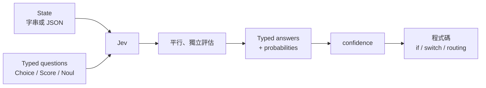


```python
from typesafe_sdk import Choice, Noul, Score, TypeSafeClient

ticket = "API 從 20 分鐘前開始全部回 500，我們現在無法出貨。"

with TypeSafeClient(model="jev-latest") as client:
    r = client.system_one(
        state={"ticket": ticket},
        questions={
            "team": Choice(
                instructions="Which team should handle this?",
                criteria={
                    "billing": "Payment, invoice, or subscription issues",
                    "technical": "Bugs or integration problems",
                    "account": "Login, profile, or permissions",
                },
            ),
            "urgent": Noul(
                instructions="Does the message convey time pressure?",
            ),
            "frustration": Score(
                instructions="How frustrated is the customer?",
                criteria=["Calm", "Frustrated but civil", "Very angry"],
            ),
        },
    )

print(r.answers["team"].choice, r.answers["team"].confidence)
print(r.answers["urgent"].noul)
print(r.answers["frustration"].score)
```


幾個實務上的邊界：

| 項目 | 目前狀態 |
|---|---|
| 輸入 | 文字、JSON、字串陣列；**不支援圖片、音訊、影片** |
| Context | 64k per-request / 32k per-question；長 context 模式可到 262k，但更慢、更不準 |
| 模型 | Jev 1.14（2026-10-14 釋出）；1.13 同價 |
| 價格 | 每百萬 input tokens **$0.042**（每十億 $42）；output 免費 |
| 延遲 | 官方量測 **70–500ms** |
| 版本 | `jev-latest` 會隨新版本移動；調過 threshold 就該 pin 版本 |

> 想把 Jev 接進專案，官方也有 agent skill：`npx skills add typesafe-ai/skills --skill typesafe-ai`。它會把 API 形狀、題型與 pattern 一起帶給 coding agent。

## 3. 三種題型，選錯就會難用

Jev 只有三個 primitive。真正的設計工作不是「怎麼寫 prompt」，而是**把一個模糊判斷拆成正確的題型**。

| 題型 | 什麼時候用 | 回傳 | 上限／注意 |
|---|---|---|---|
| **Choice** | 答案是固定、無順序的選項 | `choice`、`probabilities`、`confidence` | 最多 255 個選項；選項描述要能互相區隔 |
| **Score** | 答案是有順序的程度 | `score`、`probabilities`、`confidence` | 官方上限 10 級；`score` 可以是小數 |
| **Noul** | 只有是／否的命題 | `noul`（0–1） | 沒有獨立 `confidence`；一個問題只問一個命題 |

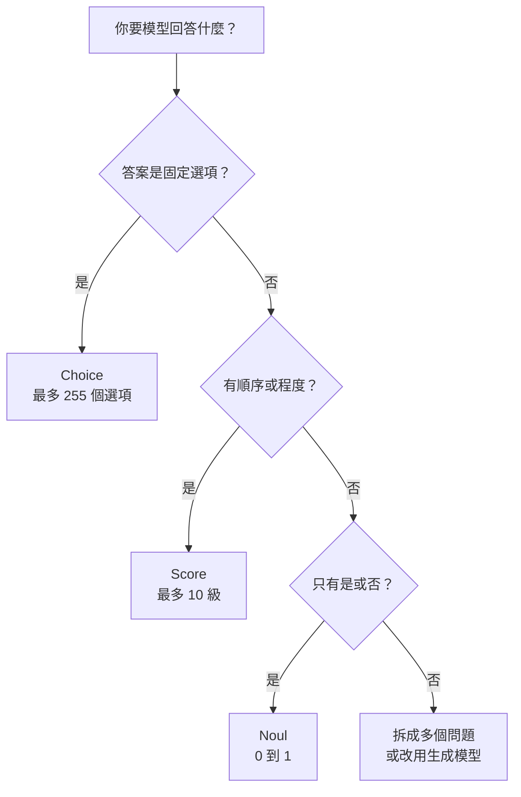

三個最常見的選錯方式：

- **拿 Choice 問程度。** 「這客戶多生氣？」應該是 Score，不是 `calm / angry / very angry` 的 Choice。
- **拿 Noul 問程度。** Noul 的 0.8 是「這個命題為真的機率」，不是「強度 80%」。要程度就用 Score。
- **把多個判斷塞進一題。** 「這份履歷好嗎？」同時混了經驗、領域、地點、薪資。拆成多題，再用程式加權，才會可控。

Score 還有一個很容易踩的坑：**每個級別是獨立判斷的，模型看不到級別編號，也看不到隔壁級別。** 所以 `criteria: ["0", "1", "2"]` 幾乎一定不穩；要寫「什麼情況算這一級」，不是寫數字。

## 4. 為什麼快、為什麼便宜

先看最實際的數：同一個決策，LLM 的 end-to-end 延遲是 **3–329 秒**，Jev 是 **70–500ms**；input 價格是 **$0.042 / MTok**，而且 output 免費。

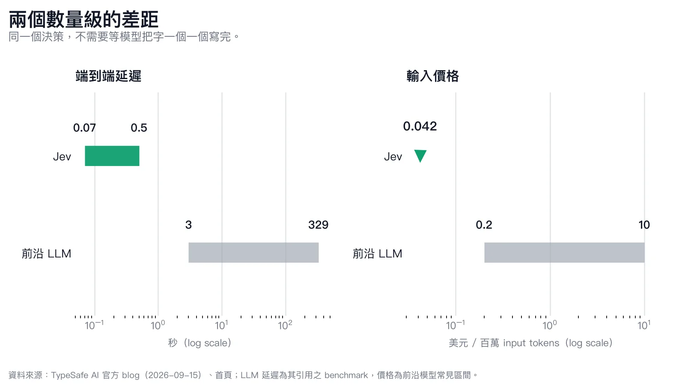

*圖一：左邊是 end-to-end 延遲，右邊是 input token 價格。LLM 的延遲區間取自 TypeSafe 引用的 benchmark，價格為前沿模型常見區間；不代表所有模型、所有任務。*

真正讓成本拉開的，不只是單價，而是**同一個 state 不必重送 N 次**。官方用 GDPR 維基百科文章做了一個 13 題的 cookbook：

- 文件：53,777 字元
- 題目：8 個 Noul、2 個 Choice、3 個 Score
- 逐題送出：13 次呼叫，每次都重送整份文件
- 一次送出：1 次呼叫，13 題平行評估

結果是 **12.2x 便宜、10.0x 快**，而且 5 次重複實驗的回答沒有因為批次而改變。

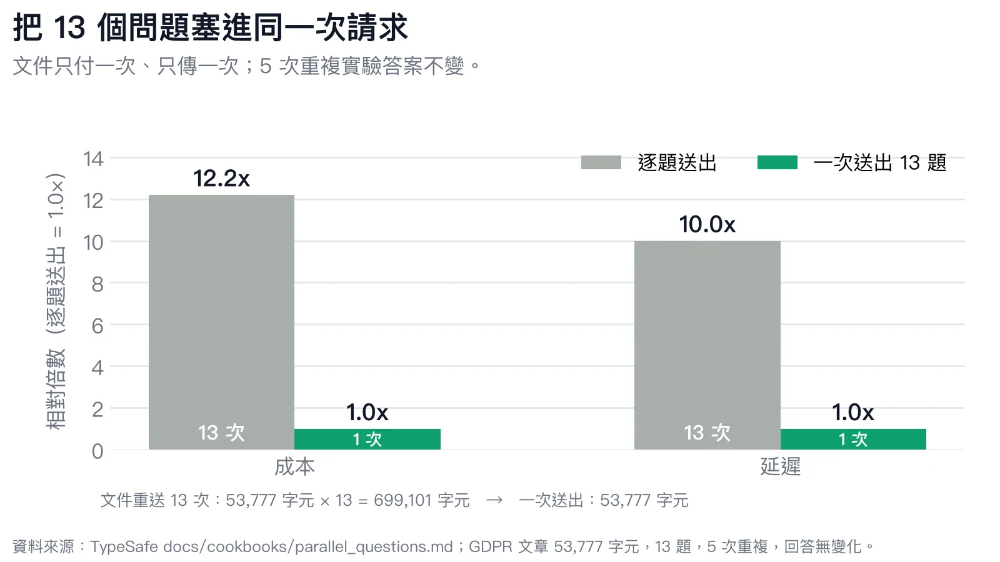

*圖二：批次把文件成本從 13 次壓成 1 次。注意「10x 快」是逐題**序列**呼叫的比較；如果你把 13 個請求並行送出，延遲差距會縮小，但 token 成本不會。*

官方另外公布了一組更複雜的 workflow eval：**193.6x faster、444.6x cheaper**。這個數字來自 4 個 workflow，官方自己說可能是 real-world 偏高的一端；首頁的 40x–200x、40x–444.6x 又是不同基準。**看到倍數先問「跟什麼比、怎麼跑」，不要直接把數字的最高值當通則。**

## 5. Confidence 不是裝飾，是路由條件

Choice 和 Score 都會回傳 `probabilities` 與 `confidence`。`confidence` 是把整個分布壓成 0–1 的一個統計量：全部集中在一個答案時是 1，平均分散時接近 0。

以 Choice 為例，若有 \(n\) 個選項、最高機率是 \(p_{\max}\)：

$$
\text{confidence} = \frac{p_{\max} - \frac{1}{n}}{1 - \frac{1}{n}}
$$

官方範例的分布是 `returns 0.61 / billing 0.35 / shipping 0.04`，三個選項：

$$
\frac{0.61 - \frac{1}{3}}{1 - \frac{1}{3}} \approx 0.415
$$

所以回傳的 `confidence` 是 **0.42**。這不是「42% 正確率」，而是「最高選項只比平均高出一些」。

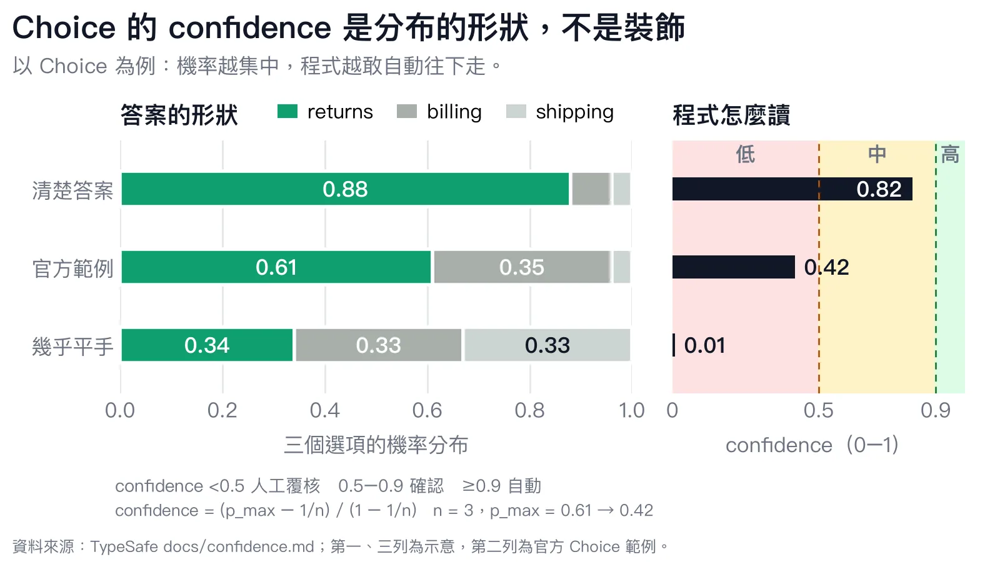

*圖三：同樣三個選項，分布越集中，confidence 越高。最下面那列幾乎平手，confidence 只有 0.01。*

Noul 沒有獨立的 `confidence`，因為它只有是／否兩個結果；如果你硬要換算成同一把尺：

$$
\text{confidence} = |2p - 1|
$$

`p = 0.9` 會得到 0.8，`p = 0.5` 會得到 0。**Score 的公式又不一樣**：因為級別有順序，官方用「機率加權的平均距離」來算，會懲罰離峰值較遠的機率。不要拿 Choice 的公式套 Score。

拿到 confidence 之後，程式通常分三條路：

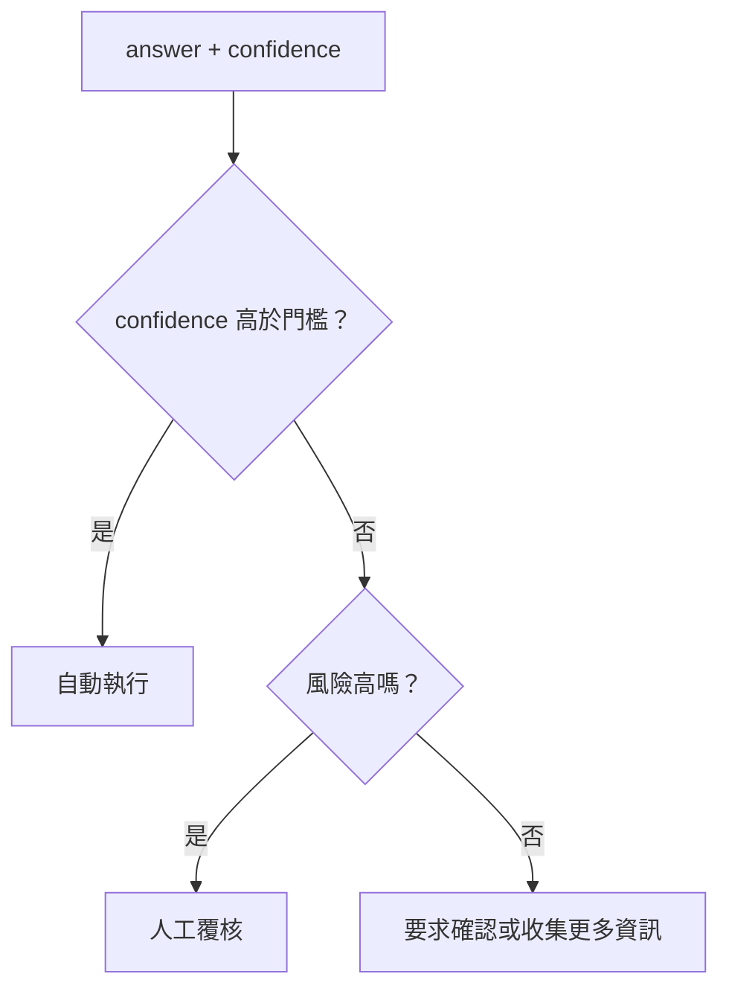

門檻不是一個全站共用的數字。官方建議依風險調整：低風險、可回復的操作可以寬鬆；高風險、不可逆的操作應該更嚴格，甚至要求人工確認。文件裡的 0.5 只是一個「明顯不確定就不要猜」的起步地板，不是通用答案。

還有一個很重要的區別：**confidence 高只代表分布集中，不代表答案正確。** 一個模型可以非常有信心地錯。confidence 能幫你決定「要不要動作」，但不能取代 ground truth 驗證。

## 6. 它不該當 Agent，該當 Agent 的 guardrail

Jev 沒有工具呼叫、沒有記憶、沒有「下一步要做什麼」。它不是 agent，也不負責 chain-of-thought。它只回答你問的那個問題。

這反而是它最好用的地方：**把 agent 的自由度收回來，讓程式保有控制流。**

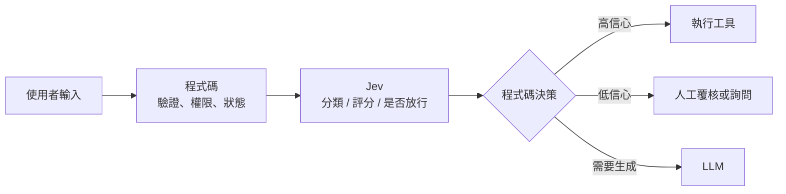

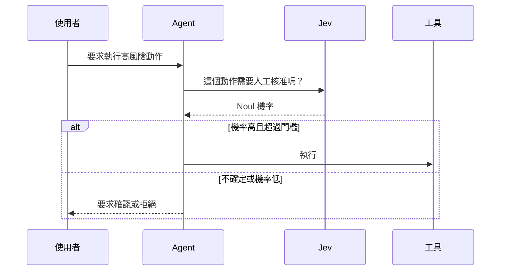

適合放 Jev 的位置：

- 分類與路由：這是哪一類工單、該進哪個流程
- 評分與排序：嚴重度、風險、品質、優先級
- Guardrail：這段 LLM 輸出是否違反政策、是否該攔下來
- 驗證：抽取出來的欄位是否真的被文件支持
- 即時判斷：使用者輸入後 100ms 內就要決定下一步

不適合的位置也很明確：

- 寫文章、寫程式、寫解釋
- 多步推理、算術、日期先後、跨段代名詞
- 需要「先想一想再回答」的任務
- 把大量無關內容塞進 state，期待它自己找到重點

官方對 Jev 的定位是 **atomic gut-check**：一個很懂領域的人，在幾秒內可以做出的判斷。如果一個問題需要 extended reasoning，正確做法是拆成多個問題，或留給 LLM，而不是叫 Jev「想清楚一點」。

## 7. 實務上最容易踩的六個坑

1. **用數字當 Score 的級別。** `["0", "1", "2"]` 沒有語意，模型只能猜。寫「什麼情況算這一級」。
2. **把 Noul 當程度量表。** Noul 的 0.8 是命題為真的機率，不是強度。要程度就用 Score。
3. **不同長度的 Score 直接相加。** 3 級和 4 級的 `score` 範圍不同，先除以最高級別歸一化，再加權。
4. **全站共用一個 threshold。** 高風險與低風險的容忍度不同；threshold 應該跟動作綁在一起。
5. **用 `jev-latest` 卻調了 threshold。** alias 會隨版本移動，答案與 confidence 可能跟著變；要 pin 版本。
6. **忽略語言與領域。** 官方明確說英文是目前最準的語言，CJK 有支援但沒有同等準確度；上線前一定用自己的資料測。

第 3 點值得用一張圖說明：

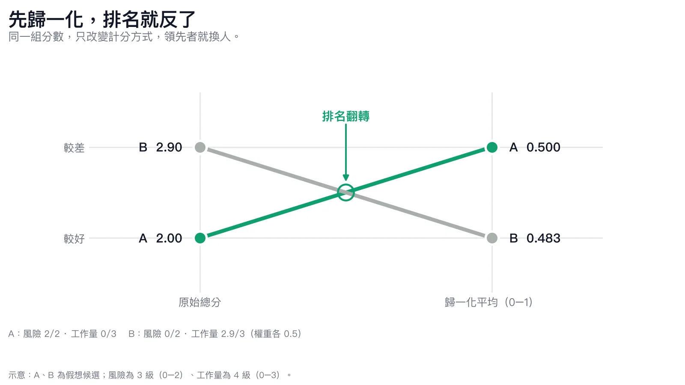

*圖四：示意。3 級與 4 級的原始分數不能直接相加；先除以該題最高級別，再加權，排序才不會被級距大小綁架。*

還有一個觀念上的坑：**「type-safe」不等於「truth-safe」。** Jev 保證答案落在你給的型別裡，不保證那個答案符合現實。這是它比 LLM 可靠的地方，也是它仍然需要驗證的地方。

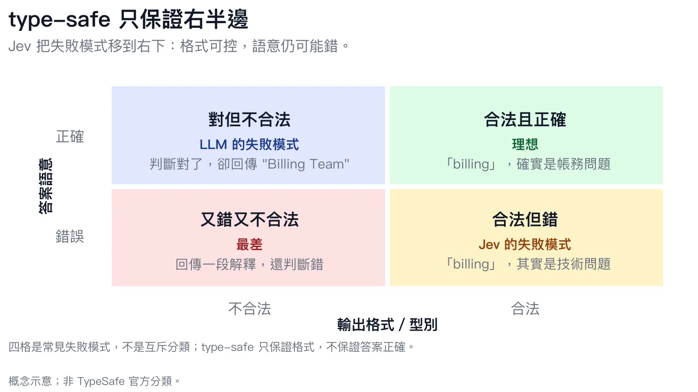

*圖五：type-safe 只涵蓋右半邊；truth-safe 是另一個維度。Jev 把失敗模式移到右下角——可預測，但仍要驗證。*

## 8. 結論：不是每個 AI 都需要會聊天

Jev 的價值不是「比 GPT 聰明」，而是把 AI 從：

```text
生成一段話 → parse → validate → 希望它不要亂
```

改成：

```text
給定 state 與問題 → 直接拿到可分支的答案
```

它不會取代 LLM。它會把 LLM 從 workflow 裡一些不需要生成的位置拿掉，讓那些位置變成比較穩、比較快、比較便宜的另一種呼叫。

如果你手上有一個決策，可以拆成 3–10 個 atomic questions，而且每個問題的答案空間是固定的，那 Jev 很可能值得試。如果答案需要長篇推理、需要生成、或你連「什麼叫好」都還說不清楚，先別急著把 prompt 換成 API。

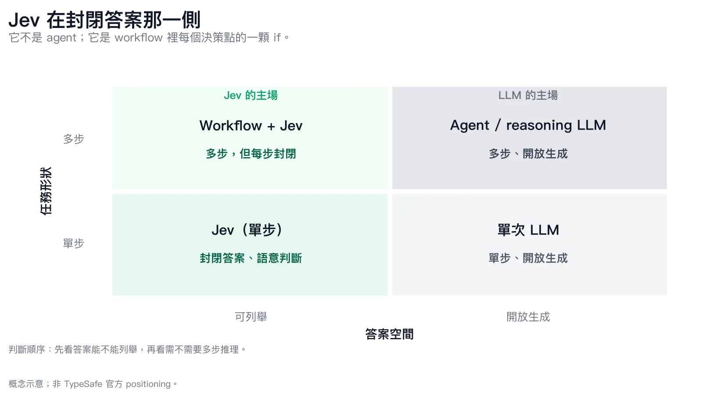

*圖六：概念示意。答案可列舉、且能拆成單步判斷時，Jev 是 workflow 裡的一顆 if；需要生成或多步推理時，才交給 LLM。*

**不是每個 AI 都需要會聊天。有些 AI，只需要在程式裡當一個很會判斷的 `if`。**

---

## 參考資料

- [Introducing System One Models & Jev](https://typesafe.ai/blog/introducing-system-one-models-and-jev) — TypeSafe AI，2026-09-15
- [Jev Documentation: Introduction](https://docs.typesafe.ai/) — state、questions、primitives
- [System One](https://docs.typesafe.ai/concepts/system-one) — 與 LLM 的差異、定位
- [Quick Start](https://docs.typesafe.ai/introduction/quickstart) — API 形狀與 SDK 範例
- [Choice](https://docs.typesafe.ai/primitives/choice)／[Score](https://docs.typesafe.ai/primitives/score)／[Noul](https://docs.typesafe.ai/primitives/noul) — 題型與回傳值
- [Confidence](https://docs.typesafe.ai/confidence) — 三種題型的 confidence 公式與路由建議
- [Models](https://docs.typesafe.ai/models) — Jev 1.14、價格、context、語言支援
- [Parallel questions cookbook](https://docs.typesafe.ai/cookbooks/parallel_questions) — 13 題、12.2x / 10.0x 的實驗
- [How to build with System One](https://docs.typesafe.ai/concepts/how-to-build-with-system-one) — 拆題、組合、confidence gate

> 本文以官方 blog、docs 與 cookbook 為主要來源。API 形狀、價格與模型版本可能變動，實作前請以當下官方文件為準；文中倍數與延遲皆為官方量測或官方引用之 benchmark，不代表你的環境。
