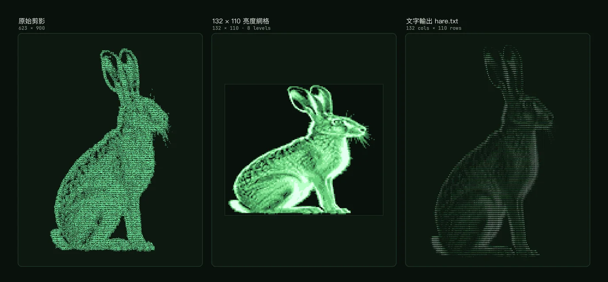


首頁 hero 右邊的兔子是一張 132×110 的亮度網格。共 14,520 格，其中 6,306 格有值。每一格對應一個字元，亮度決定字級與顏色，Canvas 逐格印出來。

整張圖沒有圖片檔。資料在 `assets/js/glyph-art-data.js`。渲染器在 `assets/js/glyph-art.js`。沒有 JS 時退回 `assets/glyph-art/hare.txt` 的 `<pre>`。

Canvas 與 `<pre>` 要對齊，靠的是同一組格子比例與字型 advance。任一邊改了，另一邊就要跟著重算。


## 1. 先看效果

滑過首頁 hero 右側，兔子會從上往下長出來。游標掃過的地方會亮一下，離開後慢慢退熱。

- 進場：每一格延遲 `y × (1100/110)` 毫秒，再加 0–420 毫秒抖動。落定前 260 毫秒隨機抽 `NOISE` 字元，邊緣先閃一下再定格。
- 熱點：游標半徑 7 格，橢圓範圍內的格子升溫。
- 靜止：`prefers-reduced-motion` 只畫一幀，不做進場與熱點。



*左：自製剪影；中：資料裡的 132×110 亮度網格。右：`hare.txt` 用同一份網格印出的文字。*

三個版本共用同一份資料。差別只在輸出媒介：Canvas、`<pre>`，或一張對照圖。

## 2. 資料：132×110 的亮度網格

`window.ART` 的結構很單純：

```js
window.ART = {
  hare: {
    cols: 132,
    rows: 110,
    ratio: 1.85,
    lv: ["000000...", "000002...", /* 共 110 列 */]
  },
  mark: { /* 250×31 */ }
};
```

`lv` 是字串陣列，每列 132 個字元，值域 `0`–`8`。`0` 代表空白，`1`–`8` 代表亮度階級。`ratio` 是單一格子的高寬比，用來算行高。

| 鍵 | 尺寸 | 有值格子 | 用途 |
|---|---|---|---|
| `hare` | 132×110 | 6,306 | 首頁 hero 的兔子 |
| `mark` | 250×31 | 2,919 | 目前沒有頁面使用 |

`hare` 的資料原樣搬自 Hallmark "Terminal" 主題的 demo（burrow），本站沒有改內容。`mark` 留在資料裡，但 `layouts/partials/glyph_art.html` 只輸出 `data-art="hare"`，所以它不會被渲染。

首頁第一次載入的檔案不大：

| 檔案 | 大小 | 內容 |
|---|---|---|
| `glyph-art-data.js` | 22.8 KB | 兩張網格 |
| `hare.txt` | 11 KB | 無 JS 文字版 |
| `martian-mono-latin-var.woff2` | 38 KB | 變體字型 |
| `glyph-art.js` + `lab-glyph.css` | 12.8 KB | 渲染器與樣式 |

原始檔合計約 85 KB；JS 會再 minify。`hare.txt` 的內容會內聯進 HTML，不是另一個請求。載入後都進瀏覽器快取，換頁不會再下載。資料與 JS 只有首頁引用；`lab-glyph.css` 會併進全站 CSS，約 5 KB。

`lv` 用字串存，省下陣列的逗號與括號。兩張圖共 22,270 格。若每格寫成一個數字加逗號，光分隔字元就多 22 KB 左右。字串還有一個好處：把 `lv` 印出來，`0` 與 `8` 的分佈一眼可見。整數陣列在終端機裡只會變成一條橫向捲軸。

132×110 是資料解析度，與螢幕尺寸無關。4K 螢幕不會拿到更多格子。Canvas 只是把每格放大，再用 DPR 補回銳利度。

每個有值的格子會依序拿到一個字元。字元池 `DOT` 是一串 dotfiles 內容：

```js
const DOT = `export EDITOR=nvim
export PATH="$HOME/.local/bin:$HOME/.cargo/bin:$PATH"
alias gs='git status -sb' ...
`.replace(/\s+/g, '');
```

空白被去掉後，`DOT` 變成連續字串，指標 `k` 每取一格就加一。讀者看到的不是隨機雜訊，而是被拉長、切碎的命令與設定。遠看是明暗，近看才是文字。

## 3. 為什麼用 Canvas

14,520 個 `<span>` 也能排成這張圖。代價是版面、樣式與記憶體都交給瀏覽器。行動裝置會先卡在 layout。

Canvas 只有一個元素。繪製流程分成三層：


flowchart LR
    A["glyph-art-data.js<br/>window.ART"] --> C["glyph_art.html"]
    B["hare.txt<br/>無 JS 版本"] --> C
    C --> D["canvas<br/>glyph-art.js"]
    C --> E["pre<br/>靜態文字"]


*示意：資料與渲染分離；同一個 partial 同時輸出 Canvas 與無 JS 的 `<pre>`。*

渲染器先把格子按亮度放進 9 個桶：

```js
const buckets = Array.from({ length: 9 }, () => []);
cells.forEach((c) => buckets[c.v].push(c));
```

已落定的格子每幀只切 8 次字型。桶 1 到桶 8 各設一次 `ctx.font`，再一次畫完同亮度的格子。若所有格子都逐格切字型，`ctx.font` 會是 6,306 次賦值。這是第一版最明顯的卡頓來源。

未落定、正在落定與正在退熱的格子走另一條路。逐格計算位置與雜訊字元。等到沒有格子需要更新，`busy` 變成 `false`，`requestAnimationFrame` 就不再排下一幀。

每一幀會掃兩次 6,306 格。一次分桶畫已落定，一次處理進場與熱點。進場的 1.5 秒內，每幀最多 6,306 次 `fillText`；加熱時也一樣。已落定的格子只在分桶那一輪切 8 次字型。進場與熱點走逐格路徑。桶陣列在建資料時就分好，不是每幀重分。

穩定時沒有 raf，兩次掃描都是 0。只有進場與游標經過才付出成本。

## 4. 五個不能改的係數

| 係數 | 公式 | 作用 |
|---|---|---|
| `cw` | `min(W/132, H/(110×1.85))` | 單格寬度，同時受容器寬高限制 |
| `ch` | `cw × 1.85` | 單格高度 |
| `fs` | `cw × 1.62` | 字級，刻意大於格寬讓字重疊 |
| `ox` | `W − cw×132` | 水平偏移，讓圖貼齊右側 |
| `oy` | `H − ch×110` | 垂直偏移，讓圖貼齊底部 |

```js
cw = Math.min(r.width / H.cols, r.height / (H.rows * H.ratio));
ch = cw * H.ratio;
fs = cw * 1.62;
ox = r.width - cw * H.cols;
oy = r.height - ch * H.rows;
```

`fs` 若等於 `cw`，字與字之間會出現縫隙，整張圖變成點陣。放大到 `1.62` 倍，相鄰字元互相咬住，才會出現掃描線的質感。

`cw` 同時受寬與高限制，哪邊先撞到就用哪邊。在 1168 版心下，hero 右欄約 544 px；寬度算出 `544/132 ≈ 4.12`。要讓寬度成為限制，hero 高度得超過 `4.12 × 110 × 1.85 ≈ 839` px。一般筆電不到這個高度，所以兔子通常由高度決定大小。

`ox` 與 `oy` 把剩餘空間留在左側與上方。兔子的右下角貼齊容器。視覺重量落在 hero 的右下，文字區則從左上開始。

色階索引也固定：

```js
ctx.fillStyle = ramp[v - 1];
```

`v` 從 1 到 8，`ramp` 有 8 個位置。寫成 `ramp[v]` 會讓 `v=1` 吃到第二階，`v=8` 超出陣列；索引必須減一。

字重與字級也跟著 `v` 變：

```js
ctx.font = `${v > 6 ? 700 : 500} ${(fw(v) * fs).toFixed(2)}px "Martian Mono", monospace`;
const fw = (v) => 0.62 + 0.38 * Math.min(1, v / 6);
```

字級係數從 0.62 起跳，`v=1` 約 0.68，`v≥6` 才到 1.0。浮雕感來自字級差，透明度做不到同樣的效果。

Canvas 不設 `font-stretch`。原版也沒設，字元重疊約 20% 正是它的樣子。`<pre>` 那邊才需要 `87.5%` 才能對齊。

## 5. 字型：先等載入，再開始畫

兔子用 Martian Mono，一個 38 KB 的變體字型（weight 100–800、stretch 75%–112.5%）。OFL 授權檔 `assets/fonts/OFL.txt` 跟著字型一起發佈，不能刪。

partial 用 assets pipeline 註冊 `@font-face`，檔名會帶 fingerprint：

```go-html-template
{{- with resources.Get "fonts/martian-mono-latin-var.woff2" }}
  {{- $font := . | fingerprint }}
  <style>
    @font-face {
      font-family: "Martian Mono";
      src: url("{{ $font.RelPermalink }}") format("woff2");
      font-weight: 100 800;
      font-stretch: 75% 112.5%;
      font-display: swap;
    }
  </style>
{{- end }}
```

字型只在首頁註冊，因為只有首頁呼叫這個 partial。其他頁面不會多下載 38 KB。

自架字型有三個好處。版本固定、沒有第三方請求、OFL 允許再發佈。變體字型用一個檔案涵蓋 weight 100–800 與 stretch 75%–112.5%。一個檔案比註冊四、五個靜態字重小。38 KB 是 latin subset 的大小；兔子只用 ASCII，不需要載入 CJK 字型。

dotfiles 裡有 `->`、`<=`、`!=` 這類序列。`<pre>` 若套用合字，advance 會改變，跟 Canvas 的固定格寬對不起來。`font-variant-ligatures: none` 關掉它。

字型載入完成前不能量字寬：

```js
const fontReady = document.fonts
  ? document.fonts.load('500 12px "Martian Mono"')
  : Promise.resolve();
```

沒有等 `document.fonts.load` 完成，瀏覽器會先用替代字型量字寬。替代字型的字寬不同。`cw` 沒變，但每個字實際佔的寬度變了，整張圖會錯位。`font-display: swap` 只保證文字會出現。不保證第一次測量就拿到正確字型。

## 6. 無 JS 也要長一樣

沒有 JS 時，`glyph_art.html` 輸出 `hare.txt`：

```go-html-template
{{- with resources.Get "glyph-art/hare.txt" }}
<pre class="lab-glyph__still">{{ .Content | safeHTML }}</pre>
{{- end }}
```

`safeHTML` 不能省。`.Content` 是字串，Hugo 會把 `+` 轉成 `&#43;`，整張圖變成實體碼。非空白字元會從 6,306 暴增到一萬多。

`hare.txt` 的每一列都對應網格的一列。最後一列是空的，行尾空白也被裁掉。最長的一列只有 125 個字元，不是 132。所以 `<pre>` 要靠右下對齊，不能靠左。

文字版的字級用容器單位算：

```css
.lab-glyph {
  container-type: size;
}

.lab-glyph__still {
  position: absolute;
  right: 0;
  bottom: 0;
  font-size: min(calc(100cqw / 85.8), calc(100cqh / 132.3));
  line-height: 1.2025;
  white-space: pre;
}
```

`85.8` 是 132 欄乘以每字 0.65em；`132.3` 是 110 列乘以行高 `1.85 × 0.65`。`87.5%` 字寬下，Martian Mono 的實測 advance 約 0.65em。

`line-height: 1.2025` 正好等於 `1.85 × 0.65`，讓 110 列剛好塞滿高度。換字型或改 `font-stretch`，兩個數字都要重算。

只寫 `100cqw / 85.8` 只顧寬度。hero 通常由高度限制，`<pre>` 會超出容器，兔子的耳朵被裁掉。`min()` 同時考慮寬與高，兩個版本才會對齊。


flowchart TD
    W["容器寬 100cqw"] --> A["字級 A = 100cqw / 85.8"]
    H["容器高 100cqh"] --> B["字級 B = 100cqh / 132.3"]
    A --> M["font-size = min(A, B)"]
    B --> M


*示意：`<pre>` 的字級取寬、高兩個上限的較小值。*

少了 `container-type: size`，`cqw` 與 `cqh` 就沒有參考容器，計算會失效。

JS 啟動前，canvas 是 `display: none`，`<pre>` 是唯一可見版本。`start()` 加上 `.is-live` 後才交換。若字型載入失敗，`fontReady.then(start, start)` 仍會啟動。只是用替代字型，版面不會空白。

`.lab-glyph` 的 `overflow: clip` 是為了讓 `<pre>` 不溢出 hero。

## 7. 互動與省電


stateDiagram-v2
    [*] --> Idle
    Idle --> Entrance: IntersectionObserver
    Entrance --> Settled: 約 1.5 秒
    Settled --> Heat: pointermove
    Heat --> Settled: heat < 0.04
    Settled --> Paused: 分頁隱藏
    Paused --> Settled: 回到前景


*示意：進場、熱點與暫停都只是同一條繪製路徑的開關。*

熱點的距離用橢圓算，不是矩形：

```js
const d = Math.hypot((x - gx) / R, (y - gy) / (R / 2));
if (d < 1) c.heat = Math.max(c.heat, 1 - d);
```

格子是扁的，半徑 7 格的圓在畫面上會變成長橢圓。除以 `R/2` 補回比例，熱點才會貼著兔子的形狀走。

`pointermove` 只掃游標附近約 15×8 格，不是 6,306 格。`grid` 是 `Map`，key 為 `y × cols + x`，命中測試不用走完整個陣列。

熱度每幀乘 `0.9`，低於 `0.04` 就停止重畫。`heat > 0.5` 用 `--glyph-hot`，其餘用比原亮度高兩階的顏色。這一小段決定游標掃過時是「發光」還是「換色」。

省電交給四個判斷：

- `prefers-reduced-motion`：所有格子的 `at` 設成 `-1e6`，只畫一幀。
- `(hover: hover) and (pointer: fine)`：手機不接 `pointermove`，避免拖曳誤觸。
- `visibilitychange`：分頁隱藏時 `cancelAnimationFrame`，回到前景再續。
- `ResizeObserver`：容器尺寸變了才重算 `cw`，不是每幀讀 `getBoundingClientRect`。

三個觸發來源各管一件事：`IntersectionObserver` 開始、`ResizeObserver` 重算、`visibilitychange` 暫停。`still` 與 `fine` 只在載入時算一次，之後不重讀 media query。

Canvas 的像素密度上限是 2：

```js
const dpr = Math.min(devicePixelRatio || 1, 2);
```

3x 手機用 3 倍解析度畫 14,520 格，畫布像素是 DPR 2 版的 2.25 倍。肉眼差別很小，上限因此設 2。

## 8. 版面：只放寬 hero

首頁的版心比其他頁寬，但只有 hero 變寬。實作靠 `:has()`：

```css
.main:has(.lab-hero) {
  max-width: calc(1120px + var(--gap) * 2);
}

.main:has(.lab-hero) > :not(.lab-hero) {
  max-width: var(--main-width);
  margin-inline: auto;
}
```

hero 用 12 欄 grid：文字佔 1–6 欄，兔子佔 7–13 欄。桌機的 `--nav-width` 也設成 1120，logo 才會跟 hero 左緣對齊。

用 `:has()` 的原因是不用改 template。CSS 自己判斷頁面有沒有 `.lab-hero`，首頁放寬，其他頁維持 720。若在 `body` 加 class，每個 layout 都要記得設，漏一個就回到窄版。

手機（`max-width: 59.999rem`）改成上下堆疊，兔子高度 `min(70svh, 620px)`。`svh` 用較小的視窗高度，手機網址列伸縮時 hero 不會跟著跳。沒有 `:has()` 的舊瀏覽器走 `@supports not selector(:has(*))`。直接改成上下堆疊，不保留兩欄。

`.lab-glyph` 的底色固定是深綠黑 `oklch(12.5% 0.012 150)`。淺色模式下它仍然是一塊深色，跟 Console 一樣。

色票 scope 在 `.lab-glyph` 上：

```css
.lab-glyph {
  --glyph-0: oklch(30% 0.06 146);
  --glyph-4: oklch(67% 0.17 142);
  --glyph-7: oklch(94% 0.12 138);
  --glyph-hot: oklch(87% 0.2 142);
}
```

JS 用 `getComputedStyle(box)` 讀，不是 `documentElement`。搬到 `:root` 只會讓全站多 9 個變數，換不到好處。

## 9. 驗收與踩坑

| 症狀 | 原因 | 修法 |
|---|---|---|
| 字重錯位、整張圖歪掉 | 字型還沒載入就量寬 | 等 `document.fonts.load` |
| `<pre>` 比 Canvas 高、耳朵被裁 | 只算寬度 | `min(100cqw/85.8, 100cqh/132.3)` |
| 圖變成 `&#43;` 實體碼 | `.Content` 沒過 `safeHTML` | 加 `\| safeHTML` |
| 每頁都下載 38 KB 字型 | partial 放進共用模板 | 只在 `layouts/index.html` 呼叫 |
| 手機拖曳也發光 | 沒擋 coarse pointer | `(hover:hover) and (pointer:fine)` |
| 分頁在背景持續重畫 | 沒取消 raf | `visibilitychange` |
| 高 DPR 螢幕邊緣模糊 | 沒乘 devicePixelRatio | `min(devicePixelRatio, 2)` |
| 熱點邊緣方方的 | 用矩形距離 | 橢圓公式 |

建置後可以這樣確認：

```sh
rm -rf public && hugo --minify
rg -c 'lab-glyph' public/index.html
rg -c '<script[^>]*glyph-art' public/posts/<slug>/index.html   # 應為 0
```

再從 `public/index.html` 抽出 `<pre>`，數非空白字元與最長列：

```python
import re, html
h = open('public/index.html', encoding='utf-8').read()
t = html.unescape(re.search(r'<pre class=lab-glyph__still[^>]*>(.*?)</pre>', h, re.S).group(1))
print(len([c for c in t if not c.isspace()]), max(len(l) for l in t.split('\n')))
# 6306 125
```

`glyph-art` 的 script 只該出現在首頁。其他文章若也載入，通常是 partial 被放進了共用的 `extend_head.html` 或 `extend_footer.html`。

`hugo --minify` 預設不含 draft；這篇已設為非 draft，所以會直接輸出。若日後改回草稿，驗稿指令才要加 `--buildDrafts`。

DevTools 的 Performance 面板可以錄 3 秒。穩定的首頁不該出現連續的 rAF。滑過兔子時才會有短暫的繪製工作。

封面與內文圖都是 JPEG 或 WebP。`check_generated_images.py --check` 會擋下 content 裡的 PNG。

## 10. 帶得走的做法

1. 資料、渲染器、降級版本分開放。換一張圖只要換資料，不動 JS。
2. 先量字型，再算幾何。字型沒載入前的尺寸都是暫時的。
3. 能用 CSS 容器單位處理的縮放，不要留給 JS。
4. 無障礙與省電開關放在渲染器入口，不要散在事件裡。

若改 `cols`、`rows` 或 `ratio`，`<pre>` 的 `85.8`、`132.3` 與 `line-height` 也要跟著重算。

這套做法適合裝飾性的 hero。不適合需要選取、搜尋或朗讀的文字。Canvas 裡的 6,306 個字元對瀏覽器來說是像素，不是文字。容器因此設了 `aria-hidden="true"`，可讀內容留在左側標題與說明。若文字本身是內容，該用 HTML，不該用 Canvas。

首頁其他終端機元件的做法在[建站日誌第 7 節](/posts/hugo-papermod-devlog/#7-把首頁從-papermod-預設改成終端機)。
