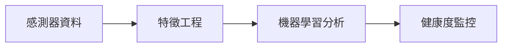
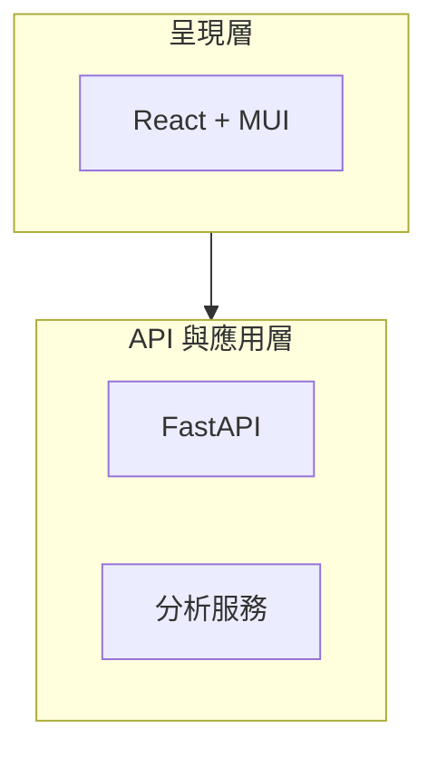
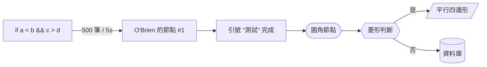

這是一頁**煙霧測試**，用來確認 Mermaid 整合的每一條路徑都通。正式文章不會出現這種頁面。
它刻意放成 `draft: true`（`hugo server` 看得到、`hugo --minify` 不會發佈）。

## 1. Fenced block，緊接語言名



## 2. Fenced block，語言名前面有空格

這是 `drafts/` 裡 ChatGPT 產的稿件實際使用的寫法。Goldmark 會 trim 掉空白，
所以它跟第 1 節走的是同一個 hook。



## 3. Shortcode 寫法

注意必須是**單大括號** ``。用雙大括號 `` 會先把
內文當 Markdown 渲染，mermaid 語法會在送到 mermaid 之前就被破壞。

⚠️ 順帶一個坑：想在文章裡「寫出」這個 shortcode 的樣子時，不能直接用反引號包起來。
Hugo 的 shortcode 掃描是在 Markdown 層級**之前**做的 raw text 掃描，它不看 inline code span，
所以 `` 就算包在反引號裡也會被當成真的 shortcode 開啟，然後整個 build 掛掉：

```
ERROR failed to extract shortcode: shortcode "mermaid" must be closed or self-closed
```

正確寫法是用 Hugo 的跳脫語法 ``，輸出結果就會是 ``。


flowchart TD
    A["User Request"] --> B["LLM Planner"]
    B --> C["Select an Approved Tool"]
    C --> D["Validate & Authorize"]
    D --> E["Execute Tool"]
    E --> F["Structured Result"]


## 4. 字元轉義測試

這張圖每一個會破壞 HTML 的字元都出現一次：`>` `<` `&` `"` `'` `#`。
render hook 必須把 `.Inner` 轉義，否則節點標籤裡的 `<` 會被瀏覽器當成真實標籤，
`textContent` 拿到的就會是殘缺的字串。

⚠️ 標籤裡想放**雙引號**不能用反斜線跳脫。`\"` 不是 mermaid 語法，
整張圖會直接 parse error：

```
Parse error on line 3: ...]B --> C["引號 \"測試\" 完成"]C --> D([圓角節點]
Expecting 'SQE', 'DOUBLECIRCLEEND', 'PE', '-)' ...
```

要寫雙引號請用 mermaid 的實體語法 `#quot;`。
（注意這跟 Hugo 層的 `htmlEscape` 是兩回事：Hugo 轉義的是 HTML 特殊字元，
mermaid 自己還有一套標籤跳脫規則，兩層都要過。）



## 5. 非 mermaid 的 code block 不受影響

這段應該照常拿到 Chroma 的 monokai 高lighter，而不是變成圖。

```python
def render_diagram(source: str) -> None:
    mermaid.run({"nodes": source})
```

## 6. 深色模式反相

把 PaperMod 的主題切到深色，`.mermaid svg` 應該會拿到
`filter: invert(1) hue-rotate(180deg)`，白底黑線變成黑底白線。

## 7. 故意寫錯的圖

下面這張語法是壞的（`-->>` 不是合法箭頭、`[[` 括號不閉合）。
它**只該讓自己失敗**：mermaid 會把該元素換成一塊錯誤訊息方塊
（`aria-roledescription="error"`），頁面其他部分照常運作。
如果整頁爆掉或白畫面，就是整合有問題。

```mermaid
flowchart LR
    A[節點A -->> B[未閉合的節點
    C --> D
```

## 8. 同一頁多張圖（回歸測試，最容易壞掉的地方）

這一頁放了 5 張圖，就是為了守住這個情境。
`mermaid.run()` 預設會用 `Date.now()` 當每張圖 SVG 的 id，而它是在一個
`await` 迴圈裡連續跑完所有圖的 —— 同一毫秒內很容易撞到相同 id，
結果是**第 2 張之後的圖全部產生沒有 `viewBox`／沒有 `max-width` 的空 SVG**，
而且會整片疊在一起、錯誤圖還會蓋到別的圖上面。

修法是 `mermaid.initialize({ deterministicIds: true })`，改用 `count++` 產生 id。
`assets/js/mermaid-init.js` 開了這個選項。

驗證方式：捲到這頁，5 張圖必須各自獨立、位置正確、互不重疊。
只要第 2 張之後有哪一張變成空白或跟別張疊在一起，就是這個設定被改掉了。

## 9. 沒有圖的頁面不得載入 mermaid

這個條件由 `layouts/partials/extend_head.html` 依 `.RawContent` 判定。
驗證方式：打開任一沒有流程圖的文章（例如任意一篇 TECH_TRENDS），
檢視原始碼應該**找不到** `<script type="importmap">`。
