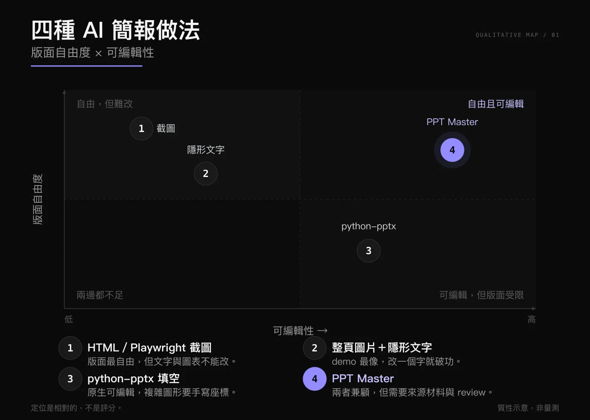
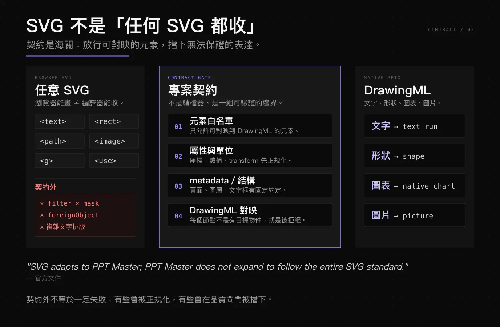
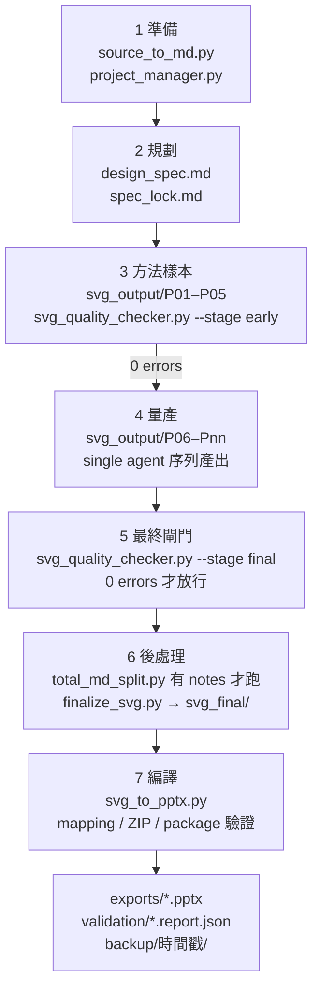
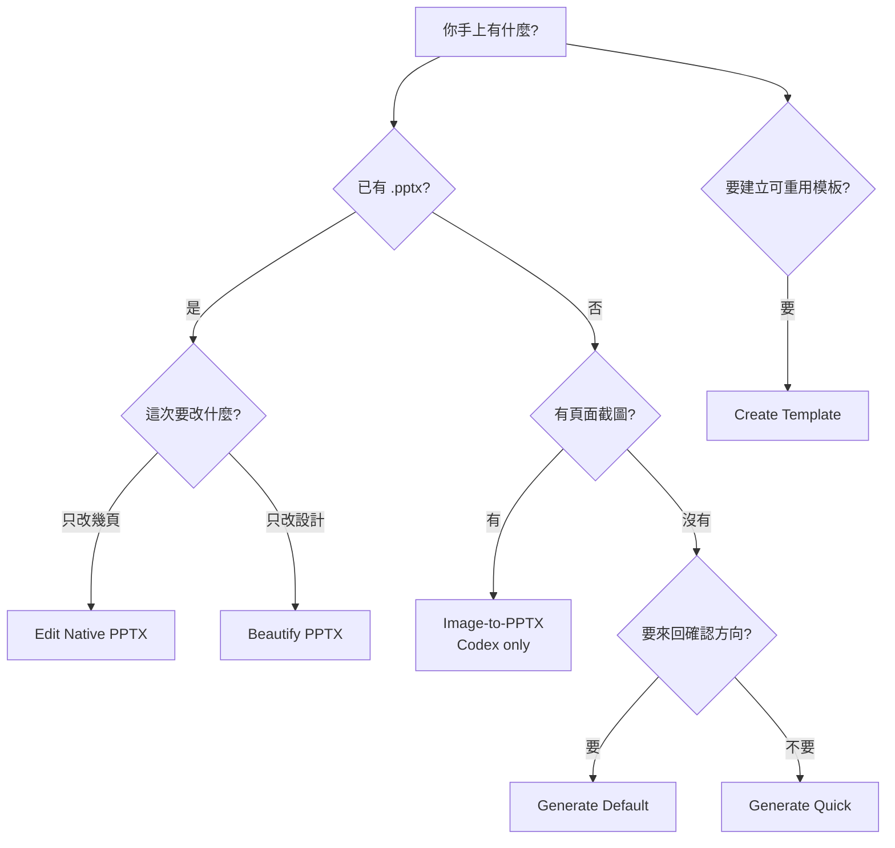
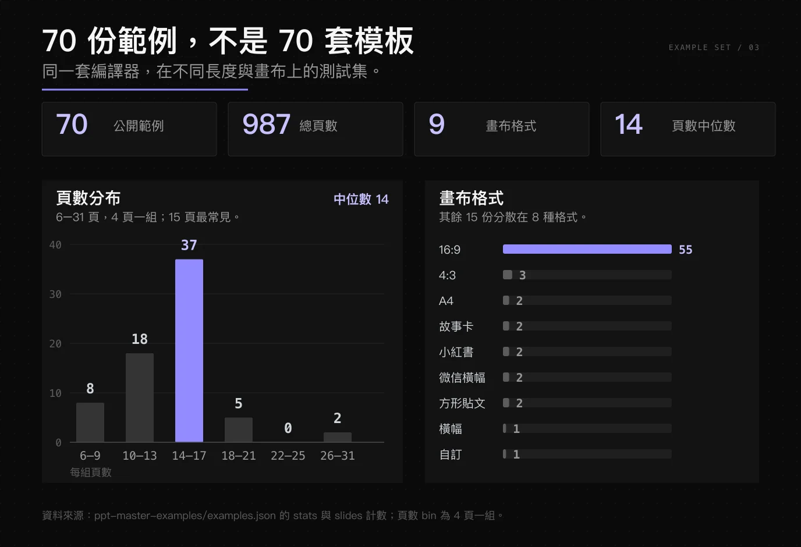


**PPT Master 不是「AI 排版工具」，它把簡報當成一個編譯目標。** 專案內的 SVG 是中繼語言（IR），DrawingML 是目標碼，模型負責決定內容與版面，確定性的 Python 工具負責檢查、轉換與封裝。

**它最反直覺的設計，是拒絕「任意 SVG 轉 PPTX」。** 只有符合專案契約的 SVG 才會被接受；`spec_lock.md` 鎖住設計決策，品質閘門擋下編譯器無法對映的表達，最後再由 `[POSTFLIGHT]` 核對封裝結果。

這篇文章會拆解：為什麼多數 AI 簡報最後還是截圖、SVG 為何適當中繼語言、六條入口怎麼選、單一 agent 如何扮演三個角色，以及它在哪裡仍然不是萬靈丹。


## 1. 導論：你花在「不是內容」的時間

做一份簡報，真正花時間的通常不是想清楚要講什麼，而是把想清楚的東西**手動搬進版面**：標題要對齊、三張圖要等寬、表格要縮到不爆框、換一台電腦字型就跑了、主管說「這頁拿掉」你又得重排後面十頁。

如果把簡報看成一份程式，這些工作其實是**手工編譯**：你用人眼解析內容，用手腕產生版面，再用 PowerPoint 當 linker，把文字、圖片、圖表黏成一個 `.pptx`。編譯一次可以，改需求再編譯一次就痛苦了。

PPT Master 的切入點，是把這段流程拆成編譯器熟悉的形狀：

- **原始碼**：PDF、DOCX、Markdown、網址、Excel，或直接貼上的主題文字。
- **中介語言**：專案內一份一份的 SVG，但不是瀏覽器什麼都吃的 SVG，而是受契約約束的 project-canonical SVG。
- **目標碼**：PowerPoint 原生的 DrawingML，文字、形狀、圖表都還是可編輯物件。
- **測試與閘門**：`svg_quality_checker.py` 檢查 SVG，`svg_to_pptx.py` 驗證對映與封裝，最後輸出一份 postflight 報告。

這個類比不是裝飾。它解釋了後面所有看起來「很工程」的設計：為什麼要有 lock file、為什麼要先產五頁再產剩下頁數、為什麼轉檔器不順便重跑完整檢查、為什麼「檔案產生了」不等於「可以交付」。

### 專案快照

| 項目 | 數值 |
|---|---|
| GitHub | [`hugohe3/ppt-master`](https://github.com/hugohe3/ppt-master) |
| 版本 | `6.7.2` |
| 授權 | MIT |
| 星數 | 65,416（撰稿時 GitHub API 快照） |
| Repo 建立 | 2025-12-10 |
| 執行環境 | Python 3.10+，需要能讀寫工作目錄、執行 shell 的 agent host |
| 公開範例 | 70 份、987 頁、9 種畫布格式 |

數字只提供量級感，**它每天都在變**。真正要判斷的是架構，不是 star 數。

## 2. 為什麼多數「AI 做 PPT」最後還是截圖

「AI 生成簡報」聽起來很簡單：給它一段文字，它吐一個 `.pptx`。但實際拆開，市面上常見的做法是三條替代路線，加上 PPT Master；它們各自把成本藏在不同的地方。

*圖：依「版面自由度 × 可編輯性」做的質性定位，不是量測。截圖派最自由但最難改；`python-pptx` 反過來；PPT Master 想同時拿到兩邊，代價是來源材料與 review。（點圖放大）*

第三條替代路線「整頁圖片＋隱形文字」只是把截圖包裝成可編輯的假象：文字看起來能選，實際上仍是圖片或疊上去的裝飾，改一個字就破功。

截圖路線的問題不只是「不能改」。它把簡報從**結構化文件**降級成**圖片集**：你不能再問「這頁有幾個文字框」、不能讓 PowerPoint 幫你重排、不能把圖表資料換成下一季的數字，也不能讓下游系統讀取講者備忘錄。

`python-pptx` 路線反過來，檔案很原生，但模型要直接面對座標系。叫 LLM 在 1280×720 的畫布上放十二個元素，它會給你一組「差不多」的數字；跑版不是例外，是常態。這不是模型不夠聰明，而是**直接寫目標碼太難 debug**。

PPT Master 選了另一條路：先讓模型寫一種它比較擅長、又看得見結果的中間格式，再用確定性工具編譯成 PowerPoint。這個選擇幾乎決定了它所有的優點與限制。

## 3. 核心設計：SVG 是中介語言，不是成品

### 為什麼不直接生成 DrawingML

DrawingML 是 `.pptx` 底層的 XML。它很精確，但非常囉嗦：一個圓角矩形可能要幾十行巢狀 XML，一個帶陰影與漸層的形狀更長。對 LLM 來說，這有兩個致命問題：

1. **訓練資料少**：模型看過的 SVG 遠多於 DrawingML，生成穩定度不是同一個量級。
2. **肉眼難 debug**：SVG 打開瀏覽器就知道哪裡錯；DrawingML 錯了，你只會看到一個打不開的檔案或一頁空白。

官方文件把這件事講得很直白：直接生成 DrawingML 看似最短路徑，實際上輸出不可靠、除錯幾乎不可能。於是它選擇 SVG 當中繼語言，讓模型在一個有即時視覺回饋的格式裡工作。

那為什麼不用 HTML／CSS？因為瀏覽器的版面引擎跟 PowerPoint 不是同一個。HTML 的 flex、grid、字型度量、換行規則，到了 PPTX 並沒有逐項對應；你可以用 Playwright 截出一張很漂亮的圖，但那個「漂亮」是瀏覽器算出來的，不是 PowerPoint 算出來的。要把它變成可編輯物件，最後還是得回到幾何與文字框，等於繞了一圈。

### 但也不是「任何 SVG 都收」

這是文章最需要講清楚的一點：**PPT Master 不是 SVG 轉檔器。**

*圖：契約像海關。`<text>`、`<rect>`、`<path>`、`<image>` 這類可對映的元素放行；filter、mask、`foreignObject` 與複雜文字排版則會被擋下或正規化。（點圖放大）*

瀏覽器能畫的 SVG 是一個很大的集合，而 DrawingML 只覆蓋其中一部分。專案契約借用 SVG 的語法與二維繪圖模型，但把允許的元素、屬性、單位、metadata 與結構規則全部關起來。官方文件的一句話很準：

> SVG adapts to PPT Master; PPT Master does not expand to follow the entire SVG standard.

換句話說，**是 SVG 配合這個編譯器，不是編譯器去追整個 SVG 標準。** 契約外的表達會在品質檢查階段被擋下，或在轉換時被正規化成支援的形式。這聽起來很嚴格，但這正是「可預測」的來源。

### 三個格式各自負責什麼

| 格式 | 角色 | 誰會用到 |
|---|---|---|
| `svg_output/` | 作者格式，也是唯一的頁面設計權威 | Executor 撰寫、checker 檢查、converter 編譯 |
| `svg_final/` | 給人看的預覽，會把支援的圖片內嵌 | 瀏覽器、IDE、人工檢查 |
| `.pptx` | 目標碼，原生 DrawingML | 使用者、PowerPoint、下游流程 |

⚠️ `svg_final/` **不是第二條匯出路徑**。它只是把 `svg_output/` 處理成比較好預覽的形式；真正可編輯的形狀只會從 `svg_output/` 經由 converter 產生。這一點很多人會誤會，以為「final 資料夾裡的 SVG 可以直接丟進 PowerPoint 轉成物件」——不行。

## 4. 編譯管線：從一份 brief 到一個 `.pptx`

把官方流程攤開，先把主線每段實際會用到的 script 標上去；分支與可選工具放在後面的表。大概是這樣：

拆開來看，有幾個值得注意的決策。

### 4.1 先確認「這份 deck 要解決什麼」

Default Generate 的 Stage 1 不是先問「你要幾頁、什麼顏色」，而是先確認溝通契約：用途、受眾、閱讀情境、畫布格式，以及要用自由設計還是既有模板。Stage 2 才確認頁數、視覺系統、模板應用方式與生產選項。

這個順序很重要。簡報的成敗通常不是配色，而是**你到底在對誰、在哪個情境、完成什麼溝通任務**。把這件事寫進 `design_spec.md`，後面的版面才有依據。

在進入設計之前，還有一道「事實充足性」的檢查。`source_to_md.py` 會依檔案類型分派：PDF、DOCX、XLSX、PPTX、網址、Markdown 各有自己的轉換路徑；如果只有主題、沒有材料，或規劃所需的關鍵事實有缺口，流程會先進入 topic-research，補出帶 provenance 的 Markdown，再匯入專案。這一步很關鍵：**簡報的幻覺通常不是排版錯，而是來源根本沒有那個數字。**

### 4.2 先做五頁，再量產

Executor 不是一次把二十頁噴完。它先產出 P01–P05，跑一次 early gate，把這五頁當成**方法樣本**：確認字級、間距、圖表語言、頁面節奏與契約都對，再連續產出剩下的頁面，中間不再呼叫 checker，最後跑一次 final gate。

這很像編譯器的 bootstrap：先用一小組測試把語法與規則釘住，再放大到完整程式。如果前五頁就有系統性錯誤，與其產完二十頁再回頭修，不如在第五頁就停下來。

### 4.3 為什麼不切成平行 sub-agent

長 deck 最容易壞的地方不是單頁，而是**頁與頁之間的一致性**：標題突然變大、強調色突然多一種、圖表突然換一套語言。平行生成會讓每個 agent 各自帶一份上下文，最後再靠人工對齊，等於把編譯問題變成 merge 問題。

官方文件列出的失敗模式很具體：sub-agent context loss、page-batching drift、long-deck color/font drift、out-of-order execution。這些不是理論風險，是實際跑出來才會看到的漂移。例如第三頁的標題用 32px、第十二頁變成 28px；第一頁的強調色是 `#938BFF`、第八頁多了一個沒人記得的藍色。單頁看都合理，整套看就是不對。

所以它選擇**單一 agent、序列化階段、每階段吃上一個階段的產物**，而不是開一堆 agent 搶同一份設計。序列化的代價是慢，但換來的是「第十頁還記得第一頁長什麼樣」。

### 4.4 後處理不是「順手做的事」

`finalize_svg.py` 負責把 `svg_output/` 轉成可預覽的 `svg_final/`，把支援的圖片內嵌，讓 EMF/WMF 之類的向量資產保持外連。`svg_to_pptx.py` 才是真正的編譯器：它驗證對映、正規化相容形式、檢查 ZIP 與投影片數量、封裝，最後產生 `.pptx` 與 postflight 報告。

成功匯出後，預設流程還會把 `svg_output/` 備份到 `backup/時間戳/`。這是實務上很實用的設計：**你不必重跑 LLM，就能從凍結的 SVG 重新匯出。**

### 4.5 如果你去翻 repo：`scripts/` 怎麼讀

`scripts/` 底下有八十幾個 top-level 檔案，再加上子目錄，第一次看會以為這是一套龐大的 framework。其實主線只有少數幾個入口；其餘是分支、可選交付與維運。可以用這張表把噪音濾掉：

| 區域／時機 | 主要 scripts | 它解決什麼 |
|---|---|---|
| 主線 Default Generate | `source_to_md.py` `project_manager.py` `svg_quality_checker.py` `finalize_svg.py` `svg_to_pptx.py` | 來源轉換、專案邊界、品質閘門、後處理、編譯 |
| PPTX 進口 來源是 `.pptx`，或走 Beautify／Edit Native／Create Template | `pptx_intake.py` `pptx_to_svg.py` | `intake` 抽 identity 與 slide library；`pptx_to_svg` 把既有 deck 還原成可編輯 SVG |
| 全域修改 已生成後要改主色或字體 | `update_spec.py` `stamp_native_fallbacks.py` | 只支援 `colors.*` 與 universal `font_family`；改完同步 `spec_lock.md`，必要時重蓋 native fallback baseline |
| 素材 有圖片、要搜圖、生圖、切圖或同步 icon | `analyze_images.py` `image_search.py` `image_gen.py` `image_treat.py` `slice_images.py` `icon_sync.py` | 量測幾何、搜尋與授權、AI 生成、裁切與切片、icon pool |
| 旁白與動態 要 notes、旁白、動畫、轉場或影片 | `total_md_split.py` `notes_to_audio.py` `narration_sync.py` `pptx_animations.py` `pptx_transitions.py` `powerpoint_video.py` `video_sound_mix.py` `video_subtitles.py` | 把靜態 deck 延伸成可播放的交付物 |
| 模板 走 Create Template，或要套用既有模板 | `pptx_template_import.py` `svg_authoring_view.py` `mirror_template_materialize.py` `template_preview_pptx.py` `apply_template.py` `register_template.py` | 萃取 master／layout、建立 authoring tree、預覽、安裝與註冊模板 |
| 維運 除錯、批次檢查、交付前檢驗 | `workflow_transcript.py` `workflow_log.py` `batch_validate.py` `pptx_delivery_check.py` `error_helper.py` | 審計紀錄、批次驗證、交付檢查、標準化錯誤提示 |

這張表刻意把「主線」與「分支」分開。最容易誤讀的是 `pptx_to_svg.py`：它是進口器，不是 Generate 的第一步。Generate 的方向是 `source_to_md → SVG → PPTX`；Edit Native 才是 `PPTX → SVG → PPTX`。同樣地，`finalize_svg.py` 產出的 `svg_final/` 只是預覽，真正把 SVG 編譯成原生 DrawingML 的是 `svg_to_pptx.py`。

還有一個容易誤會的點：`workflow.log` 是 append-only 的審計證據，不是流程能否前進的依據。它不會幫你判斷品質，只幫你事後查帳。真正決定能不能放行的是 `svg_quality_checker.py` 的 final report，以及 `svg_to_pptx.py` 的 postflight。

## 5. 六條入口：三個頂層路線，四個 Generate profile

官方路由不是「一個按鈕打天下」。它先分三個頂層路線，Generate 底下再分四個 profile。加起來是六種常見入口：

| 你的情境 | 入口 | 實際發生什麼 | 代價或限制 |
|---|---|---|---|
| 有材料、要做新 deck、想先確認方向 | Generate（Default） | Stage 1／2 確認溝通契約與設計，產出 `design_spec.md` + `spec_lock.md`，再逐頁產 SVG | 最慢，來回最多 |
| 有材料、不想被問 | Generate（Quick） | 跳過 Strategist、spec、lock，決策留在當前上下文，直接產 SVG 與 PPTX | 速度快，但上下文一斷就不能續跑 |
| 只有頁面截圖，想拆成可編輯 | Image-to-PPTX | 把圖片正規化成頁面序列，還原文字、重建圖層 | **目前只支援 Codex**，且固定走 Quick；不接受整頁截圖當可編輯外殼 |
| 已有 deck，只想改設計、保留文字與頁數 | Beautify PPTX | 保留 wording 與頁面，重做版面 | 會依意圖選 Default 或 Quick |
| 已有 deck，只想改幾頁 | Edit Native PPTX | 匯入 round-trip 工作區，未改頁面逐位元組還原，`page_plan.json` 可選頁、重排、重複或省略 | 只編輯計畫中的頁面 |
| 想建立可重用的品牌／版式 | Create Template | 從參考材料建立 Brand、Style、Layout 或 Deck 工作區 | 必須顯式要求，不是「給一份 pptx 就自動變模板」 |

把選擇畫成決策樹，會更清楚：

這張表比「支援哪些功能」有用，因為它回答的是**你該走哪條路**。同一個 `.pptx`，你說是「套模板」還是「改設計」，走的是完全不同的流程；走錯不是效果差一點，而是產物壽命不一樣。

最容易走錯的一條，是「我有一份現成 pptx，想拿它當模板，再塞新內容」。預設會進 Edit Native PPTX，因為你的直覺是「沿用這份 deck 的頁面」；但如果你要的是**先萃取可重用的設計系統，再生成一份新 deck**，必須明確說出 Create Template。前者保留原頁面，後者重建工作區，兩者的產物不能互換。

## 6. 三個角色，其實是一個 agent

文件裡會看到 Strategist、Image_Generator、Executor 三個名字，很容易以為這是三個平行 agent。不是。

它們是同一隻 agent 在不同階段載入的 **instruction scope**：

- **Strategist**：負責溝通契約、設計方向、`design_spec.md` 與 `spec_lock.md`。它決定「這份 deck 長什麼樣、為什麼」。
- **Image_Generator**：只有在資源列需要 AI 生圖、網路搜尋或切片時才載入。它處理的是素材，不是版面。
- **Executor**：照著 lock 撰寫 SVG，開即時預覽，跑早期與最終品質檢查。

為什麼要拆成角色，卻不拆成 agent？因為角色邊界是**責任邊界**，不是**平行單位**。每個階段都吃上一個階段的產物，產物有明確的消費者與驗收條件；拆成 agent 只會讓 Context 被切碎，最後沒人記得整體設計長什麼樣。

這種載入方式還有一個實際好處：**上下文可以縮小到當前工作**。寫 SVG 的 Executor 不需要在腦中同時掛著「來源 PDF 第三段在講什麼」；它只需要 lock、當前頁的內容與該頁的資源。Image_Generator 也只在真的需要生圖或切片時才出現，不會讓一整份圖庫佔滿每一次推理。

用作業系統比喻：模型是 CPU，workflow 是 scheduler，Python 工具是 syscall。你不會為了跑一個程式，開四個 kernel。

## 7. 契約與閘門：對抗「看起來差不多」

AI 產出最危險的地方，不是明顯的錯，而是**看起來差不多**。字級差 2px、顏色差一階、圖表資料對不上、頁面順序怪怪的——這些都不會讓檔案壞掉，但會讓簡報失去可信度。

PPT Master 用三層東西來擋：

### 7.1 `spec_lock.md`：把設計決策變成契約

`spec_lock.md` 不是設計文件，是執行契約。它鎖住 global 顏色與字體、`page_rhythm`（anchor／dense／breathing）、`page_visualizations`（這頁用哪個 chart／table 家族）、圖片列的放置與裁切、`mode`／`visual_style`，以及模板重用範圍。

Executor 每一頁都要重讀 lock。這件事聽起來很笨，但它解決的是 LLM 最常見的漂移：寫到第十頁時，早就忘了第一頁的強調色是哪一個。

### 7.2 兩段式品質閘門

- **Early gate**：P01–P05 之後跑。目的是抓系統性錯誤，不是抓錯字。
- **Final gate**：全部頁面完成後跑，**必須 0 errors**；warnings 不阻擋，但會記錄。

這個設計把「錯誤」與「風格建議」分開。Blocking error 會讓流程停下來，要求 Executor 重寫；warning 則是提醒，不會自動改寫你的設計。這個界線很重要，否則模型會為了消 warning 把版面改得四不像。

### 7.3 `[POSTFLIGHT]`：檔案存在，不等於可以交付

`svg_to_pptx.py` 不會重跑完整的 SVG checker。它做的是另一件事：驗證自己的對映與封裝，並且**要求一份與當前 SVG 來源 fingerprint 相符的最終品質報告**。沒有報告、報告過期、報告有 blocking error，正式匯出就會被拒絕。

匯出後，postflight 會檢查 ZIP 與 package 結構、投影片數量、關係檔、轉場與動畫，並在終端機印出一張 `[POSTFLIGHT]` receipt，包含 status、counts、未解析的 token、外部圖片、只有泛用字型的字型堆疊。

它甚至會核對實際的 ZIP part 數量，而不是只看「檔案大小不是 0」。這聽起來很偏執，但簡報檔的壞法通常不是完全打不開，而是「開得起來，某幾頁的圖不見了」或「轉場被吃掉」。這些問題不會讓匯出失敗，只會讓你在客戶面前才發現。

這張 receipt 不是裝飾。它是「檔案產生了」與「release gate 過了」之間的差別。

## 8. 原生 PPTX 的邊界：哪些是真的，哪些不是

「原生」這個詞很容易被過度使用。比較準確的說法是：

| 內容 | 匯出後是什麼 | 可以改嗎 |
|---|---|---|
| 文字 | DrawingML text run | 可以，字型、字級、顏色、段落都能改 |
| 向量形狀 | DrawingML shape（含 187 個 Office preset、Boolean、connector、freeform） | 可以，拉節點、改填色、改線條 |
| 圖表／表格 | 原生 chart／table（走 native 變體時） | 可以，資料可換 |
| 照片／插畫 | PPT picture media | 可以換圖、裁切，但不是向量 |
| 濾鏡／遮罩／複雜 SVG 表達 | 契約內的正規化結果，或直接被擋下 | 不保證一對一 |

所以它有三個必須說清楚的限制：

1. **它不是「任何 SVG 都能無損轉換」**。專案契約外的東西，要嘛被正規化，要嘛在檢查階段就失敗。這不是 bug，是設計選擇。
2. **它產出的是高品質可編輯草稿，不是密封的最終 deck**。官方自己就寫了 "high-quality editable PowerPoint draft, not a sealed final deck"。最後一哩的判斷——這頁要不要留、這句話對不對、這個圖表會不會誤導——仍然是人的工作。
3. **模板重用有範圍之分**。只有 Layout／Deck 這類 scope 會保留 Master、Layout 與 slot 結構，編譯成可重用的原生結構；Brand／Style 與自由設計走 flat，不會幫你生出母片。想要「原生模板感」，不是隨便丟一份 pptx 就有。

還有一個不在工具控制內的邊界：**模型品質仍然決定上限**。工作流能保證格式、契約與封裝，但不能保證策略選得對、文案寫得好、圖表挑得準。它把下限拉高，不會把上限拉高。

把這些講清楚，反而讓它更可信。真正工程師會在意邊界，不會在意「什麼都能」。

## 9. 70 份範例：當測試集，不是型錄

我不建議把 70 份範例當成「70 套模板」。更準確的讀法是：**同一套編譯器，在不同設計系統與內容型態下的測試集。**

*圖：70 份範例合計 987 頁，頁數 6–31、中位數 14；55 份是 16:9，其餘 15 份分散在 8 種畫布格式。（點圖放大）*

這個分布說明它不是只會做「十五頁商務簡報」：15 頁確實是最常見的長度，但同一條流程也能編譯 6 頁的短 deck、31 頁的長 deck，以及 A4、故事卡、小紅書、微信橫幅與方形貼文。

若你也是軟體工程師，這幾份特別值得打開來看：

| 範例 | 視覺語言 | 為什麼適合工程師 |
|---|---|---|
| **Kubernetes Blueprint 2026**（13 頁） | 深藍網格、青色等距方塊，control plane 與 nodes 畫成 3D 堆疊 | 系統架構、分散式系統內訓、K8s 教學 |
| **uv**（14 頁） | 終端機視窗當主角，等寬字、巨大倍數、深色底 | 開發工具發表、CLI 產品介紹 |
| **WebGPU 是什麼**（12 頁） | instructional dark-tech；32 個 preset shapes、19 個 icon、7 個可編輯 code block、36 個入場動畫、3 組 Morph | API 概覽、code-heavy 技術分享、工程入門教材 |
| **Attention Is All You Need**（15 頁） | 深藍工程紙、橘色單一強調、論文圖解 | Paper reading、ML 技術分享 |
| **Swiss Grid Systems**（14 頁） | 純白紙面、可見網格、Helvetica、瑞士紅圓 | 架構原則、設計素養、less-is-more 主題 |
| **Cloudflare Outage Postmortem**（15 頁） | 無彩編輯風、紅色只代表 severity、時間軸與表格原生 | Incident review、postmortem、SRE 報告 |

這些 deck 的差別不是「模板換皮」，而是設計系統、頁面節奏與內容結構都不同。你可以從 [官方 gallery](https://hugohe3.github.io/ppt-master-examples/) 下載 `.pptx`，直接進 PowerPoint 看原生形狀、圖表與轉場——這比看截圖更能判斷它到底是不是你要的工具。

## 10. 什麼時候值得用，什麼時候不值得

| 適合 | 不適合 |
|---|---|
| 你已經有 PDF、文件、資料或明確主題 | 你只有一句「幫我做一份 AI 簡報」 |
| 簡報需要可編輯、可套品牌、可交接 | 你只要一張漂亮圖片，不在乎能不能改 |
| 內容包含程式碼、架構圖、圖表、表格 | 內容需要複雜 3D、影片或大量自由手繪 |
| 你願意花時間 review 方向與事實 | 你期待一鍵產出、不必檢查就能寄給客戶 |
| 長 deck 需要一致的視覺系統 | 只有一頁，手工做更快 |

如果要用一句話總結：**它自動化的是「內容 → 版面」的搬運，不是「決定要講什麼」的判斷。**

如果你想試，最小路徑不是先研究 70 個範例，而是：

1. 準備一份真的來源材料，想清楚用途、受眾與閱讀情境。
2. 走一次 Default Generate，把 Stage 1／2 的確認當成需求訪談，不要急著跳過。
3. 打開 `exports/*.pptx`，逐頁點文字、形狀、圖表，確認它們真的是原生物件；不滿意就從 `svg_output/` 改，重新匯出，不必重跑 LLM。

先跑一份你熟悉的內容，比跑十份別人的範例更能看出它適不適合你。

## 結論：工具消失的那一天

編譯器的價值，不是讓你不用寫程式，而是讓你不用手動組譯。PPT Master 的價值也不是讓你不用想簡報，而是讓你不用把同一份內容，手動排版三次。

它最值得學習的地方，甚至不是 SVG 或 DrawingML，而是那個**把簡報當系統設計**的態度：先定義格式，再定義契約；先做小樣本，再放大產量；先讓錯誤擋在閘門前，再談交付。這些原則跟寫後端、做資料管線、維運服務沒有本質差別。

所以下一次做簡報，也許可以先問自己一個問題：

> 這是內容問題，還是編譯問題？

如果答案是後者，那就讓編譯器去做。

## 參考資料

- [PPT Master（GitHub）](https://github.com/hugohe3/ppt-master)
- [Technical Design](https://github.com/hugohe3/ppt-master/blob/main/docs/technical-design.md)
- [Why PPT Master](https://github.com/hugohe3/ppt-master/blob/main/docs/why-ppt-master.md)
- [Getting Started（中文）](https://github.com/hugohe3/ppt-master/blob/main/docs/zh/getting-started.md)
- [公開範例 Gallery](https://hugohe3.github.io/ppt-master-examples/)
