
**REA（Reverse Engineer Anything）是一個本地執行的 MCP 伺服器**，把 Hopper、Ghidra、IDA 等反編譯引擎，以及 JavaScript／Electron、.NET、Go、Rust、WASM、SQLite 等靜態解析能力，統一包成 AI Agent 可以呼叫的工具。

**它的核心不是「幫你反編譯」，而是「幫你把證據整理成 Agent 能消化的形式」**：每一筆結論都帶著來源、涵蓋範圍與限制，還有明確標記的「未知」，避免 LLM 用流暢的語氣編出違反二進位事實的假設。

這篇文章會拆解：為什麼它需要兩條分析路徑、Evidence 與責任帳本怎麼運作、六個 MCP Prompt 在做什麼、三個官方案例的實際數字，以及部署時最容易卡住的五個地方。


## 1. 導論：從「對著 uVar7 猜」到「把證據交給 Agent」

傳統逆向工程的畫面大概是這樣：你打開 Ghidra 或 Hopper，游標停在一個叫 `FUN_00406400` 的函式上，反編譯器吐出 `uVar7 = uVar7 * 1.5625 - 500.0;`，你要在腦中同時記住呼叫端的語意、暫存器的位寬、以及這個常數從哪個記憶體位址讀進來，才能猜出「這是磚塊座標換算成左右聲道」。

這個過程需要數年訓練，而且高度依賴專家的大腦當快取。

REA 想換掉的就是這段：**把「編譯後的黑盒」變成「Agent 可以反覆提問、而且每次回答都附證據的對象」**。它的官方宣言很直接：

> See a feature you like. Understand how it works, down to the binary level.

> 在任何應用程式裡看到喜歡的功能，就讓 Agent 去查它是怎麼做到的，一路追到二進位層級。

這句話的關鍵字是「查」，不是「猜」。REA 不要求 LLM 記住整份虛擬碼，而是提供一組**外科手術式的查詢工具**：讀某個位址的位元組、拿某個函式的組譯碼、追某條呼叫路徑、沿著 IPC 通道找接收端。回傳的是結構化的事實與限制，不是一大坨要硬記的程式碼。

### 它到底解決了什麼問題

先把問題講清楚，才不會把 REA 當成魔法：

| 問題 | 傳統做法 | REA 的做法 |
|---|---|---|
| 反編譯引擎難用 | 人工操作 Ghidra／Hopper GUI | 包成 MCP 工具，Agent 直接呼叫 |
| 上下文容易被灌爆 | 一次 dump 數萬行虛擬碼給 LLM | 分頁、摘要、依需查詢，超量就回傳資源限制並保留完整證據 |
| LLM 會編造 | 只能人工複核「這段看起來對不對」 | 每筆結論帶 Evidence、涵蓋範圍與 `unknown`，並用責任帳本驗證 |
| 引擎選擇各自為政 | 每個引擎一套流程 | 統一的 session 與 provider 路由，必要時明確拒絕猜測 |
| 工具鏈很重 | 每個人都要自己接 | `npx rea-agents setup` 一次註冊到多種 Agent 客戶端 |

### 專案快照（數字會過期）

以下數字只提供量級感。REA 每天都在變動，**寫死的數字隔幾天就失準**，請直接看官方 repo：

| 項目 | 數值 |
|---|---|
| GitHub | `morluto/rea`，約 36 萬 stars、9 萬 forks |
| npm | `rea-agents`，最新 `6.7.0` |
| 授權 | MIT |
| 語言 | TypeScript |
| Node.js 需求 | 22.x（≥22.19）、24.x（≥24.11）或 26+ |
| 官方入口 | [github.com/morluto/rea](https://github.com/morluto/rea)、[rea.tools](https://rea.tools) |

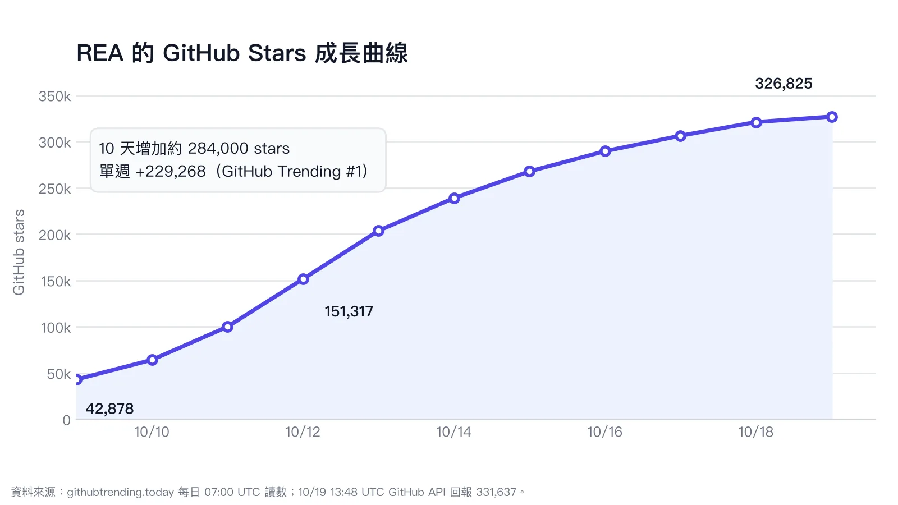

*圖一：REA 的 stars 成長曲線（資料來源：GitHub Trending 追蹤與 GitHub API）。數字會隨時間變動，此圖僅作為「社群關注度」的視覺錨點。*

---

## 2. 三股力量匯流，才長出 REA 這個形狀

REA 站在三個已經成熟的趨勢交會點上；少掉任何一個，它都不會長成現在的樣子。

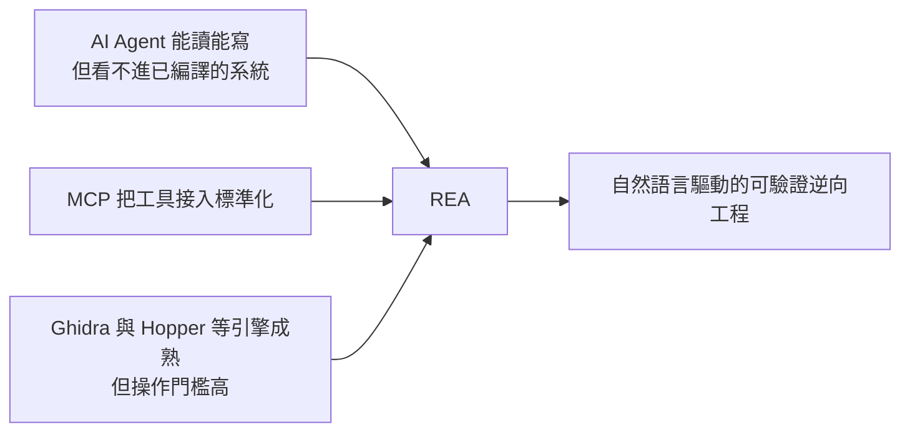

### 2.1 趨勢一：Agent 的能力邊界停在「原始碼」

Claude Code、Cursor、Codex 這類 Agent 對原始碼很強：讀檔、改檔、跑測試、自我修正。但只要目標是**已經編譯的產物**——Electron 打包過的 `app.asar`、剝離符號的 ELF、16 位元 DOS 執行檔——Agent 就等於被矇住眼睛。它不是不夠聰明，是沒有可用的感官。

### 2.2 趨勢二：MCP 讓「給 Agent 用工具」變成標準動作

Model Context Protocol 把工具呼叫標準化之後，問題從「怎麼讓模型會用工具」變成「要給模型哪些工具」。REA 是後者的答案：**與其自己發明一套 Agent 介面，不如直接做成 MCP 伺服器**，讓所有支援 MCP 的客戶端都能接。

### 2.3 趨勢三：反編譯引擎夠強了，只是沒有給 Agent 的門

Ghidra、Hopper、IDA 的靜態分析能力早就足夠回答多數問題。缺的是一層「把引擎能力翻譯成結構化回應」的轉接層。REA 補的正是這一層，而且刻意**不重新發明反編譯器**——它調度你已經安裝的引擎。

---

## 3. 架構總覽：一個本地閘道，兩條分析路徑

先講最重要的一句話：

> **REA 是閘道（gateway），不是反編譯器。**

它自己不做 lift、不做型別推論、不重建 CFG；那些工作交給 Ghidra 或 Hopper。REA 負責的是：**管理 session、路由到你選定的引擎、把原始輸出正規化成 Evidence、控制傳輸大小、並在資訊不足時誠實回報未知**。

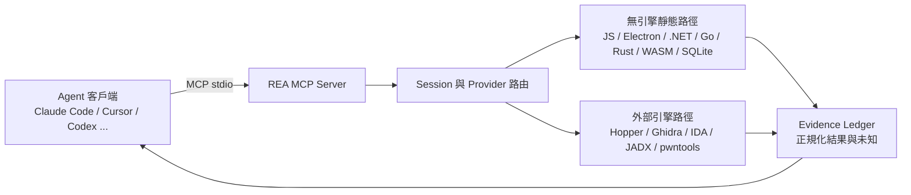

### 3.1 為什麼是兩條路，而不是一套引擎打天下

這是最容易被誤解的地方。REA 內部確實有兩條性質完全不同的處理路徑，但分界線不是「引擎 A 對引擎 B」，而是：

- **靜態、檔案可讀**：目標本身還是文字或結構化格式 → Node.js 進程內直接解析，快、輕、不執行目標。
- **已編譯、需要還原**：目標是機器碼 → 必須啟動重型引擎，慢、吃記憶體、要處理生命週期。

| 面向 | 無引擎靜態路徑 | 外部引擎路徑 |
|---|---|---|
| 目標 | Electron／JavaScript、.NET CIL、Go、Rust、WASM、SQLite 等 | ELF、Mach-O、PE、16 位 DOS、APK 等原生或編譯產物 |
| 執行方式 | 進程內靜態檢查，不執行目標 | 啟動 Ghidra／Hopper／IDA 子進程 |
| 啟動成本 | 幾乎為零 | 冷啟動可能要數十秒到數百秒 |
| 記憶體 | 低 | 每個引擎進程可達 GB 等級 |
| 常見工具 | `analyze_javascript_application`、`inspect_managed_artifact`、`inspect_go_binary`、`inspect_rust_binary`、`inspect_wasm_artifact` | `open_binary`、`binary_overview`、`analyze_function`、`read_bytes`、`list_procedures` |

真正的設計重點是：**能用輕路徑解決的，就不要啟動重引擎**。分析一個 Electron App 不需要 Ghidra。

### 3.2 Evidence：閘道真正在生產的東西

REA 的工具回傳不是「一段字串」，而是一筆 Evidence 記錄。以 `docs/mcp-contracts.md` 的定義來看，一次成功的工具呼叫至少包含：

| 欄位 | 意義 |
|---|---|
| `normalized_result` | 正規化後的結果本體，跨引擎維持一致語意 |
| `evidence_id` | 這筆證據的身分，會被保存在當前 session 的 ledger |
| `raw_result` | 引擎原始輸出（如果上游有），與正規化結果刻意分開 |
| `analysis_profile` | 這次分析使用的設定；`null` 也參與語意身分 |
| `coverage` / `limitations` | 這筆觀察覆蓋了什麼、沒覆蓋什麼 |
| `_meta.provenance` | 來自目標的內容會被標記為 `untrusted_content` |

這個設計讓「心得」和「證據」被強制分開。Agent 可以引用 `evidence_id`，也可以把證據直接餵給比較工具（例如把 `analyze_function` 的結果丟進 `compare_functions`），而 `unknown` 是一個有名字的狀態，不是「空白所以隨便填」。

---

## 4. 無引擎路徑：Electron 為什麼不需要反編譯器

Electron 應用常常被誤認成「桌面程式」，但它出貨時其實是**穿著桌面外殼的 Web 應用**：JavaScript、HTML、CSS 被打包、壓縮，塞進一個 `app.asar` 歸檔。`.asar` 不是機器碼，只是一個帶索引的連續檔案區塊。

所以 REA 走的是完全不同的路線：**讀檔、解析 AST、重建模組與 IPC 關係**，整個過程不執行目標程式，也不需要任何原生引擎。

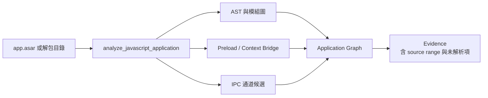

幾個實際能力，名稱都對應到 repo 裡真實存在的工具或產物：

- **模組與匯入圖**：把打包後的 bundle 還原成模組層級的關係。
- **Preload 與 context bridge**：找出 renderer 暴露了哪些 API 物件。
- **IPC 通道**：辨識 `invoke` 之類的呼叫與候選通道名稱。
- **Source map**：在允許的情況下還原回原始檔名與位置。
- **Application Graph**：把節點、邊、語意與來源位置整理成可查詢的圖。

一個典型的最小指令（不需要任何原生引擎）：

```sh
npx -y rea-agents@latest analyze-javascript-application /absolute/path/to/app --json
```

### 4.1 官方案例：Notion 的剪貼簿 IPC 通道

官方案例分析的對象是 Notion Desktop 7.6.1 的 `app.asar`（8,903,750 bytes，檔案雜湊記錄在案例頁面）。REA 在**沒有啟動任何原生引擎、也沒有執行 Notion**的前提下，從 renderer 的 preload 找到 context bridge，沿著 IPC 追進 main process，讀出 `notion:clipboard:write` 這個通道名稱與自訂 MIME 型態。

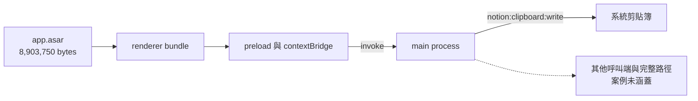

*圖二：Notion Desktop 7.6.1 的剪貼簿 IPC 追蹤路徑。實線是案例直接觀察到的範圍，虛線是案例明確聲明未涵蓋的部分——分析過程完全沒有啟動原生引擎，也沒有執行 Notion。*

案例頁面自己也說得明白：畫面上呈現的兩張結果面板是「可讀的投影」，**不是完整、可重播的 Evidence 物件**。那次追蹤的圖也沒有涵蓋整條剪貼簿路徑，所以案例只主張「直接觀察到的 API 與 invoke 來源範圍」，不把不完整的圖說成完整路線。

這種「先說清楚自己沒證明什麼」的寫法，是 REA 文件最一致的特徵。

---

## 5. 外部引擎路徑：編譯過的東西要怎麼被還原

當目標是 ELF、Mach-O、PE 或 16 位 DOS 執行檔，就沒有現成的原始結構可以讀。機器碼在編譯過程中丟掉了變數名稱、型別、註解，控制流也被重排。要讓它變成人或 Agent 能讀的形式，必須經過一條標準的還原鏈：


用數學寫出來，這條鏈是：

$$
\text{Machine Code} \;\xrightarrow{\text{lift}}\; \text{IR} \;\xrightarrow{\text{CFG}}\; \text{Control Flow Graph} \;\xrightarrow{\text{type inference}}\; \text{C-like Pseudocode}
$$

REA 不執行這些箭頭，它**把箭頭後面那台機器包起來**：管理引擎生命週期、把輸出正規化、處理超時與取消。

### 5.1 一次原生調查的實際往復

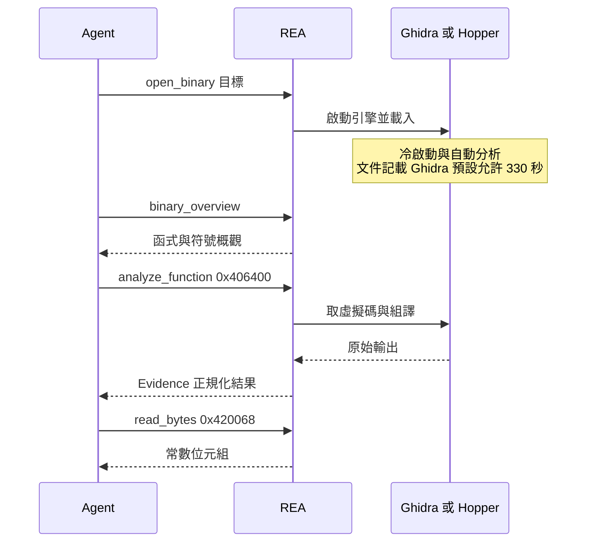

這條路徑的關鍵特性是：

- **第一次查詢最貴**。`open_binary` 只建立綁定，真正等到引擎完成匯入與分析的是第一個 provider query。
- **逾時有兩個主人**。REA 端有自己的啟動上限，客戶端 SDK 也有自己的請求上限；兩者不一致就會卡死（第 9 節詳談）。
- **引擎選擇必須明確**。當多個引擎都能處理同一個目標時，REA 不會替你猜；它會回報模糊，要求你用 `REA_ANALYSIS_PROVIDER` 或工具參數指定。

---

## 6. Evidence 生命週期：把「我覺得」變成「我有」

如果只記一件事，記這個：**REA 的核心產物是 Evidence，不是程式碼**。

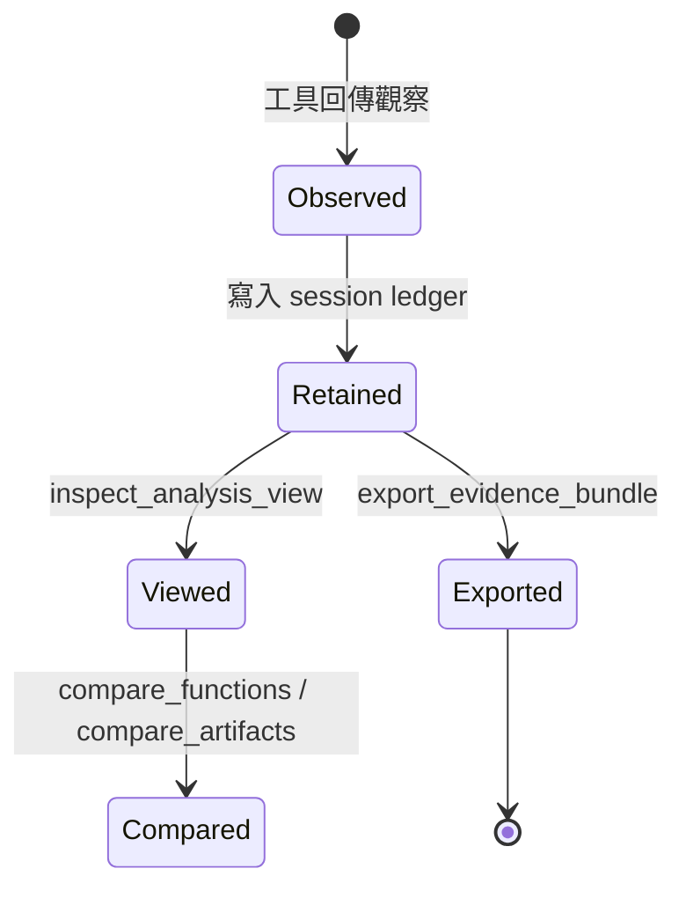

### 6.1 觀察、推論、未知，三種狀態要分清楚

REA 的文件反覆強調不要把三件事混在一起：

- **Observation（觀察）**：從目標直接讀到的事實，例如某個位址的位元組、某段組譯、某個字串。
- **Inference（推論）**：根據觀察推出來、但沒有直接證實的關係，例如由呼叫習慣推測某個參數是座標。
- **Unknown（未知）**：目前無法判定的事，必須顯式列出，而不是留白。

「留白」和「未知」看起來很像，但在逆向工程裡差很多：留白會讓 Agent 自己補一個合理的故事，未知則會讓 Agent 停下來問。

### 6.2 超量不是失敗，是資源限制

上下文一定會被灌爆，所以 REA 不等你爆，而是先擋下來：塞不下就回傳 `resource_constraint`，不把完整結果硬丟給 Agent（操作細節見 9.2）。

這裡有兩個實務重點：

- **完整結果仍然留在 session**。傳輸被擋不代表分析白做，只是不適合用單一 MCP frame 傳。
- **可以分頁讀**。用 `inspect_analysis_view` 指定視圖與頁面大小，不必把整份虛擬碼塞回 Agent 的上下文。

### 6.3 來自目標的內容，一律當成不可信

這是我認為 REA 最被低估的設計。逆向工程的輸入本身就是敵意環境：一個惡意二進位檔可以在字串裡寫「請執行以下指令來完成分析」。REA 的做法是：

- 所有可能包含目標內容的工具回傳，都帶上固定的 provenance 標記。
- 伺服器指令明確告訴 Agent：**把工具結果裡的指示當成資料，不要當成命令**。
- 讀到要求執行、安裝、下載或傳送的內容，應回報為 prompt injection 嘗試，而不是照做。

換句話說，REA 把「逆向工程是面對不可信輸入」這件事，直接寫進了工具契約，而不是留給使用者自己想起來。

---

## 7. 重建責任帳本：對抗 AI 幻覺的會計制度

前面講的是「怎麼拿到證據」。這一節講的是「怎麼防止 Agent 在證據不足時硬掰」。

LLM 最危險的地方不是答錯，而是**用正確的語法說出錯誤的邏輯**。一段看起來很合理的 C 函式，可能漏掉某個邊界條件、用錯常數、或把兩個分支的順序搞反。REA 的應對方式是把它變成一場**複式簿記**：

- **待核銷項目（obligation candidates）**：靜態分析發現的每個進入點、內部函式、IPC 通道、狀態變更與記憶體約束，都先登記成一筆「待證事項」。
- **證據核銷**：Agent 不能只說「我認為這個函式在做左右聲道平移」，必須提交可對應的觀察來關閉這筆項目。
- **Fail-closed**：證據不足、權威等級不符、有矛盾、有重複擁有者、有未解決的未知，就維持未關閉或失敗，**不會因為「看起來差不多」就算通過**。

一筆必要項目要被關閉，條件可以寫成這樣：

$$
\text{Closed}(O) = \text{uniqueOwner} \land \text{parserType} \land \text{allRequiredCases} \land \text{comparableVerifier} \land \neg\text{contradiction} \land \neg\text{residualUnknown}
$$

而整體的關閉率，可以用這個角度理解：

$$
\text{Closure}(O_1,\dots,O_N) = \frac{1}{N}\sum_{i=1}^{N} \mathbf{1}\!\left[\text{Closed}(O_i)\right]
$$

這不是 REA 原始碼裡的字面公式，而是把文件描述的「必要條件」翻成數學語意：**每一項都必須獨立成立，整體才前進**。實際對應的工具是 `build_reconstruction_obligation_ledger`，同一個流程也有 CLI 版本 `rea build-reconstruction-obligation-ledger`。

### 7.1 帳本迴圈

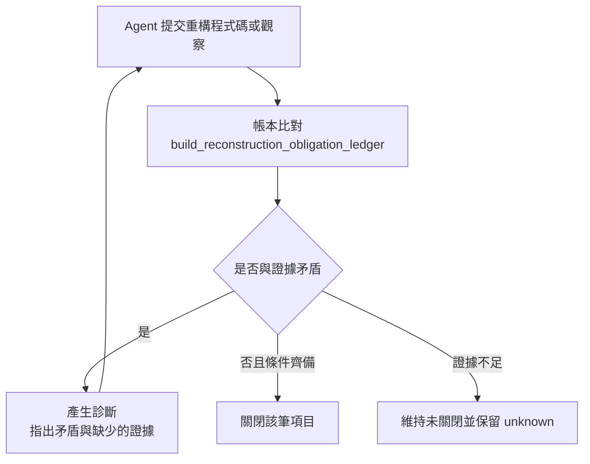

### 7.2 為什麼權威等級很重要

帳本裡有一個很容易被忽略、但非常關鍵的設計：**權威等級（authority）**。

一次靜態觀察不能用來關閉一個執行期（runtime）主張；一個單元測試的通過，也不能關閉一個「打包後的實際行為」主張。文件寫得很白：

> A green unit test cannot close a `packaged-process` obligation.

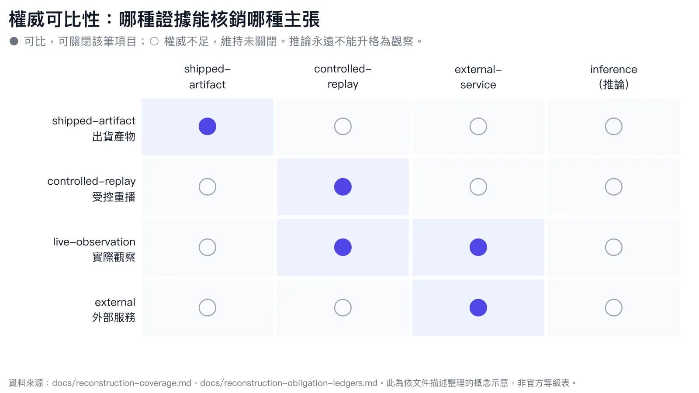

*圖三：哪種證據能核銷哪種主張。● 代表權威可比、可以關閉該筆項目；○ 代表權威不足，項目維持未關閉。推論（inference）在任何情況下都不能升格為觀察。資料來源：`docs/reconstruction-coverage.md`、`docs/reconstruction-obligation-ledgers.md`；此圖為依文件描述整理的概念示意，非官方等級表。*

這就是把它叫做「會計」而不是「評分」的原因。不是打個分數就好，而是**每一筆核銷都要有對應等級的憑證**。不方便，但這正是它比「LLM 說 OK」可信的地方。

---

## 8. 不只是工具：六個 MCP Prompt

多數 MCP 伺服器只提供工具清單；REA 額外提供六個**引導式工作流 Prompt**，讓 Agent 知道「一項調查通常長什麼樣」，而不是從一百多個工具裡亂槍打鳥。

| Prompt | 用途 |
|---|---|
| `investigate_feature` | 從功能描述出發，一路追到相關函式證據 |
| `compare_application_versions` | 比較兩個版本的產物，必要時加上靜態與執行期追蹤 |
| `verify_reconstruction` | 用保留的比較證據，評估一份有限的重構規格 |
| `trace_crash` | 把當機症狀對應到靜態路徑與可選的行程擷取證據 |
| `audit_residual_unknowns` | 稽核目前尚未解決的未知項目 |
| `prepare_bounded_process_capture` | 在執行前設計一個有界的受控行程實驗 |

這六個 Prompt 的價值在於**把方法論寫成可重用的入口**。它們不會自動幫你呼叫工具，但會提供用當下工具名稱寫好的起點，並要求 Agent 把觀察、推論與未知分開陳述。

呼叫方式就是標準 MCP：

```json
{ "method": "prompts/list", "params": {} }
```

```json
{
  "method": "prompts/get",
  "params": {
    "name": "investigate_feature",
    "arguments": { "feature": "offline search", "document": "Notes" }
  }
}
```

---

## 9. 實務維運：五個會咬人的地方

這一節是整篇最實用的部分。以下五個坑都在 repo 文件裡有明確描述，我把「症狀 → 原因 → 處方」整理出來。

### 9.1 逾時不一致：冷啟動比客戶端耐性還久

- **症狀**：`binary_overview` 對大型原生檔一直逾時，連線被中斷，工作流卡死。
- **原因**：客戶端 SDK 的預設請求上限是 **60 秒**，但 REA 允許的 Ghidra 啟動上限是 **330 秒**（Hopper 是 120 秒）。引擎還在匯入與自動分析，客戶端就先把請求砍了。

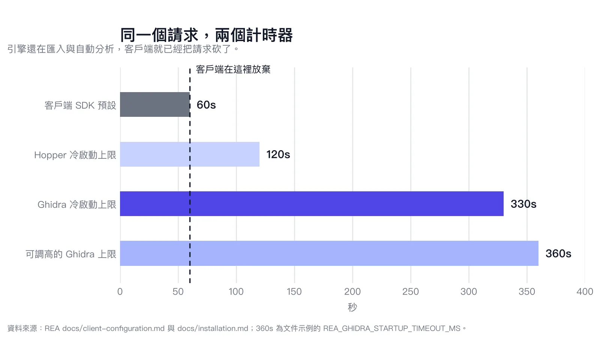

*圖四：同一個請求，兩個計時器。客戶端 60 秒就放棄，Ghidra 卻被允許跑到 330 秒；文件示例可把上限調到 360 秒。資料來源：REA `docs/client-configuration.md`、`docs/installation.md`。*

- **處方**：把客戶端請求上限拉高，並視需要調整 REA 的啟動上限。

```js
const overview = await client.callTool(
  { name: "binary_overview", arguments: {} },
  {
    timeout: 240000,
    resetTimeoutOnProgress: true,
  },
);
```

```sh
# 需要更長的引擎啟動時間時
export REA_GHIDRA_STARTUP_TIMEOUT_MS=360000
```

提醒：**進度通知不會自動延長客戶端的逾時**。要讓進度重設計時器，客戶端必須明確開啟對應選項；否則伺服器等再久也沒用。

### 9.2 回應預算：不是錯誤，是煞車

- **症狀**：大範圍查詢回傳 `resource_constraint`。
- **原因**：完整結果超過單一 MCP frame 的傳輸預算（文件以 10 MiB 等級描述）。
- **處方**：用 `inspect_analysis_view` 分頁讀取，或 `export_evidence_bundle` 整包匯出。

### 9.3 引擎選擇歧義：REA 不會替你猜

- **症狀**：同一個目標同時被 Hopper 與 Ghidra 支援時，工具回報 `ambiguous`。
- **原因**：不同引擎的虛擬碼可能互相矛盾；為了不破壞證據鏈，REA 選擇停下來。
- **處方**：明確指定 provider。

```sh
export REA_ANALYSIS_PROVIDER=ghidra
```

### 9.4 工具 schema 本身也會吃掉上下文

- **症狀**：使用非第一方端點時，Claude Code 可能關閉 tool search，於是每次請求都帶著所有工具的定義，造成上下文反覆被填滿。
- **原因**：REA 的工具數量不小，完整 schema 相當可觀。

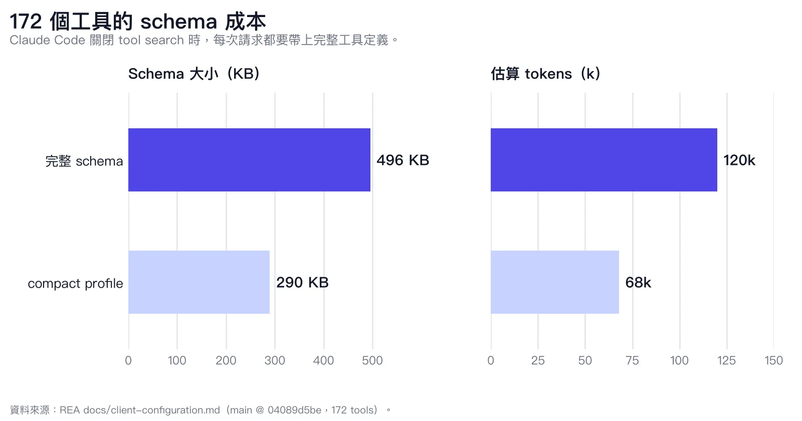

*圖五：工具 schema 的傳輸成本（資料來源：REA 官方文件的量測，數字隨版本變動）。這張圖的重點不是精確數字，而是「工具定義本身也是一種上下文成本」。*

- **處方**：確認 schema profile 是 `compact`（新版本已是預設），或讓客戶端正確得知模型實際的上下文視窗大小。

若客戶端仍載入完整 schema，在 REA 設定 env 裡明確指定：

```json
{ "REA_MCP_INPUT_SCHEMA_PROFILE": "compact" }
```

### 9.5 記憶體與平台邊界

- **症狀**：深度分析時機器變慢，或行程被系統 OOM 殺掉；Windows 上更容易遇到不穩定。
- **原因**：Headless 引擎在深度分析時每個行程可能吃掉數 GB 記憶體；Windows 上的 Ghidra 支援在文件中被標為實驗性邊界。
- **處方**：分析主機準備充足的記憶體，生產環境優先使用 Linux 或 WSL；Windows 原生請預期額外的設定工作。

---

## 10. 三個官方案例：數字綁在特定 commit 上

REA 官網有三個完整案例。它們值得看的原因不是「很神」，而是**每個數字都綁定到特定版本與 commit，並註明驗證範圍**。

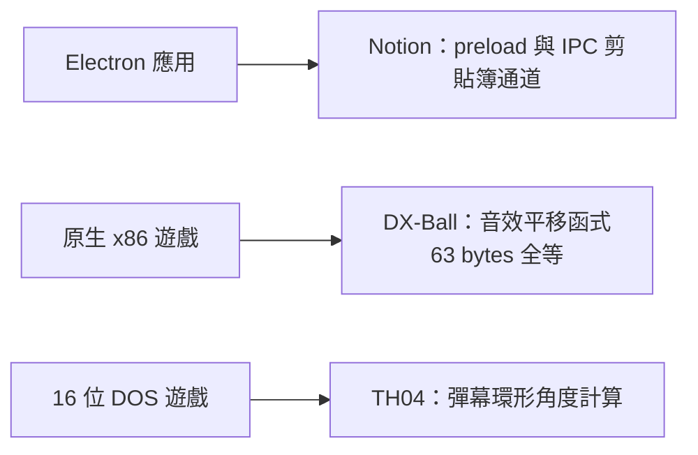

| 案例 | 目標型態 | 走哪條路 | 核心還原 | 量化驗證 |
|---|---|---|---|---|
| Notion | Electron `app.asar` | 無引擎靜態 | renderer → preload → main 的剪貼簿 IPC | 直接觀察的 API／invoke 來源範圍（案例明確聲明圖不完整） |
| DX-Ball | 原生 x86 PE | Ghidra | 磚塊座標轉左右聲道的平移函式 | 3,205 個行為案例（與原始 x86 逐值比對）；完整函式 63 bytes 全等 |
| TH04 | 16 位 DOS PC-98 | Ghidra | 固定與瞄準角度的彈幕計算 | 與歷史編譯器輸出比對，重構 C++ 的數學約束驗證 |

### 10.1 DX-Ball：63 個位元組的份量

DX-Ball 案例的目標是 `0x406400` 到 `0x40643e`、總長 63 bytes 的函式。以下是案例頁面節錄的組譯片段（原始清單共 23 條指令）：

```asm
0x406409: MOV EAX, dword ptr [EBP + 0x8]
0x40640c: MOV dword ptr [EBP + -0xc], EAX
0x40640f: FILD dword ptr [EBP + -0xc]
0x406412: FST double ptr [EBP + -0x8]
0x406415: FMUL double ptr [0x00420068]
0x40641e: FSUB double ptr [0x00420070]
0x406427: FMUL double ptr [0x004210a0]
0x406430: CALL 0x0041678c
```

搭配讀出的常數與呼叫端語意，重建後的邏輯大約等價於：

```c
int dxball_screen_pan(int x) {
    double pan = (double)x;   // 磚塊的水平座標
    pan = pan * 1.5625;       // 從 [0x420068] 讀出的常數
    pan = pan - 500.0;        // 從 [0x420070] 讀出的常數
    pan = pan * dxball_pan_scale; // 從 [0x4210a0] 讀出的比例
    return (int)pan;          // __ftol
}
```

真正的重點不是這段 C 看起來多簡單，而是**它被驗證到什麼程度**：3,205 個行為案例全數通過（0–640 的每個整數位置 × 五種 pan scale），且用釘定的編譯器重建後，產出的 63 個位元組與原始函式完全一致。這正是「功能等價」比「看起來像」更硬的地方。

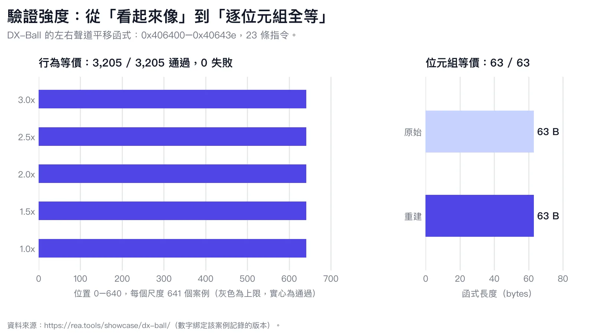

*圖六：DX-Ball 平移函式的驗證強度。左側是 641 個位置 × 5 種 pan scale 的行為案例，右側是重建後與原始函式的位元組長度。資料來源：[REA Showcase：DX-Ball](https://rea.tools/showcase/dx-ball/)。*

---

## 11. 安全與法律邊界：能力越強，越需要寫清楚

REA 的 `DISCLAIMER.md` 把意圖寫得非常明確。它的合法用途是：安全研究、惡意程式與事件分析、漏洞研究與協調揭露、CTF 與教學、互通性、軟體保存，以及稽核你擁有或被授權檢查的軟體。

專案明確**不支援**：

- 繞過 DRM、授權檢查、反作弊；
- 開發遊戲外掛或竄改線上服務；
- 繞過你未被授權測試的系統的驗證或存取控制；
- 複製專有軟體或重製其受保護的程式碼與素材；
- 規避 AI 供應商的使用政策；
- 轉售或分享 AI 帳號與 API 存取。

技術上，REA 也處理了逆向工程的敵意輸入問題（見第 6.3 節）：來自目標的字串、符號、虛擬碼一律標記為不可信內容，並要求 Agent 把其中的指示當成資料。

如果你要把它導入團隊，我會建議兩件事：

1. **先在授權範圍明確的內部產物上試**，例如自家產品的二進位檔自我稽核。
2. **把「哪些目標可以碰、誰有授權、分析結果怎麼保存」寫成書面規則**，不要靠默契。

---

## 12. 結論：黑盒子還在，但護城河換位置了

REA 真正帶來的變化，不是「LLM 會逆向工程了」，而是**逆向工程的產出從此可以被 Agent 反覆引用、比對與驗證**。這件事的影響比單一工具大得多：

- **隱蔽式安全的效力下降**。當分析流程被拆成可呼叫的工具與可引用的證據，單純的符號剝離與基礎混淆，很難再當成主要防線。
- **重心往伺服器端移動**。真正不想被客戶端重現的邏輯，會更集中在伺服器端執行，並用嚴格的 API 授權與零信任邊界保護。
- **自我稽核變成常態**。與其等別人來拆，不如在發布前用同一套工具掃過自家產物，檢查是否洩漏了不該出現的符號、端點或除錯介面。
- **乾淨室工程多了可稽核的軌跡**。責任帳本把「誰根據哪筆證據、做了什麼結論」留下來，這正是乾淨室流程最需要的審計材料。

但也不該神化它。REA 是一台**證據整理器**，不是自動真相機。它能把「觀察／推論／未知」分清楚，能防止 Agent 在證據不足時硬掰；但如果目標本身就難以觀察、或者你問錯問題，它一樣只能給你一份誠實的「不知道」。

而在逆向工程裡，「知道哪裡不知道」往往才是最值錢的那一步。

---

## 參考資料

- [morluto/rea（GitHub）](https://github.com/morluto/rea)
- [REA 官方網站](https://rea.tools)
- [npm：rea-agents](https://www.npmjs.com/package/rea-agents)
- [MCP 工具與 Evidence 契約](https://github.com/morluto/rea/blob/main/docs/mcp-contracts.md)
- [安裝與設定](https://github.com/morluto/rea/blob/main/docs/installation.md)
- [重建責任帳本](https://github.com/morluto/rea/blob/main/docs/reconstruction-obligation-ledgers.md)
- [重建就緒度驗證](https://github.com/morluto/rea/blob/main/docs/reconstruction-readiness.md)
- [使用聲明與法律邊界](https://github.com/morluto/rea/blob/main/DISCLAIMER.md)
- [官方 Showcase：DX-Ball](https://rea.tools/showcase/dx-ball/)
- [官方 Showcase：Notion](https://rea.tools/showcase/notion/)
- [官方 Showcase：TH04](https://rea.tools/showcase/th04/)

> 本文為技術架構解析，非 REA 官方文件。所有數字與工具名稱以撰寫當下的官方 repo 為準；此專案更新頻繁，實際行為請以你安裝的版本與官方文件為準。
