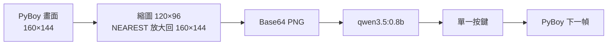
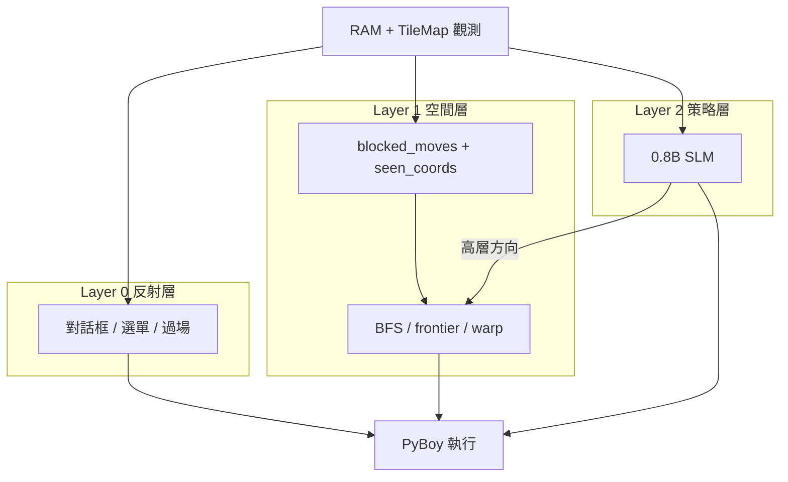
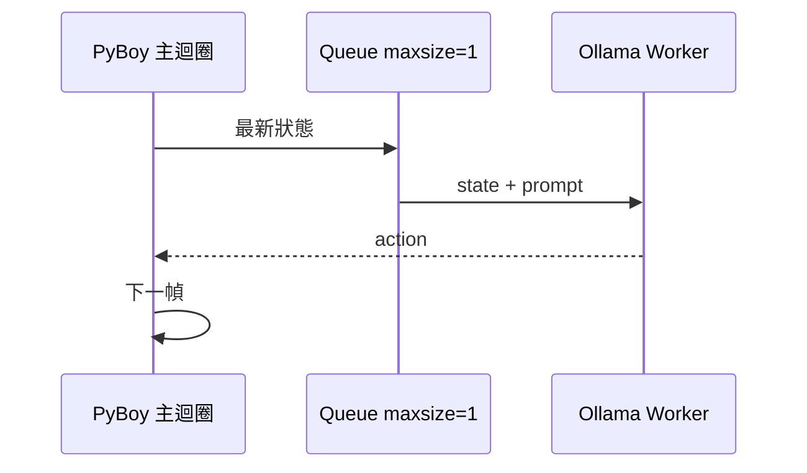


**0.8B 的價值，是在一個被整理好的世界裡做選擇。**

我一開始把遊戲畫面丟給同一個 0.8B 模型，讓它看圖決定按鍵。結果跑了 22.5 分鐘、132 個 episode（平均每個約 10 秒），動作欄位只有一個值：`A`，畫面還停在標題。後來我沒換更大的模型；我把「看畫面」改成「讀 RAM」，把「記路」從模型手上拿走，它第一次自己走出了家門，抵達 Pallet Town（真新鎮）。

這篇是 Agent Harness 的工程記錄，重點是感知、記憶、導航、反射這四件事：哪些該交給模型，哪些不該。


## 0. 按了 132 次 A，還在標題畫面

專案的 SQLite 裡躺著一段很難看的紀錄。

132 個 episode，動作欄位只有一個值：`A`。最後一次狀態仍是 `title`，其中 10 筆被標記為 `stuck_detected`。如果把這段 log 貼給任何人看，得到的結論大概都是：「0.8B 太笨了。」

我一開始也這樣想。

但把時間軸拉長，會看到另一個問題。它被塞進一張 120×96 的截圖裡，同時要做 OCR、地圖辨識、座標定位、碰撞判斷、路徑規劃與按鍵控制。任何一個環節錯了，下一步就沒有意義。模型連「自己在哪裡」都不知道。

那不是模型笨，是**我把太多工作塞給同一個模型**。

## 1. 六篇 SLM 文獻，拼出同一個結論

為了確認這不是自己的錯覺，我把手邊六篇 SLM 相關論文重新讀了一次。它們的證據類型不同，但放在一起，剛好可以解釋這個專案為什麼會失敗、又為什麼後來能動。


| 論文 | 證據類型 | 這篇在說什麼 | 對應到專案 |
|---|---|---|---|
| *A Comprehensive Survey of SLMs* `2411.03350` | Survey | SLM 的定義應該看能力與資源限制，不是只看參數量 | 0.8B 在 16GB Mac 上跑得動，這本身就是設計條件 |
| *SLMs Can Still Pack a Punch* `2501.05465` | Survey | 1–8B 的模型在特定任務可以接近、甚至超過大模型 | 但前提是「特定任務」，不是開放式世界知識 |
| *SLM: Survey, Measurements, and Insights* `2409.15790` | Measurement | 量測 70 個開源 SLM 的延遲與記憶體 | 本地推論的價值是延遲、隱私與成本，不是榜單分數 |
| *SLMs are the Future of Agentic AI* `2506.02153` | Position | Agent 的工作重複、專門，SLM 應是預設，LLM 是 fallback | 0.8B 適合當慢速策略層，不適合當全能大腦 |
| *SLMs for Agentic Systems* `2510.03847` | Survey | Agent 的瓶頸常在 orchestration 與 I/O，不是世界知識 | 這個觀察幾乎就是這個專案的診斷書 |
| *Readability ≠ Learnability* `2510.13915` | Empirical | 簡化不等於更好學；不要把人腦的直覺套到模型上 | prompt 寫得更簡單沒有救，重寫觀測介面才有 |


不過，Belcak 等人的 *SLMs are the Future of Agentic AI* 是 NVIDIA 的 position paper，不是中立綜述；Lee 與 Berg-Kirkpatrick 的 *Readability ≠ Learnability* 是訓練研究，不能當成 agentic system 的 benchmark。把它們當成「共識」會過度解讀。

但其中有一個觀察，和這個專案的體感很接近。Sharma 與 Mehta 的 *SLMs for Agentic Systems* 指出，對很多 agentic workload 而言，主要瓶頸經常是 **orchestration 與 I/O**，而不是模型的長程世界知識。它把 SLM 定位成多數 agent pipeline 的預設引擎，只在開放域推理與長程規劃等真正困難的環節，才呼叫更大的 LLM。

我的結論是：

> 如果問題是「開放式世界知識」，0.8B 一定輸。
> 如果問題是「在幾個結構化選項裡做選擇」，0.8B 可能夠用。

這篇文章要測的是：

**把哪些工作從 0.8B 拿走之後，它就能玩？**

我實際跑的是 `qwen3.5:0.8b`。這個任務的瓶頸不在知識量，所以我不需要更大的模型。與其把預算花在參數，不如先確認模型看見了什麼。

## 2. 為什麼是 Pokémon Red

Pokémon Red 不是一個公平的 benchmark。它是一個很方便的 stress test。

它有四個特性：

1. **部分可觀測**：玩家只能看到當下畫面，但遊戲的真正狀態藏在 RAM 裡。
2. **延遲敏感**：Game Boy 的移動、對話、選單都有自己的 frame 節奏，按太快或太慢都會失效。
3. **長時序**：一步走錯不會馬上爆炸，但會在半小時後變成「卡在房子裡」。
4. **可重現**：模擬器、存檔、RAM map 都是公開的，錯誤可以反覆重跑。

Pokémon Red 的 RAM map 有社群整理（DataCrystal 的 RAM map 頁面），所以我可以把「觀測」從像素換成狀態，專心測試 harness。如果今天換成一款沒有 RAM map 的遊戲，VLM 或 OCR 可能仍是唯一的路。

本文不會散布 ROM。遊戲本體請使用自己合法取得的副本。

## 3. 第一版：把畫面丟給模型

第一版是 VLM（視覺語言模型）pipeline，做法很直覺：



Game Boy 的原生解析度是 160×144。我以為把畫面縮到 120×96 再放大回 160×144，可以降低 base64 大小，於是就這樣送進模型。這個「最佳化」是第一個致命傷：120×96 不是 160×144 的等比例縮放，8×8 的字元被壓成約 6×5.3，對話框、選單、數字與地圖細節全部糊掉。更諷刺的是，繞了一圈又回到 160×144，base64 不一定變小。先失去的細節卻回不來了。如果重來，我會用 120×108，至少保住 10:9 的比例。

第二個致命傷是 prompt。我當時只問：

> 你正在玩 Pokémon Red。看這張截圖，選一個最好的下一個按鍵。只輸出 UP、DOWN、LEFT、RIGHT、A、B、START、SELECT、NONE。

沒有地圖名稱、沒有座標、沒有碰撞資訊、沒有行動歷史。模型看到的是一張縮圖，卻要回答一個需要狀態的問題。

後來加上狀態抽取器，情況也沒有好轉。JSON schema 裡只有 `location_hint`、`summary`、`confidence` 這些欄位，而且 prompt 還明寫「不要從像素猜精確座標」。於是模型給出的就是「看起來像在房間裡」這種描述。對人類來說這很合理，但 agent 要決定「往左還是往右」，這種描述等於沒有觀測。

延遲也是災難。視覺模式把推論間隔設為 1 秒，實際每次決策約 1–2 秒。如果主迴圈同步等待，遊戲就會定格。MacBook 的 M 系列晶片又是 CPU/GPU 共用記憶體，PyBoy 的模擬與顯示、Ollama 的推論共享同一塊記憶體與 GPU 資源，兩邊一起搶，風扇先受不了。

那段 132 次 `A` 的紀錄，就是這個階段的極端結果。模型沒有隨機亂按；它收斂到一個最保守的動作：既然不知道自己在哪，按 `A` 不會移動，至少不會立刻撞牆。

我沒有因此認為視覺模型沒用。**視覺不是錯，錯的是用視覺去讀一個已經有結構化記憶體的世界。**

## 4. 第二版：RAM 是更好的眼睛

Pokémon Red 的 RAM 是公開的。地圖 ID、玩家座標、面朝方向、戰鬥狀態、隊伍 HP、徽章、金錢、背包，全部有固定位址。與其讓模型從像素猜，不如直接讀。

| 位址 | 內容 |
|---|---|
| `0xD35E` | 地圖 ID |
| `0xD361` / `0xD362` | 玩家 Y / X 座標 |
| `0xC109` | 面朝方向 |
| `0xD057` | 戰鬥狀態（0/1/2） |
| `0xCFD8` | 敵方精靈 ID |
| `0xCFE6–0xCFE7` / `0xCFE8` | 敵方 HP / 等級 |
| `0xD163` | 隊伍數量 |
| `0xD16C–0xD16D` / `0xD18D–0xD18E` | 當前 HP / 最大 HP |
| `0xD18C` | 等級 |
| `0xD173–0xD176` | 四招招式 ID |
| `0xD188–0xD18B` | 四招剩餘 PP（使用次數） |
| `0xD16F` | 異常狀態 |
| `0xD356` | 徽章 bitfield（popcount 後才是數量） |
| `0xD347–0xD349` | 金錢（BCD） |
| `0xD31D` | 背包物品列表（數量在 `0xD31C`） |
| `0xCD38` | 腳本化按鍵模擬索引（非 0 時停用碰撞） |
| `0xC3A0–0xC507` | `wTileMap`，20×18 的螢幕文字層 |

`0xCD38` 是 `wSimulatedJoypadStatesIndex`；它讓遊戲模擬按鍵，非 0 時會停用碰撞，但不是完整的控制鎖定。真正的按鍵忽略旗標是 `wJoyIgnore`。

讀取本身很短：

```python
def u8(addr: int) -> int:
    return self.pyboy.memory[addr]

state = {
    "map_id": u8(0xD35E),
    "y": u8(0xD361),
    "x": u8(0xD362),
    "facing": u8(0xC109),
}
```

搭配 Game Boy 的 charmap 解碼，`wTileMap` 可以直接還原對話框、選單項目與游標位置。這些字元是遊戲自己寫進記憶體的事實，不需要 OCR 猜。

依專案 README 的自測值，這一層的讀取延遲小於 `0.01 ms`。這是專案自測，量測方式也很土：在同樣的 Python 迴圈裡連續讀幾次，抓個大概。但它和「1–2 秒的截圖推論」差了好幾個量級。

前後對照大概是這樣：

| | VLM 管線 | RAM 管線 |
|---|---|---|
| 觀測 | 120×96 截圖 | RAM + TileMap |
| 狀態 | 自然語言摘要 | 結構化欄位 |
| 座標 | 模型猜 | 直接讀 |
| 延遲 | 端到端 1–2 秒 | 讀取 <0.01 ms + 決策 10–50 ms |
| 失敗模式 | 幻覺、字太小 | ROM 綁定、需要逆向工程 |
| 除錯 | 看 log 猜 | 看地圖、座標、碰撞邊界 |

代價也很清楚：這是 ROM-specific 的解法。換一款遊戲，RAM map 要重找；換一個平台，charmap 要重寫。這種解法成立的前提，是世界本身有結構。

## 5. 三層 Harness：把「聰明」拆開

有了可靠的觀測，接下來我把它放進三層架構。



### Layer 0：反射

對話框出現就按 `A`，過場動畫就等待，選單有 YES/NO 就確認。這些規則明確、延遲要求高，交給模型反而變慢。

Layer 0 的優先順序最高。程式只要看到 `screen_type == "dialogue"`，就不會去問模型「你覺得要不要按 A」。這樣做是為了不浪費它的時間，跟信不信任無關。

### Layer 1：空間記憶

Layer 1 維護三種東西：

- `seen_coords`：走過的格子。
- `blocked_moves`：`(map_id, x, y, direction)` 的碰撞邊界。
- `discovered_warps`：走過的門、樓梯、入口。

然後用 BFS（廣度優先搜尋）找最近的未探索 frontier，或走到已知出口。這層完全不需要語言模型。它要的是全域路徑、碰撞檢查與一致性。

### Layer 2：0.8B 的策略

模型拿到的是整理過的狀態：地圖名稱、座標、可行方向、障礙方向、NPC 線索、frontier 方向、上一個動作。模型的輸出是一個動作（方向或互動鍵），必要時附帶 1–3 步的步數。

依 README 的自測值，文字模式推論約 `10–50 ms`。這個數字同樣是專案自測，不是獨立 benchmark；但至少說明，當輸入是結構化狀態時，0.8B 不需要很長的思考時間。

### 非同步：讓慢的層不要擋住快的層



主迴圈維持 30–60 FPS，模型在背景執行緒跑。`Queue(maxsize=1)` 是刻意的：寧可丟掉排隊中的舊狀態，也不要讓模型追著歷史跑。但這樣只能丟掉排隊中的狀態，不能保證回傳的 action 對應最新狀態；要做到「只採用最新」，每個狀態得帶一個遞增的 sequence number，模型回來時比對，舊的就丟掉。

按鍵也有時序校正，單位是 Game Boy 的 60 Hz 幀：方向鍵按住 12 幀、放開 12 幀，總共 24 幀；A/B 這類非方向鍵是按住 8 幀、放開 10 幀。按太快，遊戲只會轉向不會走；按太慢，一個 tile 的移動會拖成兩步。

這種分層在機器人學裡很常見：**慢速 planner + 快速 controller**。在這裡，planner 是一顆 0.8B 的語言模型，controller 是 BFS 與反射規則。

## 6. 四個卡點

### 6.1 Warp 不是 frontier

Agent 第一次卡住，是在房子裡上樓、下樓、再上樓。

原因是 BFS 對 frontier 的定義太單純：**沒走過的格子就是未探索**。但樓梯與門口也是「沒走過」的格子，卻不是房間的一部分。模型看到 frontier 在樓梯口，就走過去。一走過去就被傳送到另一層。另一層的 BFS 又把剛剛的入口當成 frontier，於是來回跳。

我把「門」從「房間」裡分離出來。

- `known_warps` 不列入 frontier 目標。
- 記錄 `current_entry_warps`，剛進來的那個入口要冷卻。
- 一般冷卻 25 步；偵測到嚴重來回震盪時鎖 60 步。

```python
# 已知的 warp 是傳送門，不是未探索的地板
if (nx, ny) not in known_warps:
    ...
```

BFS 現在追的是「還沒探索」的格子，已知的門直接排除。

BFS 排除 warp 只保證它不會把樓梯當目標，不能保證模型不會自己走過去。所以我在給模型的路況摘要裡把走過的 warp 入口標成 `[B]`，新出口才是 `[D]`。Prompt 直接寫明 `[B]` 是來時路，當前區域沒走完就不要踩。

### 6.2 四個方向都 blocked

第二個卡點更荒謬。Log 長這樣：

```text
Immediate Paths: Walkable -> [None] | Obstacles -> [UP, DOWN, LEFT, RIGHT]
```

四個方向都被標成牆。模型收到「沒有路」，探索建議也失效。Agent 站在一個理論上不可能存在的位置。

根因是碰撞網格把一次誤判累積成四面牆。可能是按鍵沒生效、可能是地圖切換瞬間讀到舊座標、也可能是一次移動被對話框打斷。只要有一次錯，那個 `(map, x, y, direction)` 就被永久標成 blocked。這層記憶沒有過期機制，錯誤會一直留著。

我加了兩層處理：

- `get_movement_options` 偵測四個方向全 blocked 時，自動衰減，必要時清除這個位置的區域障礙。
- Smart Unstick 在真的卡住時，從可行方向隨機挑一個，重新取狀態。

### 6.3 壞掉的碰撞網格被存下來

第三個卡點更難查。Agent 不動了，但 stuck detector 沒有觸發。重開程式，還是在原地按 `B`。

因為壞掉的碰撞網格被持久化到磁碟了。程式重跑，讀回同一份「四面都是牆」的記憶，於是永遠找不到路。更糟的是，卡死檢測只看座標有沒有變。如果當下 `screen_type` 是選單或對話，它會刻意忽略停滯，避免把「按 A 翻頁」誤判成卡住。兩個機制疊在一起，就變成一個不會自己結束的迴圈。

後來的做法是：

- 寫入磁碟前先驗證網格是否自相矛盾。
- 地圖切換時重置局部障礙。
- 不把「四個方向全 blocked」的狀態持久化。
- 為這個案例加一個回歸測試。

**原則：持久化錯誤比錯誤本身更貴。** 一個會消失的 bug 還可以重跑；一個被寫進 state 的 bug 會跟著你到下一次啟動。

### 6.4 模型原地打轉

最後一個卡點不是空間，是行為。模型連續輸出：

```text
Action: DOWN 2
Action: DOWN 2
Action: DOWN 2
```

它看不見自己剛剛做了什麼。Prompt 裡有當前狀態，卻沒有行動歷史。0.8B 的有效上下文與指令跟隨能力有限，很容易把「往下走」當成預設答案。

最後我把決策空間縮小。

- 把最近 N 個動作放進 prompt。
- 加入停滯檢測，重複動作時強制換方向。
- 只給四個方向與互動鍵，不給開放式指令。
- 讓 Layer 1 在模型選到 blocked 方向時直接覆蓋。

## 7. 實驗：從 title screen 到 Pallet Town

先看舊管線的紀錄：

| 指標 | 數值 |
|---|---|
| Episode 數 | 132 |
| 時間跨度 | 22.5 分鐘 |
| 平均 episode 長度 | 10.2 秒（含截圖、推論與環境重置） |
| 動作分布 | `A` × 132 |
| 最後狀態 | `title` |
| `stuck_detected` | 10 |

這還談不上玩得好不好：它根本沒有進入遊戲。拿來開場可以，當基準不行。這是舊的視覺狀態格式，不能和後來的 RAM 管線直接比。

新管線的記憶檔是另一組數字：

| 指標 | 數值 |
|---|---|
| 走過的格子 | 72 |
| 碰撞邊界 | 34 |
| 地圖數 | 3（37 / 38 / 0） |
| Quest log | 5 筆 |
| 最後位置 | Pallet Town |

三張地圖分別是 Red's House 2F（37）、Red's House 1F（38）與 Pallet Town（0）。Quest log 裡有兩次「Entered new area: Red's House 1F!」，這是 warp 偵測的噪音。所以 warp 偵測不能只看一次狀態變化。

它沒有通關，只是第一次靠自己走出家門。

兩邊比的不是同一件事。舊管線在標題畫面按了 132 次 `A`。新管線在 72 個格子、34 條碰撞邊界與 3 張地圖之間，完成了一次有意義的移動。

延遲量級如下（專案自測與設計參數，尚未獨立驗證）：


{
  "data": [
    {
      "type": "bar",
      "orientation": "h",
      "x": [1500, 0.01, 30],
      "y": ["VLM 截圖決策", "RAM 狀態抽取", "文字 SLM 決策"],
      "text": ["1–2 s", "< 0.01 ms", "10–50 ms"],
      "textposition": "outside",
      "marker": { "color": ["#EF4444", "#22C55E", "#6366F1"] },
      "hovertemplate": "%{y}<br>%{x} ms<extra></extra>"
    }
  ],
  "layout": {
    "margin": { "l": 150, "r": 110, "t": 20, "b": 55 },
    "xaxis": {
      "type": "log",
      "title": "毫秒（對數刻度）",
      "range": [-2, 4],
      "gridcolor": "rgba(128,128,128,0.18)"
    },
    "yaxis": { "automargin": true },
    "paper_bgcolor": "rgba(0,0,0,0)",
    "plot_bgcolor": "rgba(0,0,0,0)",
    "font": { "family": "system-ui, sans-serif", "size": 13 },
    "showlegend": false
  },
  "config": { "displayModeBar": false, "responsive": true }
}


不要把 `0.01 ms` 當成「RAM 萬能」。觀測變快了，決策還是原本的難題。加速來自整個 pipeline 的重新分工，單看一個數字會誤判。

## 8. 討論：SLM 的正確位置

把這次實驗拆開，我會把 agent 的工作分成這樣：

| 工作 | 交給誰 | 為什麼 |
|---|---|---|
| 讀座標、地圖、對話 | RAM / TileMap | 確定性、低延遲、沒有幻覺 |
| 走路、避牆、找 frontier | BFS + 碰撞記憶 | 需要全域路徑，不需要語言 |
| 對話、選單、過場 | Layer 0 反射 | 規則明確，模型反而增加延遲 |
| 高層策略、選目標 | 0.8B SLM | 選項少、上下文短、需要一點常識 |
| 多跳推理、模糊語意 | 更大的 LLM fallback | SLM 容易自信地猜錯 |

這張表大致對應前面的文獻回顧：SLM 適合當預設引擎，LLM 留給較難的個案。Belcak 等人的 position paper 更激進，但那是立場，不是定論。

Lee 與 Berg-Kirkpatrick 的研究則提醒我：該動的是**介面**，不是語言。我一開始也犯過類似的錯，以為 prompt 寫得更短、更口語，0.8B 就會更聰明。後來發現，把世界整理成四個方向、一個互動鍵、一份碰撞記憶，比寫一段更友善的 prompt 有用得多。

Whidden 的 Pokémon Red RL 實驗很容易被拿來對照。他用 PPO 開大量平行模擬器，reward 包含探索新格子、重複停留的懲罰、事件旗標與徽章。這類來回彈跳在訓練裡會被重複停留的負 reward 壓下去，最後變成 policy 的一部分。

這套方法不能直接搬到 0.8B。LLM 是 inference，決策時不會更新權重；不可能像 RL 那樣跑大量 episode 再回頭改模型。但 reward 的形狀可以借：新格子加分、重複停留扣分、剛走過的 warp 扣分。我沒有把 RL 放進這個專案，也不是說兩者等價。RL 用訓練時間換 policy；這裡用 harness 把問題縮小。

所以，什麼時候該用 SLM？

- 動作空間是結構化的（按鍵、API、工具呼叫）。
- 上下文不長，狀態可以壓縮。
- 任務重複、專門，且錯誤可以檢查。
- 你需要在本地跑，在意延遲、隱私或成本。

什麼時候該 fallback 給大模型？

- 需要多跳推理或長上下文整合。
- 語言本身有歧義，選項無法事先列舉。
- 錯誤代價高，需要更強的世界知識與判斷。
- 你要處理的是「沒見過的問題」，不是「見過很多次的問題」。

## 9. 結論：模型不是大腦

我以前會把 agent 想成「一個很聰明的大腦，加上一些手腳」。這次做完，比較準確的畫面是反過來：

**模型不是大腦。它比較像整個系統裡最會說話的那一層。**

它負責在幾個被整理好的選項裡，選一個當下最合理的。讓 agent 變聰明的，是那個把世界整理成選項的 harness：可靠的觀測、會遺忘的記憶、能走路的導航、以及知道什麼時候不要問模型的反射層。

如果你也在做 edge agent，可以先問自己一個問題：

> 模型現在被迫做哪些不該它做的事？

把那些事拿走，0.8B 可能比你想像的更能幹。

下一步，我會把戰鬥策略、跨地圖的長期記憶與工具路由補上，也會試著讓 0.8B 與 4B／雲端模型分工：小模型處理常規決策，大模型在被需要時接手。

0.8B 不是終點。它是一個很好的預算單位。

## 參考資料

- Wang et al., *A Comprehensive Survey of Small Language Models in the Era of Large Language Models*, arXiv:2411.03350. <https://arxiv.org/abs/2411.03350>
- Gupta et al., *Small Language Models (SLMs) Can Still Pack a Punch: A Survey*, arXiv:2501.05465. <https://arxiv.org/abs/2501.05465>
- Lu et al., *Small Language Models: Survey, Measurements, and Insights*, arXiv:2409.15790. <https://arxiv.org/abs/2409.15790>
- Belcak et al., *Small Language Models are the Future of Agentic AI*, arXiv:2506.02153. <https://arxiv.org/abs/2506.02153>
- Sharma & Mehta, *Small Language Models for Agentic Systems: A Survey of Architectures, Capabilities, and Deployment Trade-offs*, arXiv:2510.03847. <https://arxiv.org/abs/2510.03847>
- Lee & Berg-Kirkpatrick, *Readability ≠ Learnability: Rethinking the Role of Simplicity in Training Small Language Models*, arXiv:2510.13915. <https://arxiv.org/abs/2510.13915>
- DataCrystal, *Pokémon Red and Blue RAM map*. <https://datacrystal.tcrf.net/wiki/Pok%C3%A9mon_Red_and_Blue/RAM_map>
- PyBoy, Game Boy emulator for Python. <https://github.com/Baekalfen/PyBoy>
- Whidden, P. *PokemonRedExperiments: Playing Pokémon Red with Reinforcement Learning*. GitHub. <https://github.com/PWhiddy/PokemonRedExperiments>
- Ollama, local LLM runtime. <https://ollama.com>

> 本文的程式碼、log 與記憶檔來自本地專案；ROM 未隨文章散布。遊戲與相關商標權利屬於原權利人。
