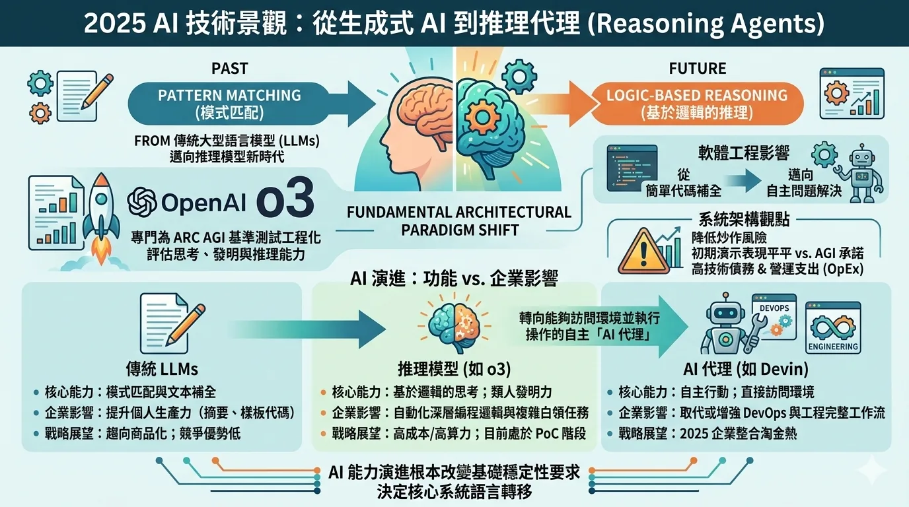
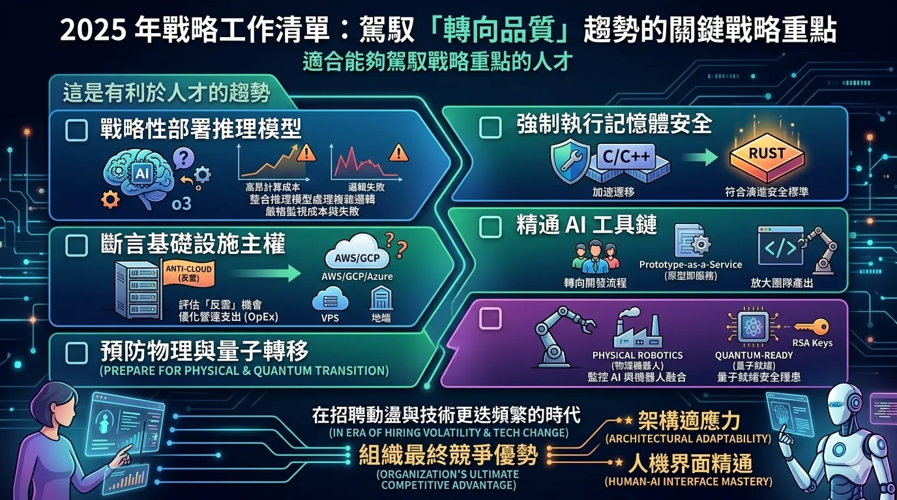


- o3 等推理模型是策略轉折，但運算成本與邏輯失誤使其仍停留在概念驗證階段。
- 能存取環境並執行操作的 AI 代理，是更重要的企業趨勢。
- C／C++ 遷移至 Rust 的腳步加快，驅動力來自記憶體安全、監管與長期基礎設施安全。
- 框架選擇日益取決於 AI 工具在該生態系中生成與維護程式碼的能力。
- 「反雲」運動將非必要工作負載推回 VPS 或地端基礎設施。
- 機器人、腦機介面、量子運算與後量子安全進入策略規劃視野。

**總結：** 架構適應力與人機協作調度，才是持久的優勢。




---
# 2025 年技術戰略路線圖

## 導航 AI 整合、語言遷移與基礎設施主權

---

## 1. 2025 年景觀：從生成式 AI 轉向推理代理 (Reasoning Agents)

我們正觀察到一個根本性的架構範式轉移：產業正從標準大型語言模型 (LLMs) 的「模式匹配」能力，邁向「推理模型」的新時代。OpenAI **o3** 的發布標誌著一個戰略轉折點；這是首批專門為 **Arc AGI 基準測試**（一套旨在評估系統是否具備類人靈活性來思考、發明與推理的指標）而工程化的模型。

對於軟體工程而言，這意味著開發將從簡單的代碼補全轉向自主問題解決。然而，從系統架構的角度來看，我們必須降低炒作帶來的風險。雖然這些模型被行銷為「國際特級大師」，但其初期演示（例如建立帶有基礎 UI 的簡單 Python 腳本）與 AGI 的承諾相比，表現依然平平。

在戰略上，這些模型目前代表了極高的技術債務與營運支出 (OpEx)。每次任務的計算成本高達數千美元，且容易在連人類新手都能處理的簡單邏輯問題上失敗，推理模型目前尚不是資深工程師的「即插即用型」替代品。儘管如此，轉向能夠訪問環境並執行操作的**自主「AI 代理」**仍是 2025 年的主要趨勢。

### AI 演進：功能 vs. 企業影響

| 功能類別 | 核心能力 | 企業影響 | 戰略展望 |
| --- | --- | --- | --- |
| **傳統 LLMs** | 模式匹配與文本補全。 | 提升個人生產力（摘要、樣板代碼）。 | 趨向商品化；競爭優勢低。 |
| **推理模型 (如 o3)** | 基於邏輯的思考；類人發明力。 | 自動化深層編程邏輯與複雜白領任務。 | 高成本/高算力；目前處於「概念驗證 (PoC)」階段。 |
| **AI 代理 (如 Devin)** | 自主行動；直接訪問環境。 | 取代或增強 DevOps 與工程的完整工作流。 | 2025 年企業整合的「淘金熱」。 |

AI 能力的演進正從根本上改變我們對基礎穩定性的要求，並決定了我們用於構建核心系統的語言轉移。

---

## 2. 戰略語言遷移：向 Rust 轉型

作為首席系統架構師，首要任務是減輕系統性漏洞。我們正目睹 **C 與 C++ 在關鍵任務環境中的管理式衰落**。在政府與軍事機構的指令驅動下，產業正帶頭轉向記憶體安全語言——特別是 **Rust**。記憶體安全性的戰略重要性已不再是理論上的偏好，而是長期基礎設施安全的先決條件。

一個典型的轉移案例是 DARPA 領導的 **「Tractor」計畫**。該計畫旨在利用 LLMs 和專業工具，自動將遺留的 C++ 代碼翻譯為 Rust。然而，技術領導層必須謹慎行事。考慮到 DARPA 實驗性計畫歷史上的高失敗率，僅依賴自動翻譯存在引入細微邏輯錯誤的風險。儘管有這些風險，採用 Rust 仍是降低遺留技術債務風險最可行的路徑。

### 採用 Rust 的戰略優勢

* **系統性記憶體安全：** Rust 的借用檢查器 (Borrow Checker) 預設消除了 C++ 中根深蒂固的緩衝區溢出與記憶體洩漏問題。
* **監管合規性：** 符合軍事與國防領域針對記憶體安全軟體開發的新興標準。
* **市場長效性：** 隨著 AI 代理處理更多常規「編碼」任務，人類在系統級 Rust 的專業知識將成為「真實」（手動）編程角色中的高價值利基。
* **生態系統成熟度：** 隨著在技術棧中的廣泛採用，該語言已從實驗性轉變為性能關鍵型系統的產業標準。

底層語言的安全性為目前正在重塑開發生命週期的「AI 驅動快速原型工具」提供了必要的基礎。

---

## 3. 以工具為中心的轉移：AI 驅動的開發工作流

「JavaScript 框架戰爭」已進入停滯期，導致 PHP 與 Laravel 等穩定生態系統出現意外的復甦。對於現代架構師而言，框架的選擇標準已從內部語法轉向 **「AI 工具兼容性」**。一個框架的戰略價值現在取決於 AI 代理在其生態系統中生成、維護與擴展代碼的效率。

我們已進入 **「原型即服務 (Prototyping-as-a-Service)」** 的時代。如 **v0** 和 **Bolt** 等工具允許在數秒內生成功能完整的 UI 與原型，瓦解了傳統的開發時程。這種加速重新定義了「10x 工程師」。在 2025 年的語境下，10x 工程師是能夠管理 AI 代理以在動盪市場中維持超高生產力的工程師。隨著招聘競爭依賴持續激烈，獎勵將留給那些能夠彌補架構構思與 AI 輔助執行之間差距的人。

應用程式部署速度的提升正在創造應用組合的巨大擴張，這迫使我們必須對這些資產的託管位置與方式進行關鍵性的重新評估。

---

## 4. 基礎設施合理化：脫離雲端的「反雲」運動

組織開始正視其對主要雲端供應商（AWS、GCP 與 Azure）的「成癮」問題。我們正看到一場追求**基礎設施主權**的戰略運動——即「反雲」情緒。經濟現實是，對於許多標準 Web 屬性與非必要服務，託管雲服務的高昂成本是不必要的營運支出 (OpEx) 負擔。

擺脫這種成癮涉及到回歸 **虛擬私人伺服器 (VPS)** 或**實體在地化 (On-premise) 託管**。這一舉措得到了當前法律壓力的支持；針對 Google（針對 Chrome 瀏覽器與搜尋主導地位）、Meta 和 Amazon 的反壟斷訴訟預示著未來「三巨頭」霸權將被碎片化。這種監管環境為組織收回數據控制權與優化基礎設施成本創造了空間。

實現基礎設施主權不僅僅是節流措施；它是下一階段技術整合的戰略先決條件：即控制專有的「機器人大腦」與物理自動化。

---

## 5. 組織的未來佈局：機器人與人機界面

下一個十年的軟體工程將日益與物理現實產生交集。我們正看到 OpenAI 級別的「大腦」被整合到 **Figure 01** 與 **Tesla Optimus** 等物理形式中。這種從數位螢幕到物理自動化的轉變代表了系統架構的下一個前線。此外，隨著 **Neuralink** 腦機晶片的植入以及如 Google **Project Astra** 等 AI 驅動增強現實技術的發展，人機界面正擴展到鍵盤之外。

然而，我們也必須考慮新興的安全風險。Google 的 **Willow 晶片** 顯著降低了錯誤率，標誌著量子計算的重大飛躍。雖然量子電腦可能不會在 2025 年破解 RSA 加密，但對現有密碼標準的威脅已隱約可見，這使得**後量子密碼學 (Post-quantum cryptography)** 的研究變得至關重要。

技術就業市場反映了這一過渡時代。來自「True Up」與聯準會的數據顯示，雖然技術職位空缺較 2022 年的高峰下降了 50%，但市場已從近期低點回升了 30%。這種「轉向品質 (Flight to quality)」的趨勢有利於那些能夠駕馭以下戰略重點的人才：

### 2025 年戰略工作清單

* [ ] **戰略性部署推理模型**：整合如 o3 的模型處理複雜邏輯，同時嚴格監視其高昂的計算成本與邏輯失敗。
* [ ] **強制執行記憶體安全**：加速將關鍵的 C/C++ 服務遷移至 Rust，以符合演進中的安全與政府標準。
* [ ] **斷言基礎設施主權**：評估「反雲」機會，將非核心業務轉向 VPS 或地端解決方案以優化營運支出 (OpEx)。
* [ ] **精通 AI 工具鏈**：將開發流程轉向「原型即服務」，以放大團隊產出。
* [ ] **預防物理與量子轉移**：監控 AI 與機器人的融合，以及量子就緒系統帶來的長期安全隱患。

在招聘動盪與技術更迭頻繁的時代，組織最終的競爭優勢在於其**架構的適應力**以及對**人機界面**的精通。

---
