
- 五層架構：React／MUI、Flask API、分析、邊緣執行、SQLite／檔案持久化。
- 有界 deque 批次緩衝近期樣本（500 筆或約 5 秒），但不是持久化佇列。
- PHM 結合 RMS／FFT、One-Class SVM、DTW 與 PCA 漂移監控；判讀仍由工程師負責。
- AI Agent 是受控的應用程式用戶端：工具白名單、授權、驗證與稽核紀錄由後端強制執行，不依賴 LLM 提示詞。
- 部署從 Docker Compose 邊緣單體開始；待量測證明有必要，才解耦為獨立 Worker。

**總結：** 可靠性來自可追溯的資料、明確的故障行為與受治理的 Agent。


## 前言

這篇文章介紹我參與開發的 **Edge AI／PHM（Prognostics and Health Management，故障預測與健康管理）平台**。平台涵蓋感測器資料處理、機器學習、設備端推論、健康度監控、後端服務與生成式 AI Agent，目標是把原本分散的資料分析與模型應用，收攏成一套可操作、可追蹤且能持續演進的工程系統。

本文不會只列出使用了哪些技術，而是沿著實際的系統設計脈絡，回答幾個問題：

- 為什麼需要整合 Edge AI 平台？
- 如何設計從感測器到模型推論的端到端資料流？
- 如何在缺乏故障標籤的情境下進行異常偵測？
- 如何讓 LLM 使用真實的設備資料，而不是直接生成未經驗證的答案？
- 為什麼現階段選擇 Flask、SQLite 與 Docker Compose，而不是一開始就採用完整的分散式架構？
- 當資料量與併發需求增加時，系統應該如何演進？

文章也會討論目前架構的限制與可能的改善方向。對我而言，理解系統的瓶頸、設計選擇與演進路線，與把當下功能做好同樣重要。

> **專案說明：** 本文為個人技術展示與面試簡報的延伸版本。涉及公司、客戶及內部專案的識別資訊均已移除，相關資料與情境亦經去識別化或虛擬化處理。文中的架構描述不應被解讀為特定客戶或生產環境的完整規格。

---

## 1. 專案總覽：建立從感測器到工程決策的完整流程

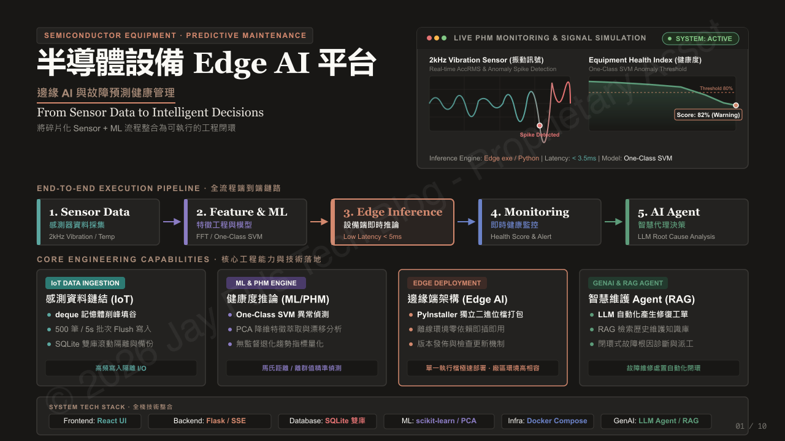

### 1.1 專案定位

這套平台的核心目標，是將感測器資料、機器學習模型、設備端推論、監控告警與 AI 輔助診斷整合成一條完整的工程工作流程。

整體流程可以分成五個階段：

**Sensor Data → Feature Engineering & ML → Edge Inference → Health Monitoring → AI Agent**

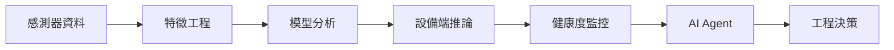

1. **Sensor Data：** 收集設備振動、溫度等感測器資料。
2. **Feature Engineering & ML：** 將原始訊號轉換為具有分析價值的時域與頻域特徵，並進行模型訓練與異常偵測。
3. **Edge Inference：** 在設備端執行資料處理與模型推論，降低對遠端服務的即時依賴。
4. **Health Monitoring：** 持續追蹤設備健康度、異常分數與告警狀態。
5. **AI Agent：** 整合設備狀態、歷史紀錄與分析工具，協助工程師理解異常並整理後續處置建議。

這五個階段並非彼此獨立的工具，而是透過資料格式、API、模型檔案與狀態管理串接起來的系統。

### 1.2 四大核心能力

| 模組                 | 核心職責             | 主要技術                     |
| ------------------ | ---------------- | ------------------------ |
| IoT Data Ingestion | 感測器資料接入、緩衝與持久化   | Python、deque、SQLite      |
| ML & PHM Engine    | 特徵工程、異常偵測、趨勢分析   | NumPy、SciPy、scikit-learn |
| Edge Deployment    | 設備端執行與版本發佈       | Python、PyInstaller       |
| GenAI & RAG Agent  | 資料查詢、診斷輔助、維護知識檢索 | LLM、Tool Calling、RAG     |

平台使用 React 建立操作介面，Flask 提供後端 API，SQLite 負責資料持久化，Docker Compose 管理容器化服務，並透過 AI Agent 把資料分析延伸到自然語言互動。

---

## 2. 為什麼需要 Edge AI 平台？

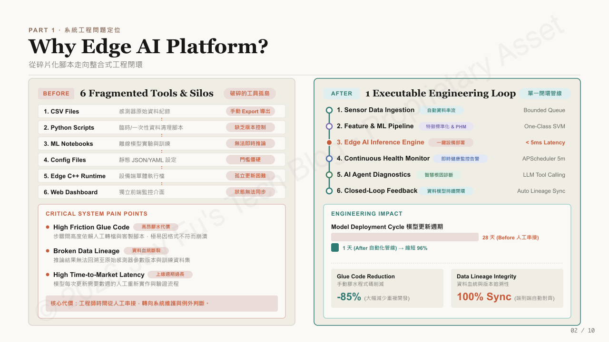

模型只是生產系統的一部分；資料路徑與維運控制才決定它是否有用。

### 2.1 三個關鍵工程問題

**整合成本高。** 資料接入、前處理、模型執行、API、Dashboard 與告警分散在不同元件；介面不清時，一個小改動就會牽動多個模組。

**資料血緣不完整。** 工程師需要知道特徵或分數來自哪些資料、模型與設定；缺乏追溯性時，分析難以重現與比較。

**模型部署週期過長。** 開發環境能跑，不代表能在現場包裝、設定、安裝與更新。

### 2.2 整合後的改善

平台把資料接入到營運使用的路徑標準化。

| 工程面向 | 預期改善 |
| --- | --- |
| 部署 | 降低平台更新的打包與發佈成本 |
| 整合 | 重用共同介面，避免重複寫專案專屬串接程式 |
| 資料血緣 | 讓分析輸入、輸出與模型版本更容易追溯 |
| 維護流程 | 以支援調查與後續追蹤的形式呈現資料與分析 |

三項指標需搭配定義與基準解讀；部署週期改善不等於模型準確率提升，資料血緣同步也不代表資料品質問題消失。

---

## 3. 系統架構：五層整合設計

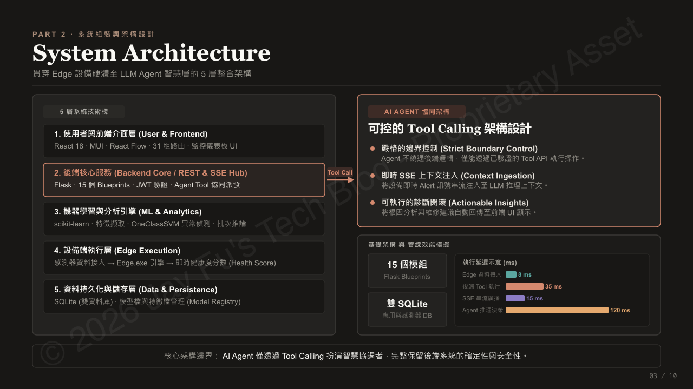

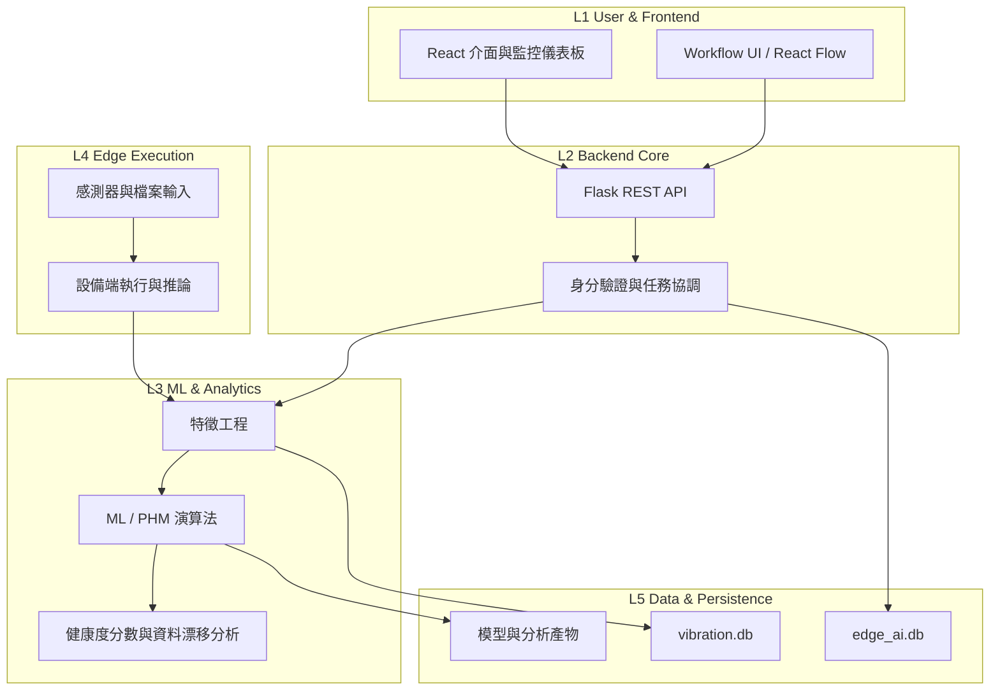

### 3.1 五層架構

| 層級／模組 | 主要職責 |
| -- | -- |
| L1 前端 | React 介面、監控儀表板、Agent UI |
| L2 後端 | Flask REST API、身分驗證、工具協調 |
| L3 分析 | 特徵工程、模型訓練、異常偵測 |
| L4 邊緣 | 感測器接入、邊緣執行、即時推論 |
| L5 資料 | SQLite、模型檔案、歷程紀錄 |

分層是職責邊界，不是獨立部署的微服務：前端不直接存取資料庫，模型推論與 UI 分離以利重複使用。

邊緣執行在本機讀取感測器，降低網路依賴並讓高頻樣本留在設備端；切分取決於延遲、運算、網路、資料量與部署限制。

### 3.2 前端與後端如何協作？

前端使用 React 18、Material UI 與 React Flow；後端使用 Flask REST API，並以 Blueprint 分離感測器、模型、設備、使用者與 Agent 等領域。

- **REST API：** 查詢資料、更新設定、提交訓練任務。
- **Polling：** 定期取得設備狀態。
- **Server-Sent Events（SSE）：** 接收伺服器事件與 Agent 串流。

### 3.3 如何看待系統效能資料？

延遲指標須使用一致的量測起訖點，區分平均、P95、P99 與冷啟動；不同來源的數字不應直接相加。

---

## 4. 端到端資料流：從高頻訊號到健康度監控

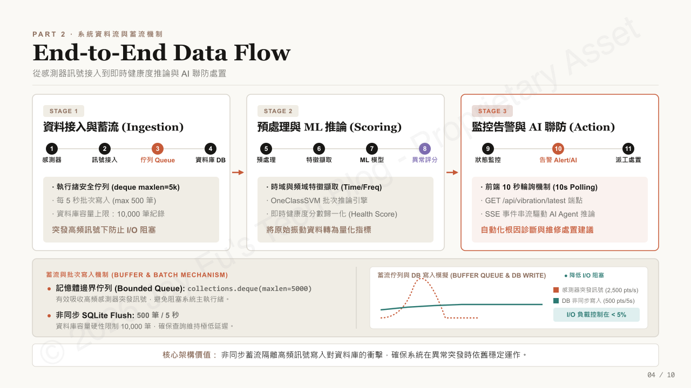

資料流定義資料如何進入、被處理，以及流量突增時如何維持穩定。

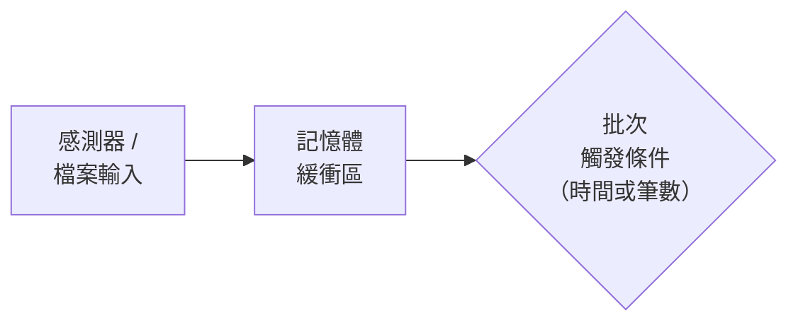

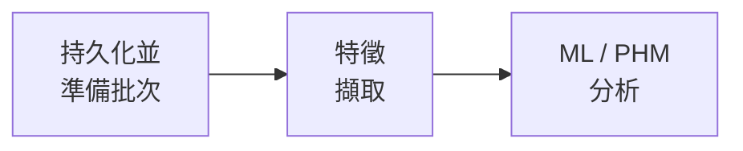

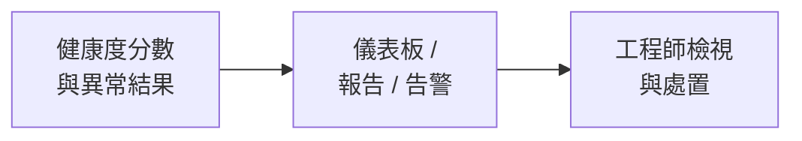

### 4.1 Stage 1：資料接入與緩衝（Ingestion）

感測器持續產生資料；平台以 `collections.deque(maxlen=5000)` 作為有界記憶體緩衝，每 5 秒或批次條件成立時，將最多 500 筆寫入 SQLite，讓高頻 I/O 不與查詢競爭。

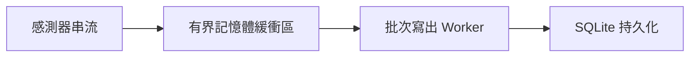

有界佇列滿載時會丟棄最舊資料，適合限制記憶體用量，但**不是可靠訊息佇列**；若樣本必須完整保存，需額外設計持久化佇列、溢位處理、背壓與遺失監控。

### 4.2 Stage 2：特徵擷取與模型推論（Scoring）

批次輸出特徵、異常指標、健康度分數與中介資料。

### 4.3 Stage 3：監控、告警與 Agent 分析（Action）

平台透過儀表板、報告或告警呈現結果；**異常偵測辨識偏離，根因分析提出解釋**，後者需結合歷史資料、設備知識與工程師驗證，不能只憑一個分數斷言故障。

---

## 5. ML & PHM Pipeline：如何從感測器資料辨識異常？

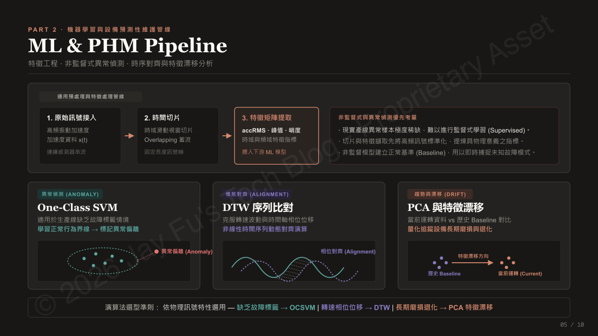

PHM 結合領域知識、訊號處理、統計分析與機器學習；沒有單一演算法能回答所有設備健康問題。

### 5.1 訊號特徵

常見的訊號特徵包括：

- **RMS（Root Mean Square）：** 描述訊號整體能量，常用於振動強度。
- **峰值（Peak）：** 視窗內最大絕對振幅。
- **峭度（Kurtosis）：** 描述分布尾部與衝擊性；解讀取決於分布假設與實作方式。
- **FFT（Fast Fourier Transform）：** 將時域訊號轉為頻域成分，觀察主要頻率與頻譜變化。

對訊號 \(x = [x_1, x_2, \ldots, x_N]\)，RMS 定義為：

$$
\mathrm{RMS} = \sqrt{\frac{1}{N}\sum_{i=1}^{N} x_i^2}
$$

特徵定義、視窗大小、取樣率、單位與前處理必須一致；否則看到的變化可能來自流程，而不是設備。

### 5.2 One-Class SVM：異常偵測

One-Class SVM 以正常資料學習決策邊界，標記邊界外的觀測；適合故障標籤很少的情境。

- 以具代表性的正常運轉資料建立基準。
- 特徵尺度保持一致。
- 用驗證資料與工程回饋調整 `nu`、`gamma`。
- 監控誤報與漏報；異常分數不是診斷。
- 運轉條件或設備改變時重新檢視基準。

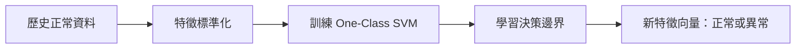

### 5.3 DTW：時間序列對齊

DTW（Dynamic Time Warping）衡量時間軸或長度不同的序列相似度，適合比較事件時間有位移的模式。

$$
D(i,j) = d(x_i,y_j) + \min\left\{ D(i-1,j),\; D(i,j-1),\; D(i-1,j-1) \right\}
$$

其中 \(d(x_i,y_j)\) 是局部距離。Warping window 可降低運算量並避免不合理的對齊。**DTW 不是萬用解**；結果取決於參考序列、距離度量、正規化與領域條件。

### 5.4 PCA：漂移監控

PCA（Principal Component Analysis）將相關特徵線性投影到較少的主成分；以歷史基準比較新資料，可觀察分布變化。

漂移不等於故障；製程配方改變、感測器更換、運轉條件或前處理版本不同，都可能造成漂移。

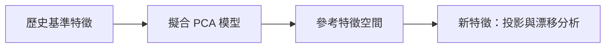

### 5.5 演算法選擇

| 方法 | 主要目的 | 主要限制 |
| -- | -- | -- |
| RMS / Peak / Kurtosis | 量化時域訊號特性 | 對視窗、雜訊與運轉條件敏感 |
| FFT | 觀察頻譜成分與頻率變化 | 需適當取樣與解讀 |
| One-Class SVM | 偵測偏離正常資料邊界的觀測 | 取決於基準品質與參數選擇 |
| DTW | 比較時間軸不對齊的序列 | 運算成本較高，且依賴參考序列 |
| PCA | 監控多變量結構與潛在漂移 | 漂移不等於故障 |

這些方法可以互補，實際組合仍須依設備與資料特性驗證。

---

## 6. Backend Engineering：讓資料、模型與服務可維護

### 6.1 Flask 與 Blueprint 模組化

後端以 Flask 建立 REST API，依領域拆分 Blueprint：感測器資料、ML 分析、邊緣管理、維護、Agent、使用者與權限。**Blueprint 只負責路由歸屬**；業務邏輯過度集中時，仍須抽離 Service Layer 與資料存取層。

### 6.2 身分驗證與權限控制

平台以 LDAP／Active Directory 驗證身分，JWT 驗證後續 API 請求。Authentication 確認身分；Authorization 檢查每個受保護操作。JWT 需有效期與簽章，密鑰不得寫死；**有效 token 仍須依角色與資源範圍授權**，敏感操作不能只靠前端隱藏按鈕。

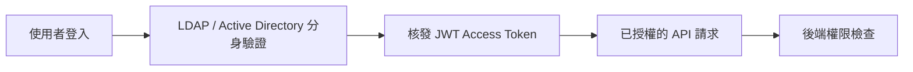

### 6.3 SQLite 雙資料庫設計

- `edge_ai.db`：使用者、專案、設定、模型歷程。
- `vibration.db`：振動資料與告警。

SQLAlchemy 管理存取，`ATTACH DATABASE` 支援跨庫查詢；但**分庫不保證跨庫交易原子性**，備份、還原、版本與併發寫入仍需測試。

### 6.4 背景任務與模型生命週期

APScheduler 執行週期性工作（漂移檢查、報表、維護摘要）；工作需容忍重試、失敗與部分完成。**多個 Web Worker 同時啟動 scheduler 會重複執行**，需專用 scheduler 或單一擁有者機制。`ModelBuildingHistory` 保存模型版本、訓練資料參考、設定、時間與評估結果；建置狀態需區分失敗與未啟動。

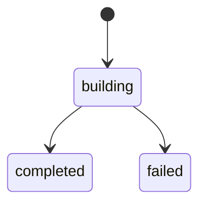

---

## 7. AI Agent：從自然語言查詢到可控的工程工具

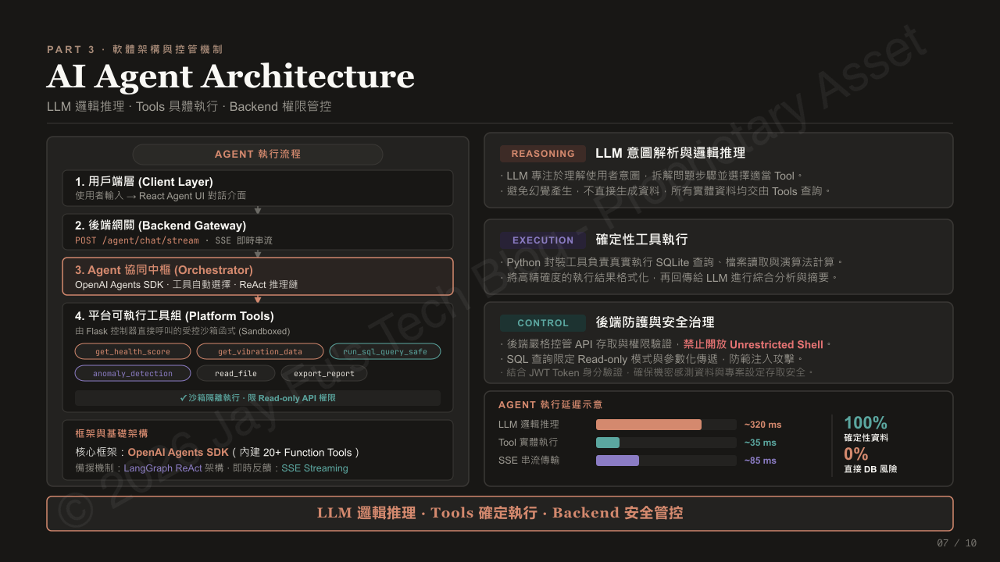

AI Agent 將自然語言請求轉成受控的資料查詢與分析流程；重點是權限、可追溯性與執行邊界。

### 7.1 工具範例

Agent 可使用的工具包括：

| 工具                   | 用途                |
| -------------------- | ----------------- |
| `get_health_score`   | 取得健康度與相關脈絡        |
| `get_vibration_data` | 查詢授權的振動資料         |
| `run_sql_query_safe` | 執行受控的唯讀查詢         |
| `anomaly_detection`  | 執行既定的異常分析         |
| `read_file`          | 讀取 allowlist 中的檔案 |
| `export_report`      | 以驗證過的輸入產生報告       |

工具名稱僅為示例；實際可用工具依部署與權限而定。

### 7.2 Agent 執行流程

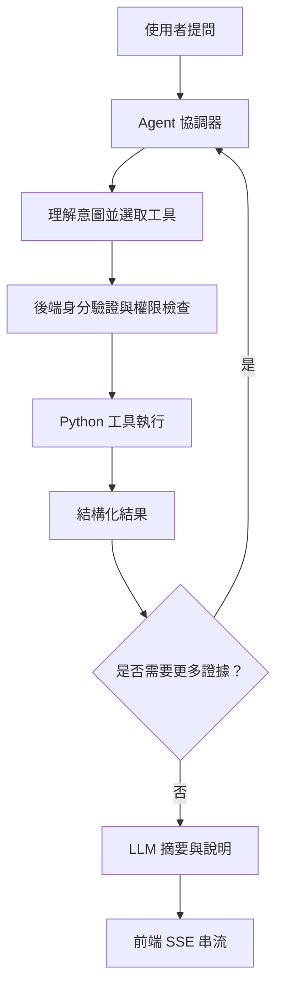

LLM 決定查詢與分析步驟；SQL、檔案存取與運算由後端工具執行。這能降低即時數值被憑空編造的風險，但**不能消除幻覺**；回答應引用查詢結果、時間範圍與資料來源。

### 7.3 工具治理與安全

模型提出動作，後端強制執行規則：

- 參數依 schema 驗證；重大操作要求確認。
- 每次工具呼叫檢查使用者、資產與資料權限。
- 檔案、工具與查詢資源採 allowlist。
- SQL 參數化、唯讀，限制時間與輸出大小。
- 記錄請求、結果與錯誤；結構化錯誤不洩漏敏感資訊。

提示詞與唯讀 SQL 都不是安全邊界；限制與強制執行須落在應用程式與工具。

### 7.4 推理與執行分工

LLM 負責理解任務、規劃與摘要；Python 工具負責查詢與運算；後端負責權限、驗證與執行邊界。這能讓運算可測試，但**增加協調、延遲與失敗點**；應與單一模型或確定性流程比較。

### 7.5 SSE

SSE 以單向 HTTP 串流進度與部分結果，讓使用者看到多步執行狀態；實作需定義事件類型、錯誤、連線逾時與重連。串流**不能取代後端日誌或持久化任務狀態**；需要雙向互動時再評估 WebSocket。

---

## 8. 部署與監控：讓平台能在目標環境中運作

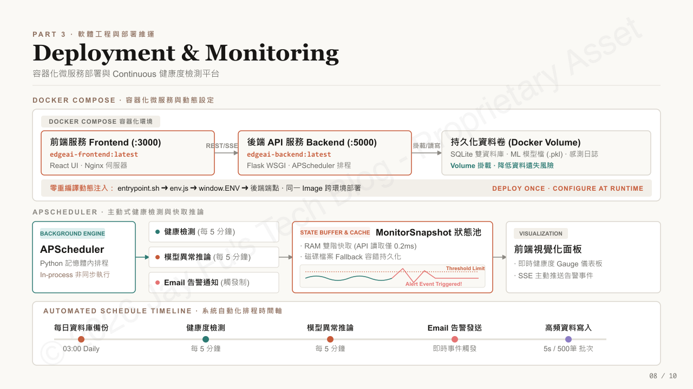

### 8.1 Docker Compose 容器化部署

Docker Compose 管理前端、後端與持久化 volume，統一依賴、port、環境變數與啟動順序。**容器健康不等於應用正常**；readiness check 應驗證關鍵依賴，資料放 volume。

### 8.2 執行時注入環境設定

前端是靜態 bundle 且後端位址隨環境改變時，可用執行時 `env.js` 經 `window.ENV` 提供端點，避免每環境重建。設定須在應用程式讀取前載入並驗證，**視為公開資訊，不得放入密鑰**。

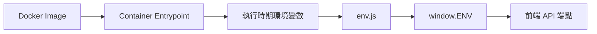

### 8.3 監控

- API 請求量、延遲與錯誤率。
- 資料接入延遲、佇列長度、批次大小與丟棄樣本數。
- 模型推論時間與分析失敗率。
- 背景任務開始時間、執行時間與結果。
- Agent 工具呼叫成功率、timeout 與成本。
- 磁碟用量、資料庫成長與產物儲存。

監控應回答什麼失敗、在哪裡失敗、能否安全復原。

---

## 9. Failure Handling & Scalability：從單機限制到橫向擴充

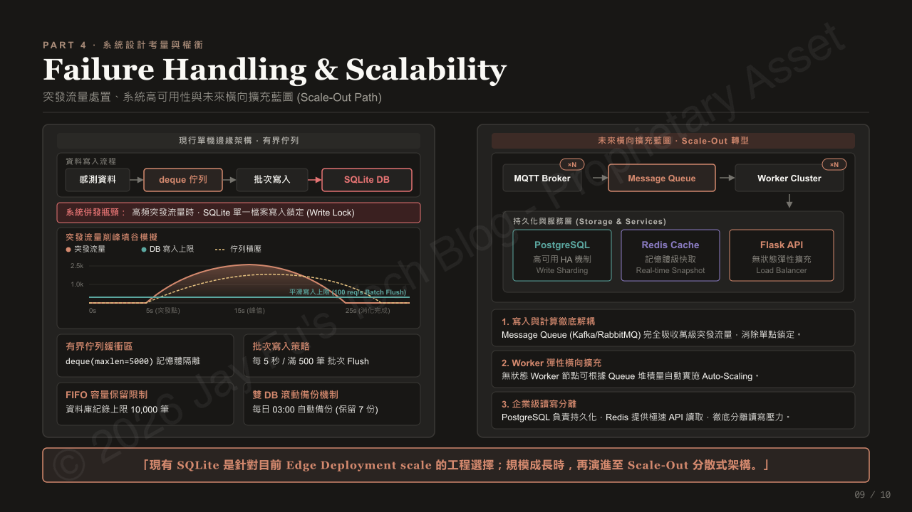

故障處理必須設計進資料路徑，而不是事故後補。

| 故障情境 | 風險 | 可能處置 |
| -- | -- | -- |
| 緩衝區滿載 | 舊樣本可能被丟棄 | 追蹤丟棄數量；不能接受遺失時改用持久化緩衝 |
| 感測器或來源中斷 | 分析不完整或過期 | 追蹤資料新鮮度，標示缺資料，不把過期值當現況 |
| 模型執行失敗 | 缺少或無效結果 | 記錄失敗脈絡、有限重試，保留上次有效結果與時間 |
| SQLite 寫入競爭 | 寫入延遲或失敗 | 減少競爭寫入、批次寫入、調整交易，或改用伺服器資料庫 |
| 排程任務重複執行 | 重複報表或工作 | 單一 scheduler 擁有者、冪等任務或協調機制 |
| LLM／工具呼叫逾時 | Agent 流程不完整 | timeout、有限重試、結構化錯誤、顯示部分失敗狀態 |
| 網路中斷 | 遠端服務不可用 | 保留本地能力、排入可恢復工作、定義同步行為 |

### 9.1 分階段演進

擴充應回應量測到的限制，而不是技術流行。

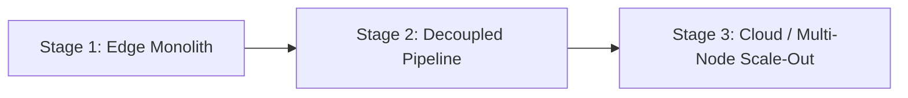

**Stage 1 — Edge monolith.** 單機部署適合負載不大的 Flask、本地持久化與本地推論。

**Stage 2 — Decoupled pipeline.** 當接入與分析影響 API 回應時，加入持久化佇列與獨立 Worker；重試與背壓更容易設計。

**Stage 3 — Cloud / multi-node scale-out.** 當負載、可用性或併發需求提高時，考慮伺服器資料庫、共享任務協調、集中監控與水平擴充；延遲敏感的工作留在邊緣。

MQTT、持久化訊息佇列、Redis、PostgreSQL 與 load balancer 是未來選項，不是目前元件。

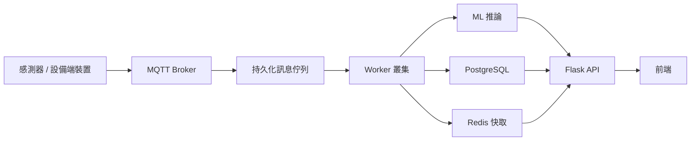

---

## 10. Engineering Trade-offs：技術選擇與架構演進

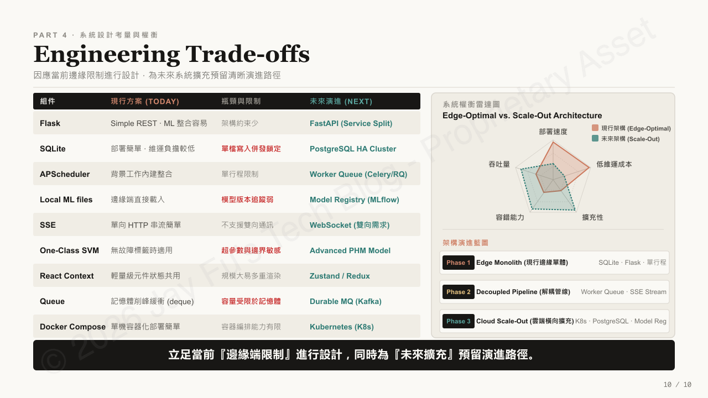

目標不是每層都用最先進的技術，而是目前可靠、未來有務實演進路徑。

| 領域 | 現行方案 | 優點 | 取捨／下一步 |
| --- | --- | --- | --- |
| Web 後端 | Flask | 輕量、容易組織 | 長時間工作可能需要獨立 Worker |
| 持久化／排程／緩衝 | SQLite、APScheduler、有界 deque | 本地維運簡單 | 併發、重複任務與非持久化緩衝需明確處理 |
| 前端更新 | REST API 與 SSE | 熟悉的請求－回應模型，可選串流 | 需設計重連與任務狀態 |
| ML／PHM | 特徵工程＋多種分析方法 | 結合可解釋訊號特徵與統計／ML 方法 | 需基準驗證與領域判讀 |
| 部署 | Docker Compose | 可重現的單機部署 | 不是大型叢集的完整編排方案 |

**把「現在已有」與「未來可能」分開**，避免把 roadmap 當成已具備的生產能力。

---

## 結語

1. **模型需要完整的資料與部署流程。** 實驗室表現只是起點，特徵設定、版本管理、推論介面、監控與錯誤處理才決定它能否進入設備。
2. **Agent 的可靠性取決於工具與系統邊界。** LLM 負責理解與規劃，權限、驗證與工具執行必須留在後端。
3. **效能設計必須可觀測。** 緩衝、批次、快取與排程都會引入新限制，只有持續量測才能判斷是否有效。
4. **架構演進由瓶頸與需求驅動。** SQLite、Flask 與 Docker Compose 可以是合理起點，但要在需求超出限制前規劃下一步。

把模型整合成可維護、可觀測、可驗證的工程系統，才是真正的價值。

---

> **版權與使用條款：** 本文所有圖表版權歸作者所有，轉載請註明出處與原作者。內容已全面進行去識別化與虛擬化處理，僅供技術交流與架構展示使用，不構成任何營業秘密洩露。文中所列未來架構屬於可能的演進方向，不代表已全部實作或部署。