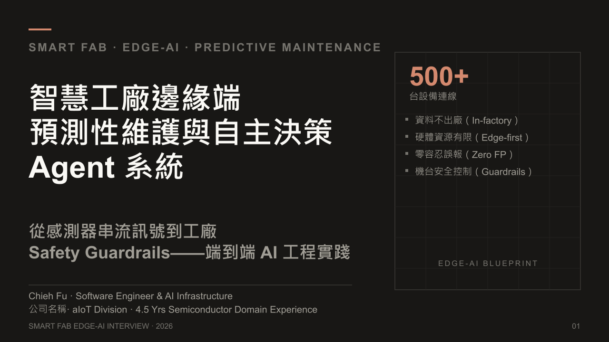
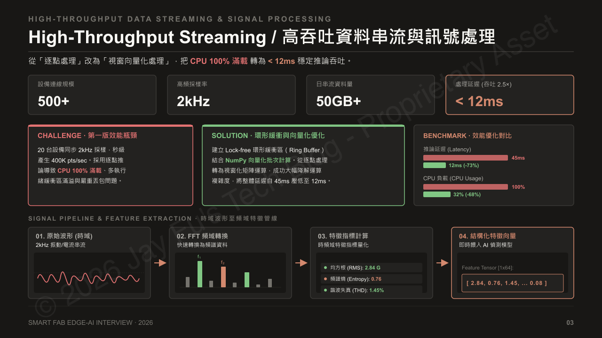
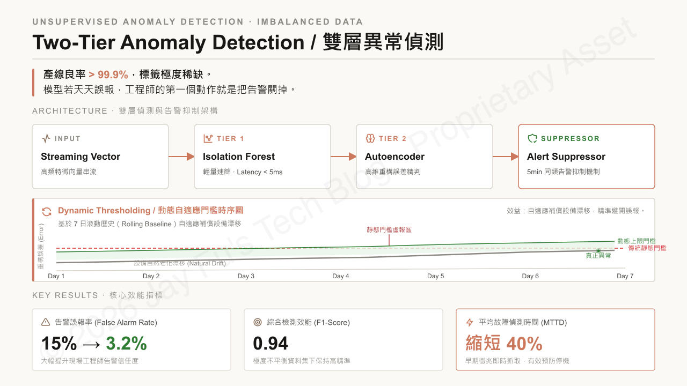
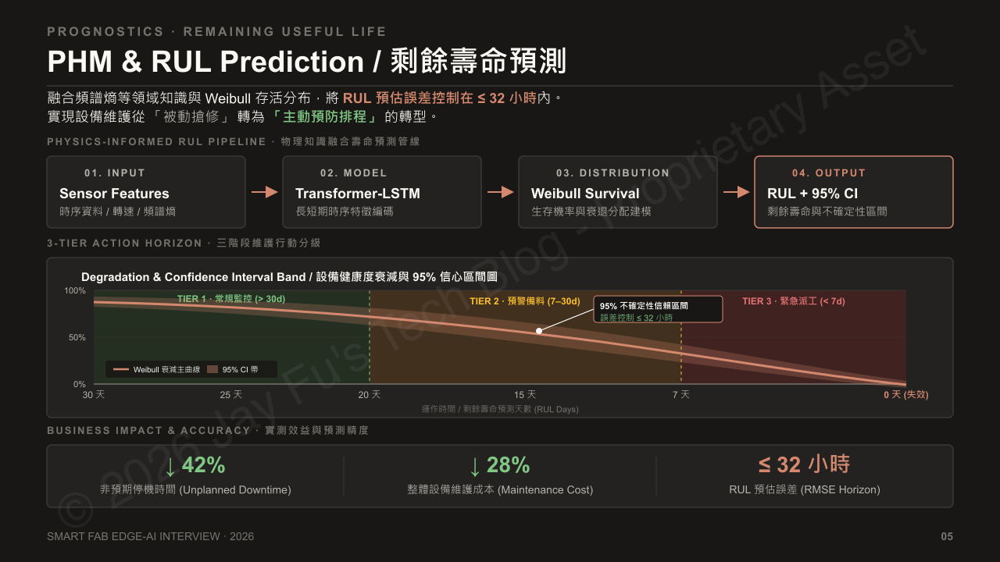
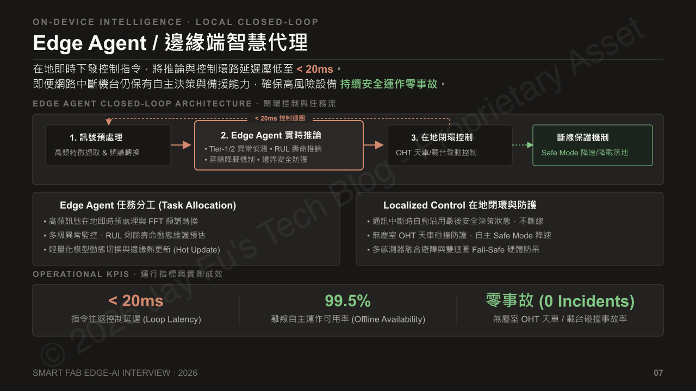
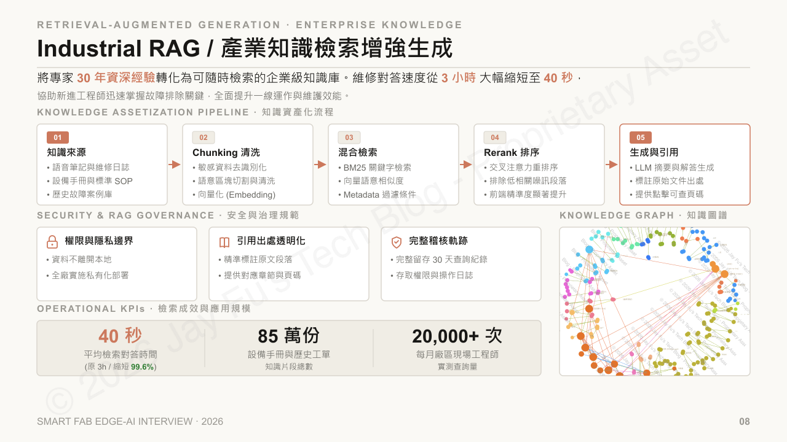
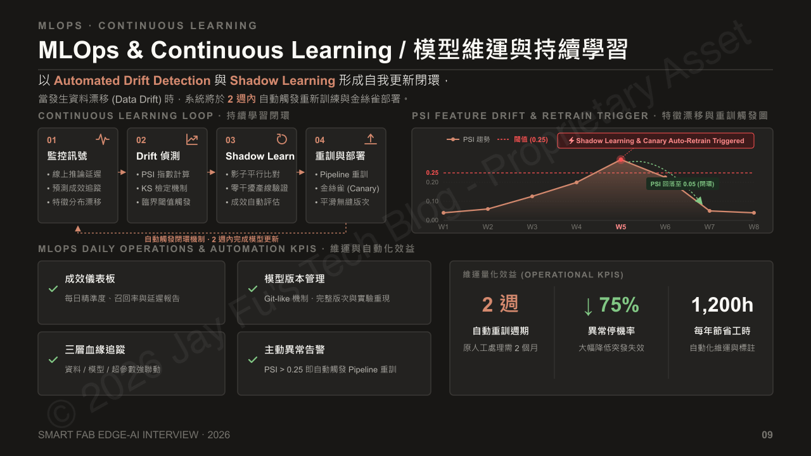
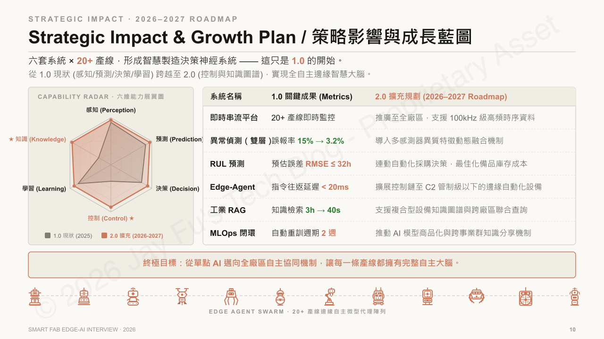
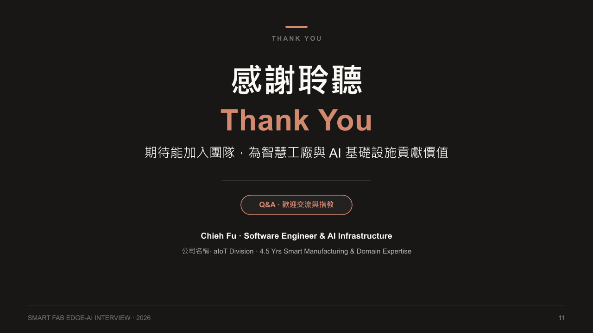


- 架構涵蓋六個層級，從感測器與串流，一路到設備健康管理（PHM）、Edge Agent 與 MES／EAP 安全整合。
- 以 20 台設備、3 個通道、2 kHz 取樣為例，每日約產生 41.5 GB 原始資料；設備納管規模與高頻資料處理規模是兩個不同指標。
- 偵測採用兩階段流程：先以 Isolation Forest 篩選，再由 Autoencoder 評估，並透過告警整併降低噪音。
- RUL 預測（Weibull、LSTM／Transformer、領域特徵）支援 30 天與 7 天維護規劃；文中數字屬專案情境，並非通用基準。
- 模型歷經標準化封裝、影子部署、金絲雀分批發佈（5% → 20% → 100%）、監控與回退。
- Edge Agent、工業 RAG 與 MLOps 串接證據與工作流程，但安全關鍵控制仍留在 LLM 之外。

在擴大自主決策之前，先讓每一層都可觀測、可驗證、可回退。


## 前言

這篇文章整理了我在面試簡報中提出的智慧工廠邊緣 AI 系統架構，將原本的 11 張簡報內容延伸成一份較完整的技術筆記。各章引用的專案指標，其定義與歸因限制統一整理於文末附錄。

文章從設備感測資料開始，依序討論即時資料處理、異常偵測、設備剩餘壽命預測（RUL）、邊緣部署、工業知識檢索，以及 AI Agent 的決策與控制邊界。但真正要回答的問題，不只是把 AI 模型部署到工廠，而是如何讓它在延遲、運算資源、可靠性與維運成本之間取得平衡，並與既有設備控制、維護流程及工廠資訊系統整合。

> **智慧財產權與使用聲明：** 本文用於技術交流、系統設計討論與個人技術能力展示。內容已進行去識別化與必要的資訊調整，不應包含未公開的客戶資料、營業秘密或內部專案資訊。本文圖表與文字的使用及轉載，請依作者公布的授權條件辦理。

---

## 01. 系統目標與設計前提

半導體製造的產線設備有幾項共同特性：設備種類多、感測資料頻率高、停機成本高，而且部分控制流程對延遲與可靠性有嚴格要求。

如果將所有資料送往雲端，再統一分析與決策，雖然有利於集中管理，但也會增加網路傳輸、資料治理及系統依賴的成本。因此，這套架構採用邊緣運算與集中式管理並行的方式，將需要低延遲反應的工作留在廠區內處理。

更現實的限制是：廠區網段的對外連線通常受防火牆與稽核規範管制，波形或影像資料要離開廠區，往往得先走一輪申請與審查。雲端分析本身並沒有錯，但這樣一來，「即時」兩個字就沒有意義了。

整體設計主要考量四個面向：

- **資料治理與資安：** 感測資料、設備資訊及維修紀錄依照資料分級與存取權限處理。敏感資料原則上在廠內完成必要的運算與管理，跨系統傳輸則需符合廠內規範。
- **邊緣運算資源：** 依據設備的 CPU、記憶體及加速器資源，選擇適當的模型大小、推論頻率與資料緩衝策略。
- **異常偵測的可用性：** 除了模型準確率，也必須評估誤報率、漏報率、告警頻率及現場人員的處理負擔。
- **設備安全與故障隔離：** AI 模型可以提供異常判斷與維護建議，但涉及設備安全的控制邏輯，仍須由經過驗證的控制系統與安全機制負責。

這些前提直接影響後續的架構分層、模型選擇與 Agent 的權限設計。

---

## 02. 端到端技術架構

整體架構分為六層，見下表。前三層解決資料從哪裡來、怎麼整理、怎麼形成判斷；後三層解決判斷之後要交給誰、用什麼權限執行，以及如何與既有系統對接。

| 層級 | 名稱 | 主要技術與職責 |
| --- | --- | --- |
| 01 | 感測與資料擷取 | MCU、IO-Link、振動／電流／壓力感測器 |
| 02 | 串流與時序資料 | Kafka、InfluxDB、環形緩衝區、資料時間戳與同步 |
| 03 | 訊號處理 | FFT、小波轉換、時域與頻域特徵萃取 |
| 04 | AI 分析與 PHM | Isolation Forest、Autoencoder、LSTM／Transformer、RUL 預測 |
| 05 | Edge Agent 與任務協調 | 狀態管理、工具路由、工作流程編排、模型選擇 |
| 06 | 整合與安全控制 | SECS/GEM、MES／EAP API、權限驗證、安全中介層 |

邊緣端負責低延遲的資料處理與推論，集中式平台負責模型管理、跨設備分析、訓練及部署協調。

各元件的職責不同。Kafka 負責訊息傳遞與降低資料流耦合；InfluxDB 負責時序資料的保存與查詢；環形緩衝區則用來處理需要穩定記憶體使用量的連續資料。這些元件不必串成單一路徑，實際組合取決於資料頻率、延遲需求與部署環境。

邊緣推論與設備控制也不是同一件事。即使模型能在數毫秒內產生結果，仍須將資料擷取、訊號處理、推論、通訊及控制器執行時間一併納入端到端延遲評估。

---

## 03. 高吞吐資料串流與訊號處理

在高頻感測場景中，資料處理的第一個問題通常不是模型準確率，而是如何處理持續輸入的資料。

### 資料量估算與計算範圍

以代表性情境估算：20 台設備，每台 3 個感測通道，每通道以 2 kHz 連續取樣，每筆數值以 4 bytes 儲存。

每秒產生的原始數值資料量為：

$$
20 \times 3 \times 2{,}000 \times 4 = 480{,}000\ \text{bytes/s}
$$

換算為每日資料量：

$$
480{,}000 \times 86{,}400 = 41{,}472{,}000{,}000\ \text{bytes/day}
$$

也就是約 **41.47 GB／日**，採十進位換算（1 GB = \(10^9\) bytes）。

這個估算只包含感測數值本身，尚未計入時間戳、通訊封包、索引、資料庫儲存格式與其他中繼資料。若將這些額外成本納入估算，實際傳輸量或儲存需求可能接近 50 GB／日，具體數值則取決於資料格式與系統設計。

20 台設備只是計算範例，不是規模宣稱。**設備納管規模**（系統能連線多少台）與**高頻資料處理規模**（同時有幾台以 2 kHz 持續送出原始波形）是兩個不同的指標，後者取決於實際啟用高頻取樣的設備數、通道數、取樣頻率與資料保存策略。即使系統已納管 500+ 台設備，也不代表所有設備都以相同頻率持續傳送原始波形；對外描述規模時，不要混用這兩個數字。

### 訊號處理流程

資料管線可以拆成四個階段：

1. **原始資料擷取：** 取得振動、電流、壓力等感測訊號，並處理時間戳、缺值與資料品質問題。
2. **視窗化處理：** 將連續訊號切分成固定長度的資料視窗，依照設備與分析任務決定視窗長度及重疊比例。
3. **特徵萃取：** 使用 FFT、小波轉換及統計方法，計算 RMS、頻譜熵、特定頻帶能量等特徵。
4. **特徵輸出：** 將結果轉換成固定格式的特徵向量，供異常偵測及健康度模型使用。

例如，模型輸入可以是 64 維特徵向量，而不是每次都直接接收完整的原始波形。這能降低下游處理的計算負擔，但是否適合仍取決於異常型態與模型需求。若特徵萃取時漏掉了重要資訊，後續模型也無法將其還原。

### 邊緣端的效能最佳化

這一層可以從幾個方向著手：

- 以批次或視窗方式處理資料，減少逐筆處理的額外成本。
- 使用預先配置的環形緩衝區，降低記憶體配置與複製的頻率。
- 將高頻訊號處理與較低頻率的狀態分析分開執行。
- 區分原始資料、特徵資料及事件資料的保存需求，避免所有資料都使用相同的傳輸與儲存策略。
- 持續監控佇列長度、資料遺失率、CPU 使用率與端到端延遲。

原始簡報列出的效能比較包括：處理延遲由 45 ms 降至 12 ms 以下、CPU 使用率由 100% 降至 32%，以及吞吐量提升約 2.5 倍。

延遲降低約 73%。不過延遲與吞吐量是不同指標，不能拿延遲降幅推算吞吐量增幅；若要比吞吐量，得在相同輸入負載下計算單位時間內實際完成的資料量。

CPU 使用率也一樣，要搭配統計區間、核心數與測試負載解讀，不能直接當成所有部署環境的穩態值。

---

## 04. 雙層異常偵測

設備故障資料的類別通常嚴重不平衡。正常運作的資料容易取得，真正發生故障的案例相對少，因此只依賴監督式學習，往往受限於標籤不足。

另一個實務問題是誤報。模型就算抓到異常，只要每天產生大量無法採取行動的告警，現場人員就很難繼續信任系統。

最常見的誤報不是模型「錯得很離譜」，而是換料或暖機階段。那段時間的振動頻譜本來就會短暫偏離平日分布，模型照異常分數判斷，就會連續觸發告警，但設備其實是正常的。這種告警不會讓系統當掉，卻足以讓現場人員開始忽略它。

因此，這套架構採用分層偵測，將低成本的初步篩選與較深入的異常判斷分開。

### 第一層：快速篩選

Isolation Forest 可用於辨識與既有資料分布不同的樣本。它的角色不是直接宣判故障，而是快速找出值得進一步分析的資料，避免把所有異常分數都轉換成設備故障結論。由於模型相對輕量，也適合用在部分資源受限的邊緣場景。

### 第二層：深入判斷

Autoencoder 可以透過重建誤差，評估輸入資料與模型所學習之正常模式的差異。

實務上，可以根據設備類型、運作狀態與感測通道設定不同的門檻，避免將正常的製程切換或負載變化全部視為故障。

### 告警整併與抑制

告警管理不應只依賴模型輸出。系統還需要考慮：

- 同一設備在短時間內重複觸發的告警。
- 告警持續時間與異常嚴重程度。
- 設備目前的運作模式及維修狀態。
- 告警是否已經被確認或建立維修工單。

例如，可以針對相同設備與相同異常類型設定五分鐘的重複告警抑制期間。但這項機制必須保留嚴重程度升級與安全相關事件的例外處理，不能為了減少通知而遮蔽新的風險。

原始簡報列出的指標包括誤報率由 15% 降至 3.2%、F1-Score 達到 0.94，以及平均故障偵測時間縮短 40%。

這些指標分別反映不同面向：

- **誤報率：** 必須先確認採用的是正常樣本中的誤判比例（False Positive Rate, FPR），還是所有告警中誤報所佔的比例。兩者的分母不同，不能直接互換。
- **F1-Score：** Precision 與 Recall 的調和平均數，用來衡量兩者的平衡，但仍須搭配評估資料及故障類別解讀。
- **故障偵測時間：** 起算點可能是故障發生、異常特徵首次出現，或系統首次發出有效告警，三者不可互換。

---

## 05. 設備健康管理與剩餘壽命預測

異常偵測主要回答「目前是否偏離正常狀態」，預測性維護則進一步回答「設備健康度正在如何變化，以及何時可能需要維護」。

設備健康管理（PHM）通常會整合感測特徵、設備歷史、故障模式及維護紀錄。若資料足夠，也可以建立 RUL 模型，估計設備距離特定失效條件還有多久。

### RUL 模型設計

可依據資料型態選擇不同方法：

- **統計與存活分析：** 例如 Weibull 存活分布，適合在合理假設下描述設備的失效時間分布。
- **時序模型：** 例如 LSTM 或 Transformer，用於分析設備健康指標隨時間的變化。
- **領域特徵：** 結合頻帶能量、頻譜熵、振動幅度與設備負載，提升模型對實際失效模式的辨識能力。

三種方法的適用條件並不相同。Weibull 存活分布本身不能保證單一設備的 RUL 準確度；要預測個別設備的剩餘壽命，仍得結合觀測資料與模型驗證。

### 從預測結果到維護安排

RUL 的價值不只是產生一個時間數字，而是讓維護團隊能提前安排人力、備品與停機時段。

例如，可以將預測結果分成三個維護區間：

- **一般監控：** 預估剩餘壽命大於 30 天，依既定頻率追蹤設備狀態。
- **提前準備：** 預估剩餘壽命介於 7 至 30 天，確認備品與維護資源。
- **優先評估：** 預估剩餘壽命小於 7 天，安排工程師檢查並評估維修時程。

這些區間只是示例，實際門檻應依設備故障後果、備品交期、預測不確定性與產線排程決定。當設備涉及安全風險時，也不能只依賴 RUL 數字判斷是否繼續運作。

RUL 給的是統計上的估計，不是保證。真正讓人緊張的情況，是預測顯示還有兩週、但下一次取樣就掉到門檻以下；這也是為什麼維護區間必須保留人工複核，而不能直接變成停機指令。

原始簡報列出的指標包括 RUL 預測 RMSE 不超過 32 小時、非預期停機時間減少 42%，以及維護成本降低 28%。

RMSE（Root Mean Squared Error，均方根誤差）衡量預測值與實際值之間的整體誤差，定義為：

$$
\mathrm{RMSE} = \sqrt{\frac{1}{n}\sum_{i=1}^{n}(\hat{y}_i - y_i)^2}
$$

其中 \(\hat{y}_i\) 為預測值，\(y_i\) 為實際值。RMSE 對較大的預測誤差更敏感，因此不能解讀成每一筆預測都保證落在 32 小時以內。

---

## 06. 邊緣部署與模型生命週期管理

模型訓練完之後，下一個問題是如何穩定部署到不同設備與產線，並在更新失敗時回到原本的服務。

部署不只是把程式打包成容器。作業系統、硬體架構、驅動程式、推論引擎版本與設備通訊方式，都可能影響模型是否能正常執行。

因此，部署流程可以拆成四個階段。

### 1. 標準化封裝

將模型、推論程式、依賴套件與設定檔納入可追蹤的發佈版本，並針對不同硬體建立相容性測試。

### 2. 影子部署

新模型先與現行模型或規則並行執行，但不直接影響正式控制流程。透過比較輸出差異、延遲、資源使用量與異常案例，評估新版本是否符合上線條件。

影子部署期間應涵蓋具有代表性的設備狀態；兩週可以是參考週期，但不一定適用於故障事件稀少的設備。

### 3. 金絲雀分批發佈

先在少量設備部署新版本，再依序推進到 5%、20%，最後全面上線。每個階段都要有明確的驗收門檻。

### 4. 監控與回退

持續監控推論失敗率、延遲、資源使用量及模型輸出分布。若指標超過門檻，系統應停止擴大部署，並依照事先定義的流程回退至已驗證版本。

在此基礎上，可以提供面向產線工程師的自助管理介面，讓使用者依照權限選擇模型版本、查看部署狀態與執行回退，而不必直接修改模型內部參數。介面看似小事，但它決定了出事時誰能動手。設計時就必須預期這種情境：新版本在少數設備上的推論延遲異常升高，值班工程師在半夜把它切回舊版，整個過程不需要改動任何一行模型程式碼。

原始簡報列出的指標包括容器映像小於 300 MB、冷啟動時間低於 30 秒，以及部署週期由六個月縮短至兩週。

其中，容器映像大小要區分是單一服務映像還是含完整執行環境；冷啟動時間則要區分容器啟動、模型載入與服務進入可用狀態三個階段。部署週期也需要說明起訖點，例如從候選版本準備完成到正式部署，或從需求提出到完成上線。

---

## 07. Edge Agent：任務協調與決策邊界

Edge Agent 負責把感測資料、模型推論、設備狀態與維護流程，整合成一套可執行、可追蹤的工作流程。

它不一定每次決策都要呼叫大型語言模型。對於延遲要求明確、輸入輸出固定的任務，使用傳統程式邏輯或輕量模型通常更容易測試與驗證。Agent 則可以負責需要跨工具協調、資訊整合或多步驟處理的任務。

### 邊緣端的任務分工

工作可以分成三類：

- **即時訊號處理：** 在邊緣端完成資料擷取、特徵計算與必要的快速推論。
- **狀態判斷與任務協調：** 整合異常分數、RUL、設備狀態與維護紀錄，決定是否需要進一步檢查或建立工單。
- **設備控制與安全處理：** 由具備明確控制邏輯與安全驗證的系統執行，不將自由生成的文字或未經驗證的模型輸出直接轉換成高風險控制指令。

若採用 LangGraph 等工作流程框架，可以管理 Agent 的狀態、工具呼叫、重試與執行分支；Model Router 則可依據任務複雜度、延遲需求與運算資源，選擇適當的模型或規則引擎。

不過，使用這些框架並不會自動帶來即時性或安全性。仍需要測試執行時間、錯誤處理、資源限制與異常路徑。

### 斷線時的處理策略

網路斷了，Agent 該繼續做，還是該停？這是邊緣系統一定會遇到的情境：網路中斷、集中式服務無法使用、模型服務異常。

合理的設計是讓必要的監控與本地狀態判斷，在失去上游連線時仍能依照既定規則運作；若系統無法確認自身狀態，則應進入預先定義的降級模式。

但降級不代表所有設備都採取相同動作。部分設備可能需要降載，有些設備則應停止特定動作或交由既有控制器接管。具體行為必須由設備風險分析與安全設計決定，而不是由通用 Agent 自行推斷。

這裡需要區分三個概念：

1. **離線服務可用性：** 網路中斷時，邊緣端仍能否執行既定的本地監控或推論任務。
2. **任務執行成功率：** Agent 是否能依照流程完成工具呼叫、狀態更新或維護工單建立。
3. **設備安全性：** 在通訊中斷、模型異常或任務失敗時，設備是否仍受到既有控制器與安全機制的保護。

三者的評估方式不同，不能以 Agent 的任務成功率代替設備安全驗證。

原始簡報列出指令往返延遲低於 20 ms，以及離線自主運作可用率達 99.5%。前者需要界定起訖點，以及是否包含網路傳輸、模型推論及工具執行；後者需要說明統計期間、離線情境與可用判定條件。

對於 OHT、載台及其他高風險設備，仍必須以獨立的安全機制及適當的驗證程序確保安全，不能單憑 Agent 的執行成功率推論設備安全。

---

## 08. 工業 RAG：讓設備知識可以被檢索與追溯

工廠的知識不只存在於設備手冊，也散落在維修日誌、異常分析報告、工程師筆記與歷史工單中。

但這些資料的格式、命名習慣與品質都不一致。直接丟進向量資料庫，即使能生成流暢的回答，也不代表答案正確，更不代表它適用於目前的設備狀態。

工業 RAG（Retrieval-Augmented Generation）要解決的就是這件事：重點不在生成答案，而在建立從問題、檢索結果到原始文件的可追溯流程。

### 知識處理流程

1. **文件整理與權限管理：** 格式轉換、去除重複、版本辨識與敏感資料處理，並保留文件來源及存取權限。
2. **語意切分與索引：** 依照文件結構與內容建立適當的文字區塊，再產生向量表示。
3. **混合檢索：** 結合 BM25 關鍵字搜尋、向量檢索與 Metadata 過濾，降低專有名詞、設備編號及相似文件造成的檢索問題。
4. **重排序：** 使用 Reranker 重新評估候選文件與問題的關聯性。
5. **答案生成與引用：** 根據檢索到的內容整理答案，提供原始文件、版本與頁碼等資訊，讓使用者能夠核對。

### 企業環境中的限制

在工廠內部署 RAG，還需要考慮文件權限是否能延伸至檢索結果、模型是否會接觸未授權資料，以及系統如何處理互相矛盾或已過期的文件。

對於設備維修建議，回答應清楚區分文件明確記載的內容與模型整理出的推論。若找不到足夠依據，系統應允許回答「目前資料不足」，而不是為了完整性自行補上操作步驟。

同時，文件索引與查詢紀錄也需要依照資料敏感程度設定保存期限、稽核方式及存取權限。

原始簡報列出的規模包括 85 萬份文件、每月超過 2 萬次查詢，以及知識查找時間由平均三小時縮短至 40 秒。

文件數量要區分原始文件、版本與切塊；查詢量要區分請求數與有效回答數。至於「三小時縮短到 40 秒」，指的是**找到資料**的時間，不是**修好設備**的時間——這兩種計算方式不能互相比較。

---

## 09. MLOps：模型上線後的持續監控

模型在測試資料上表現良好，然後呢？

設備可能因零件老化、維護作業、負載改變或製程條件變化，產生與訓練資料不同的特徵分布。因此，模型上線後仍需要持續監控，並建立從問題發現到版本更新的完整流程。

### 漂移監控

可依照資料特性使用 PSI、KS 檢定或其他分布差異指標，觀察線上資料是否偏離基準。

例如，PSI 超過 0.25 可以作為某些情境下的警示門檻，但不能直接等同於模型已經失效。門檻應依據資料分布、特徵特性與實際驗證結果設定。

系統還應監控資料缺漏、感測器異常、推論延遲與模型輸出分布，避免把感測器故障誤判為模型漂移。

若使用七日滾動基準追蹤設備狀態，也需要避免基準持續吸收緩慢發展的異常。較穩健的做法是依照設備運作模式與歷史資料建立動態基準，並加上異常狀態檢查與基準更新條件，不要讓持續性故障被吸收進正常分布。

### 模型更新流程

較完整的 MLOps 流程包含：

- 定期評估資料品質與模型表現。
- 針對確認的問題建立候選模型。
- 在歷史資料及必要的模擬情境中驗證。
- 透過影子模式比較新舊版本。
- 經過必要的審核後分批發佈。
- 保留版本、資料來源、參數與驗證紀錄，以便追蹤與回退。

自動化的目的不是讓系統在偵測到漂移後立即自行更換模型，而是縮短問題發現、模型評估與部署的週期，同時維持更新過程的可控性。

我自己在推動這類流程時，卡住的通常不是模型，而是「誰有權按下那個按鈕」。

原始簡報列出的指標包括自動重訓週期由兩個月縮短至兩週、異常停機率降低 75%，以及每年節省 1,200 小時的人工投入。

---

## 10. 系統整合與後續發展方向

前面討論的六個部分解決的是不同層次的問題：串流處理確保資料能穩定取得與分析，異常偵測與 RUL 提供設備狀態的判斷依據，Agent 整合資訊並協調任務，RAG 補上可追溯的文件知識，MLOps 則管理模型從驗證到上線後的整個生命週期。

把它們串起來並不難。難的是用明確的資料介面、權限機制與錯誤處理方式整合，而不是把幾個服務接上，就宣稱已經形成自主決策系統。

### 1.0：建立可觀測、可預測、可維運的基礎

第一階段的重點是讓各個元件具備明確的輸入輸出、監控指標與故障處理方式，並在限定設備與產線中驗證效能。

| 系統 | 第一階段的重點 | 評估指標 |
| --- | --- | --- |
| 即時串流平台 | 建立資料擷取與特徵處理流程 | 吞吐量、資料遺失率、端到端延遲 |
| 異常偵測 | 降低無效告警並保留重要事件 | 誤報率、漏報率、F1-Score |
| RUL 預測 | 提供設備健康度與壽命估計 | RMSE、預測區間與維護決策效益 |
| Edge Agent | 協調模型、工具與維護工作流程 | 任務成功率、延遲、失敗恢復能力 |
| 工業 RAG | 建立文件檢索與答案追溯機制 | 檢索品質、答案正確性、引用可追溯性 |
| MLOps | 建立模型版本與發佈流程 | 部署週期、回退時間、版本追蹤完整度 |

### 2.0：從單點分析走向跨設備協作

當單一設備的資料處理、模型品質與部署流程穩定之後，才適合進一步探索跨設備與跨產線的協作。

可能的方向包括：

- 將即時資料處理擴展至更多設備，並評估更高取樣頻率帶來的頻寬與運算需求。
- 將多個感測器的資訊結合，改善對複合型異常的判斷能力。
- 讓 RUL 結果與備品管理、維護排程及工單系統整合。
- 建立設備知識圖譜，支援跨文件、跨設備的關聯查詢。
- 讓不同 Edge Agent 在權限允許的範圍內交換狀態與任務結果。

長期而言，可以探索 Edge Agent Swarm，也就是由多個邊緣代理分工處理不同設備或任務的架構。

不過，多 Agent 協作也會帶來新的問題，例如狀態一致性、任務衝突、通訊中斷、權限管理及錯誤擴散。因此，擴大自主協作之前，仍需要先定義每個 Agent 的責任範圍、可執行動作與失敗時的處理方式。

---

## 11. 結語

智慧工廠的邊緣 AI 系統，並不是將感測器、機器學習模型與 Agent 框架組合在一起就能完成。

真正需要處理的是整個系統的工程問題：資料能否穩定取得、模型能否在受限資源下執行、異常結果是否值得信任、部署失敗時能否回退，以及 AI 的建議如何在不破壞既有安全機制的前提下，融入設備與維護流程。

預測性維護與自主決策 Agent 並不是兩個獨立的功能。前者提供設備狀態與風險資訊，後者負責將這些資訊轉換成可追蹤的工作流程；而資料治理、模型監控與安全控制，則是讓整套系統能夠長期運作的必要條件。

如果要持續推進這類系統，最重要的不是一開始就追求完全自主，而是先讓每個環節都具備可觀測性、可驗證性與可回退能力，再逐步擴大 AI 能夠參與的決策範圍。

我整理這套架構時最重視的設計原則，就是**讓 AI 的能力與系統的責任邊界同時清楚，才能讓技術真正進入工廠現場。**

如果您的團隊也正在解這類工業現場的落地難題，或對這套設計思維有興趣，非常歡迎隨時交流討論。

---

## 附錄：文中數字的閱讀方式

各章引用的數字整理自過往專案經驗與面試簡報，用途是說明設計取捨，不是效能承諾。以下四點適用於全文。

**一、來源與範圍。** 部分原始測試紀錄已無法重新取得，本文不宣稱這些數字完成過獨立驗證。涉及公司、客戶、設備配置與內部系統的資訊，均以去識別化或概括化方式呈現。

**二、量測基準比數字重要。** 同一個指標在不同定義下可能相差一個數量級。延遲與冷啟動要問起訖點；誤報率要問分母是正常樣本還是全部告警；可用率要問統計期間與判定條件；文件量要問是原始文件、版本還是切塊；容器映像要問是單一服務還是完整執行環境。平均值也應搭配分布與尾端值一起看。

**三、不可單一歸因。** 停機時間、維護成本、異常停機率、每年節省工時這類指標，同時受維護流程、備品策略、設備更新與人員分工影響。若無法把模型的貢獻拆出來，就不宜把全部改善算在 AI 頭上；反過來說，模型變好也不保證系統指標會跟著變好。

**四、不是產業基準。** 這些數字成立於特定設備、特定負載與特定部署條件。換一條產線、換一種故障型態，結果可能完全不同，請不要當成可套用到所有工廠的標準。

本文不構成任何設備操作、安全控制或維護決策的依據。